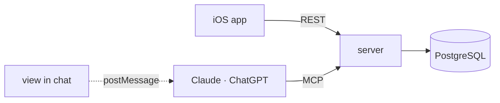

# IoT Switch

Control simulated IoT devices from a native iOS app **or** from an AI
assistant — the same account, the same devices, one set of rules.

Each device has exactly two persisted states, On and Off. That deliberate
smallness is the point: it leaves room to get the hard parts right — optimistic
concurrency, OAuth for third-party hosts, interactive UI inside a chat, and
the awkward case where a write succeeds but its response is lost.



---

## What is here

| | |
| --- | --- |
| [`server/`](./server) | Node + TypeScript. REST API, OAuth 2.1 authorization server, MCP server, four MCP App views |
| [`ios/`](./ios) | SwiftUI app for iPhone and iPad |
| [`requirement.md`](./requirement.md) | The specification everything implements |
| [`docs/`](./docs) | Architecture, authentication, code flow, sequence diagrams, testing, host compatibility |

339 tests.

---

## Quick start

**Requirements:** Node 22+ (25 recommended — it runs TypeScript directly).
Xcode 16+ only if you want the iOS app, which runs on iOS 18 and later.

```bash
cd server
npm install
npm start            # http://localhost:4000
npm test             # 279 tests
```

Nothing to provision. The store is [PGlite](https://pglite.dev) — real
PostgreSQL compiled to WebAssembly — so there is no database to install.
`DATABASE_URL` and `REDIS_URL` switch to PostgreSQL and Redis when you want
them; `npm run test:pg` runs the suite there.

<details>
<summary><b>Try it from the command line</b></summary>

```bash
npm start                 # in one terminal
npm run client-check      # in another
```

`client-check` connects with the official MCP SDK client: it discovers the
authorization server from the `401`, registers, signs in on the hosted page,
exchanges the code with PKCE, then adds a device and switches it. The REST API
cannot be driven with `curl`: it accepts only DPoP-bound tokens, each request
signed by the client's key.
</details>

<details>
<summary><b>Run the iOS app</b></summary>

```bash
cd ios
open IoTSwitch.xcodeproj
```

It points at `http://localhost:4000` by default. Pass
`-apiBaseURL http://…` and `-authBaseURL http://…` as launch arguments to aim
it elsewhere. Log In and Sign Up open the server's own page in the system
browser sheet; the app never sees a password.

```bash
xcodebuild -project IoTSwitch.xcodeproj -scheme IoTSwitch \
  -destination 'platform=iOS Simulator,name=iPhone 17 Pro' test
```
</details>

<details>
<summary><b>Connect an AI host</b></summary>

```bash
cd server && npm run host-check
```

Opens a tunnel, starts the server with the tunnel's origin as its public URL,
verifies the whole discovery chain over real HTTPS, and prints a connector URL.

Add that URL in Claude or ChatGPT under **Settings → Connectors**. Do it on
web or desktop — a custom connector must be added there before it appears on
mobile. Then ask for your devices. What each host does is recorded in
[host compatibility](./docs/host-compatibility.md).
</details>

<details>
<summary><b>Look at the views without a host</b></summary>

```bash
npm start
node tools/mock-host/run.mjs      # prints a URL
```

A mock MCP Apps host that renders any view with a live message log, so a view
can be looked at and its messages watched without a real host.
</details>

---

## How it works

```
POST /v1/devices/…/state  ─┐
                           ├─→  token exchange  ─→  Device Service  ─→  PostgreSQL
MCP tools/call             ─┘   (internal, 60 s)    validation · ownership · versions · audit
```

Both front doors call the **same** Device Service, which takes a verified
internal token rather than an HTTP request. Neither adapter validates a name,
checks ownership or compares a version — so the two surfaces cannot drift
apart. That is §3 of the specification, enforced structurally rather than by
discipline.

Three ideas do most of the work:

**Every write carries the version it saw.** The check and the write are one
SQL statement, so two callers holding the same version cannot both succeed.
There is no `toggle` — a retry can never invert what it is retrying.

**An unknown outcome is its own case.** A mutation that fails in transit may
or may not have applied. The client reads before offering a retry, and never
sends the inverse command. That is how a switch ends up flipping itself back.

**Credentials are typed in exactly one place.** A hosted authorization page,
reached through the host's OAuth flow or the iOS app's browser sheet. Never in
a conversation, a tool argument, a view, or a native screen. The app's tokens
are bound to a key in its Secure Enclave, so a copied token is useless.

**→ [Architecture](./docs/architecture.md)** ·
**[Authentication](./docs/authentication-architecture.md)** ·
**[Code flow](./docs/code-flow.md)** ·
**[Sequence diagrams](./docs/sequence-diagrams.md)** ·
**[Testing](./docs/testing.md)**

---

## The API

Four device operations, and an authentication service that is separate from
them.

| | |
| --- | --- |
| `GET /v1/devices` | Every owned device, oldest first |
| `GET /v1/devices/{id}` | One owned device |
| `PUT /v1/devices/{id}/state` | `{ state, expectedVersion }` |
| `POST /v1/devices` | `{ name }`, optional `Idempotency-Key` |

Plus `GET /v1/me`, the OAuth endpoints (`/authorize`, `/par`, `/token`,
`/revoke`, `/register`), the account pages (`/account`), and `/mcp`. Every API
request carries a DPoP-bound token and a fresh proof.

### MCP tools

| Tool | Scope | View |
| --- | --- | --- |
| `list_devices` | `devices:read` | `ui://iot/devices.<hash>.html` |
| `get_device` | `devices:read` | `ui://iot/device.<hash>.html` |
| `control_device` | `devices:control` | — |
| `add_device` | `devices:create` | — |
| `get_auth_status` | public | — |
| `show_auth` | public | `ui://iot/auth.<hash>.html` |
| `show_add_device` | public | `ui://iot/add-device.<hash>.html` |

Each view's URI carries a hash of its content, so a host that caches templates
by URI always fetches changed code.

---

## Configuration

| Variable | Default | |
| --- | --- | --- |
| `PORT` | `4000` | |
| `BASE_URL` | `http://localhost:$PORT` | **Must match the registered connector URL exactly.** Default for the three origins below |
| `AUTH_BASE_URL` | `BASE_URL` | The authorization server's origin: the OAuth issuer. Final before launch, because hosts key their client registration by it |
| `MCP_BASE_URL` | `BASE_URL` | The MCP endpoint's origin: `/mcp` here is the RFC 8707 resource and the token audience |
| `API_BASE_URL` | `BASE_URL` | The REST API's origin. With three distinct origins each surface answers only on its own host |
| `TOKEN_PEPPERS`, `PASSWORD_PEPPER`, `INTERNAL_MAC_KEY` | a key file | Key material, all three or none. Unset, the server keeps `keys.json` beside the database. **Back it up: losing it makes every stored password unverifiable** |
| `KNOWN_CLIENTS` | Claude's and ChatGPT's CIMD URLs | Metadata-document clients shown as verified on the consent screen |
| `REQUIRE_OFFLINE_ACCESS_FOR_REFRESH` | `false` | Issue refresh tokens only to clients that ask for `offline_access` |
| `ARGON2_MEMORY_KIB`, `ARGON2_TIME_COST` | `65536`, `3` | Password hashing cost |
| `SIGNING_KEYS` | the key file | JSON array of private P-256 JWKs, current first, that sign internal tokens. Published at `/.well-known/jwks.json` |
| `WRITE_BUDGETS` | `enforce` | Refuses writes over budget: 6 switches a minute per device, 20 a minute and 10 new devices an hour per grant. `report` logs them instead |
| `DATABASE_PATH` | `./.data` | PGlite's directory. Delete it to reset |
| `DATABASE_URL` | unset | A PostgreSQL server instead of PGlite. `DATABASE_SCHEMA`, `DATABASE_POOL_SIZE` (10) tune it |
| `REDIS_URL` | unset | Share rate limits, DPoP replay ids, sealed refresh responses and revocations across processes. Unreachable Redis means 503s, never a free pass |
| `KMS_PROVIDER` | unset | `local`: key material from an envelope file encrypted under a KMS key, signing keys held by the KMS. A cloud provider is an adapter implementing `Kms` |
| `METRICS_PORT` | unset | Prometheus metrics on this port, loopback only (`METRICS_HOST`) |
| `AUTH_RATE_LIMIT_PER_MINUTE` | `20` | Credential submissions per address |
| `TRUST_PROXY` | off | Only behind a proxy you control |
| `AUTHORIZE_VIEW_RATE_LIMIT_PER_MINUTE` | `60` | Authorization page views per address |
| `REFRESH_GRACE_SECONDS` | `30` | A duplicate refresh inside this window gets the identical response instead of revoking the grant |
| `NATIVE_ACCESS_TOKEN_TTL_SECONDS` | `600` | The iOS app's DPoP-bound access tokens. Hosts get an hour |
| `FIRST_PARTY_REDIRECT_URIS` | the app scheme and `API_BASE_URL/oauth/callback` | The iOS app's OAuth callbacks |
| `APPLE_TEAM_ID`, `APPLE_BUNDLE_ID` | unset, `com.example.IoTSwitch` | With a team, publish `/.well-known/apple-app-site-association` for the universal-link callback |
| `CHATGPT_TOOL_CHALLENGE` | off | `trusted-header`: answer ChatGPT's unauthenticated calls with a tool-level challenge. Needs `TRUST_PROXY` and a proxy that sets `X-Verified-Client: chatgpt` from ChatGPT's mTLS certificate and strips it otherwise |

---

## Status

339 tests pass (279 server, 60 iOS), on PGlite and on PostgreSQL 17 with
Redis 7. Run on the real backends, `npm run acceptance` reports **36 of 47**
acceptance criteria proven, 8 partial and 3 open. Load and failover results
are in [Testing](./docs/testing.md#load-and-failover).

The rest need a host account or a physical device: Claude on iPhone, how many
rows fit in an inline card on a phone, whether a host asks again in a new
conversation, iPad, a platform passkey, and an Apple Developer team for the
universal-link callback. The report names each gap rather than letting a green
suite imply otherwise. Host observations so far are in
[host compatibility](./docs/host-compatibility.md).

Known limits are listed in
[Architecture §10](./docs/architecture.md#10-known-limits). PostgreSQL, Redis,
a KMS interface and a four-process split with mutual TLS all exist and are
tested; a production deployment needs a cloud KMS adapter and the platform to
run on.

---

## Contributing

See [CONTRIBUTING.md](./CONTRIBUTING.md).

## Licence

[MIT](./LICENSE).
