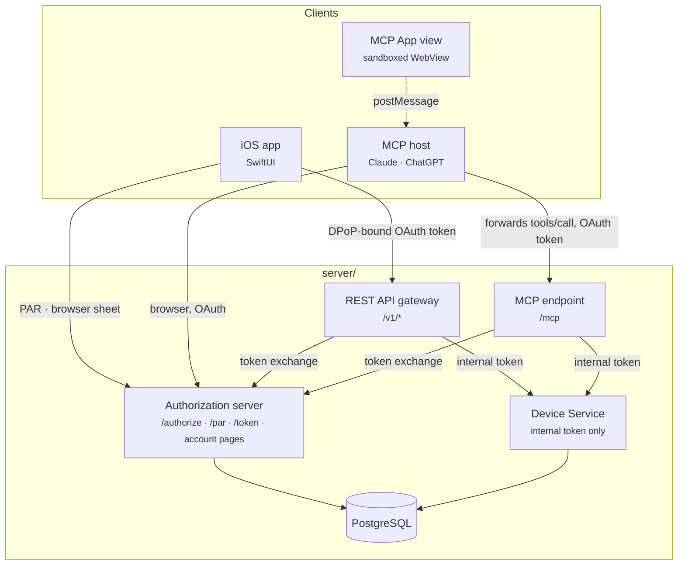
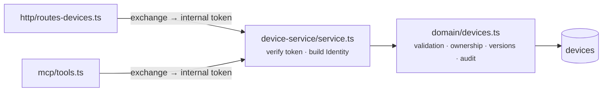
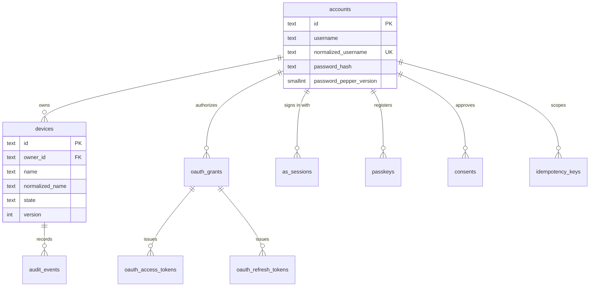
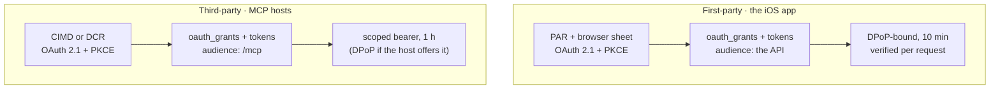
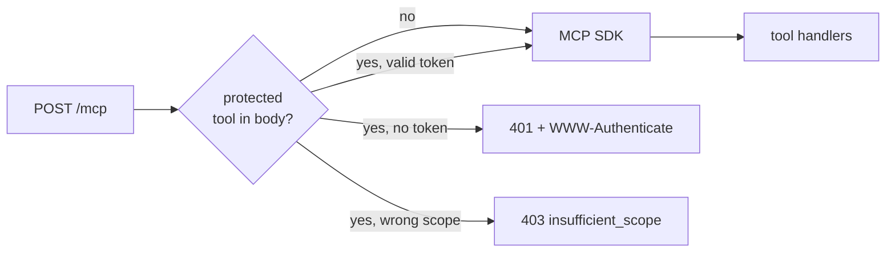
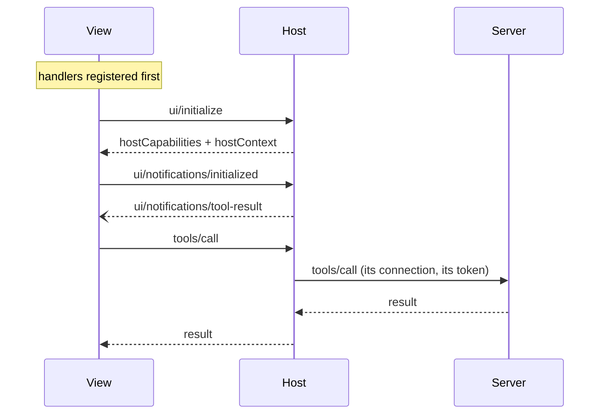
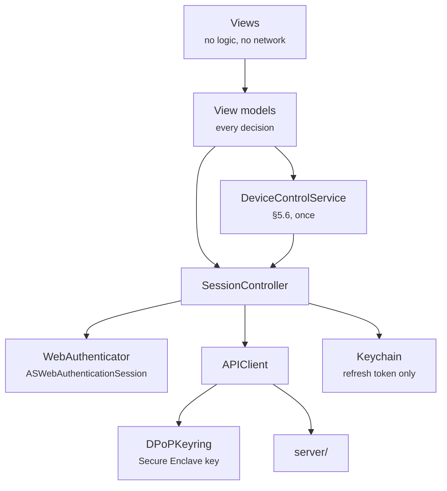

# Architecture

IoT Switch is one product with two front doors. A native iOS app and any
MCP-compatible AI host both reach the same devices, the same accounts and the
same business rules. This document explains how that is arranged and, where it
matters, why it is arranged that way.

The requirements it implements are in [`requirement.md`](../requirement.md).
Section references throughout point there. Authentication is covered in depth
in [the authentication architecture](./authentication-architecture.md).

---

## 1. The shape of it



The dotted line is the one people get wrong. **A view never talks to the
server.** It speaks `postMessage` to its host, and the host decides whether to
forward a `tools/call` over its own authenticated connection. A view holds no
token and has no network reach of its own.

The four components run in one process (profile S, `src/index.ts`) or as four
processes over mutual TLS (profile M, `src/entry/`). The code and the token
formats are the same in both.

---

## 2. The rule everything else follows

> The device API and MCP tools must use the same business rules and database.
> They must not maintain separate copies of a user's devices. — §3

This is enforced structurally rather than by discipline. `domain/devices.ts`
exports four functions that take an `Identity` — not an HTTP request, not a
tool call:

```ts
listDevices(db, identity)
getDevice(db, identity, deviceId)
addDevice(db, identity, { name, idempotencyKey })
controlDevice(db, identity, { deviceId, state, expectedVersion })
```

Only the Device Service calls them, and only after verifying an internal token
(`device-service/verify.ts`). Neither edge adapter can reach them directly:



Both adapters do the same three things: verify the caller's token, exchange it
for a one-minute internal token scoped to the one operation, and translate the
result. Neither validates a name, checks ownership or compares a version —
those live in one place, so they cannot drift apart.

`Identity` is built from the verified internal token, never from a request
field:

```ts
interface Identity {
  accountId: string;
  channel: 'native' | 'mcp' | 'internal';
  requestId?: string;
  clientId?: string;   // the OAuth client the person acted through
  grantId?: string;    // the grant behind the request
  via?: string;        // the workload that called the Device Service
  authMethod?: string; // oauth or oauth-dpop
}
```

Every mutation is audited with it, which is what makes "who changed this,
through what, and from where" answerable after the fact.

---

## 3. Layout

```
server/
  src/
    index.ts            profile S: everything in one process
    entry/              profile M: one entry point per component
    config.ts           the three origins and the values derived from them
    normalize.ts        the name folds — one implementation, imported everywhere
    password.ts         Argon2id over an HMAC under the password pepper
    errors.ts           the closed error-code set (§6.3)
    db/                 PGlite and PostgreSQL drivers, the schema
    domain/             accounts · devices · audit
    device-service/     the only caller of the device rules
    http/               REST adapter: routes, middleware, one error mapping
    oauth/              OAuth 2.1 authorization server and account pages
    mcp/                MCP adapter: gate, policy, tools, resources
      ui/assets/        the four views, plus the shared bridge and stylesheet
    security/           keys, KMS, rate limits, DPoP replay, workloads
    stores/             shared state: in memory, or Redis
    split/              profile M: mTLS listeners and remote clients
    observability/      logger, metrics, alerts
  test/                 279 tests
  acceptance/           criteria mapped to the tests that establish them
  tools/                host-check, mock-host, client-check, load, keys, split

ios/
  IoTSwitch/            SwiftUI app — auth, models, networking, session, view models, views
  IoTSwitchTests/       60 tests

ops/alerts.yml          Prometheus alert rules
```

---

## 4. Data model



Sixteen tables in three groups: the domain (`accounts`, `devices`,
`idempotency_keys`, `audit_events`); OAuth (`oauth_clients`, `cimd_cache`,
`par_requests`, `oauth_pending_authorizations`, `oauth_authorization_codes`,
`oauth_grants`, `oauth_access_tokens`, `oauth_refresh_tokens`); and the
authorization server's own state (`as_sessions`, `consents`, `passkeys`,
`webauthn_challenges`). Every token, code and session id is stored as an HMAC
under a pepper held outside the database.

### Two constraints carry the acceptance criteria

Application code loses races. The database does not.

```sql
CONSTRAINT devices_owner_name_key UNIQUE (owner_id, normalized_name)
```

is what actually prevents a duplicate device (AC-09). Creation uses
`ON CONFLICT DO NOTHING` rather than catching a unique violation, because on
PostgreSQL a failed statement aborts the transaction and leaves nothing usable
to continue with.

```sql
UPDATE devices
   SET state = $1, version = version + 1, updated_at = now()
 WHERE id = $2 AND owner_id = $3 AND version = $4 AND state <> $1
```

makes the version check and the write one statement, so two callers holding
the same version cannot both succeed (AC-10). `state <> $1` excludes the
no-op, which must not consume a version.

### Normalization

One module, imported by every caller. If this logic forked, two devices whose
names differ only by case could both be created.

| | Fold |
| --- | --- |
| Username | trim → NFKC → lowercase; charset restricted to ASCII so the fold is deterministic |
| Device name | trim → collapse internal whitespace → NFKC → lowercase |

`toLowerCase` is not full Unicode case folding, and device names are not
charset-restricted, so `Straße` and `STRASSE` remain distinct.

---

## 5. Authentication: one authorization server, two audiences



The iOS app signs in the way a host does: on the hosted page, through the
system browser sheet, with tokens bound to a Secure Enclave key. Its grants are
separate from a host's. An app token is not accepted at `/mcp`, and a host
token is not accepted at `/v1/*`. §7.2 requires that logging out of one does
not silently claim to disconnect the other.

### Why tokens are opaque and verified per request

§7.2 requires that a revoked token stops working immediately, including
access tokens **already issued**. A signed token validated only by signature
and expiry cannot be withdrawn. So every protected request looks the token up
by its HMAC, joined to its grant, and then checks its audience:

```sql
SELECT g.account_id, g.client_id, t.grant_id, t.scope, t.audience, t.cnf_jkt
  FROM oauth_access_tokens t
  JOIN oauth_grants g ON g.id = t.grant_id
 WHERE t.token_hash = ANY($1::text[])
   AND t.expires_at > now()
   AND g.revoked_at IS NULL
```

That lookup is on the hot path by design, not by accident. In profile M the
edges ask the authorization server instead, by introspection over mTLS, and
cache an answer for at most 30 seconds, dropping it the moment a revocation
event names its grant.

### Refresh rotation and reuse detection

Each refresh issues a successor and marks the presented token replaced, under a
row lock. Presenting an already-replaced token means it leaked, so the **whole
grant** is revoked — except for a duplicate inside a 30-second window, which
receives the identical response it would have received the first time. That
keeps two racing workers, or a client whose response was lost, from being
signed out.

### Scopes

`devices:read`, `devices:control`, `devices:create` — all three requested at
initial authorization and named in the `401` challenge. Minimising to
`devices:read` would make the first switch flip trigger a `403
insufficient_scope` and a re-consent prompt mid-interaction, which is a poor
experience for a light switch and slow to correct: hosts cache discovery
documents globally for minutes. Least privilege comes instead from the internal
token, which carries only the one scope each operation needs.

---

## 6. The MCP adapter

### The gate runs before the SDK



A refusal has to be an HTTP status. Once a tool handler is running its return
value is already destined for a `200`, and a `200` carrying `isError` is an
application failure — the host passes the text to the model and moves on, and
no authentication prompt appears. So the gate inspects the parsed JSON-RPC
body in the Express handler, before `transport.handleRequest`.

**It collects every protected call in the body, not the first.** A JSON-RPC
body may be a batch and the SDK executes all of it; authorizing only the first
would let a `devices:read` token send `[list_devices, control_device]` and
change a device.

### Transport errors versus tool errors

| Failure | How it surfaces | Why |
| --- | --- | --- |
| No token, wrong scope | HTTP `401` / `403` with a challenge | Only this makes a host authorize |
| Version conflict, name clash, not found, budget exhausted | `200`, `isError: true` | A normal outcome the model should act on |

Error results carry **no** `structuredContent`. A client validates it against
the tool's declared `outputSchema` whenever present, including on errors, and
an error is not the shape that schema describes. Codes travel in
`_meta['iot/error']`, which is not schema-bound.

### Tool catalogue

| Tool | Scope | View |
| --- | --- | --- |
| `list_devices` | `devices:read` | devices |
| `get_device` | `devices:read` | device |
| `control_device` | `devices:control` | — |
| `add_device` | `devices:create` | — |
| `get_auth_status` | public | — |
| `show_auth` | public | auth |
| `show_add_device` | public | add-device |

Both presentation tools are public. Gating a form's *display* behind a write
scope means merely showing it can trigger a `403` and a re-consent prompt
before the person has typed anything.

`control_device` and `add_device` are `idempotentHint: false`. Replaying
either fails rather than repeating, and a host may retry on that hint. Both
draw on write budgets (6 switches a minute per device; 20 switches a minute and
10 new devices an hour per grant), which hold whatever a host's approval
settings are.

---

## 7. The views

Four `ui://` resources, each assembled at start-up from a shared stylesheet, a
shared bridge and one view script — all inlined, which is what lets
`_meta.ui.csp` stay empty. A host blocks every external origin by default; a
page needing none cannot be broken by that policy and cannot widen it.

Each URI carries a hash of its page (`ui://iot/devices.e824b396.html`). Hosts
cache templates by URI across reconnects, so changed code has to be a new URI
or a host keeps running the old one.



Constraints that shaped the design:

- **Handlers are registered before the handshake.** A host may push
  `tool-input` or `tool-result` the instant it completes.
- **The sender is identified by window reference**, not origin — origin is
  unpredictable inside a sandbox. After the handshake every outbound message
  goes to the origin recorded from the host's reply.
- **A size is reported only when it changed.** A host that resizes in response
  would otherwise drive an unbounded loop.
- **Safe areas come from `hostContext`**, not CSS `env()`. Inside a chat
  WebView the page is not the thing the notch overlaps, and a control outside
  the insets cannot be tapped.
- **Handlers are additive, and context updates merge.** `host-context-changed`
  carries only the fields that changed, and the reply to
  `ui/request-display-mode` is the mode actually granted, so the bridge applies
  both rather than replacing its whole context.

### The inline row budget

`devices.js` renders `INLINE_ROW_BUDGET` rows inline and offers fullscreen for
the rest, because on a phone the conversation owns vertical scrolling: a pan
starting inside an inline card scrolls the chat, and the host clips overflow.
A long list rendered inline is partly **unreachable**, not merely ugly.

The number is **4**, Claude's published guidance. On a desktop browser there is
room for more; no phone measurement has been taken yet
([host compatibility](./host-compatibility.md), Q2).

---

## 8. The iOS app



The app has no password fields. Log In and Sign Up push an authorization
request (PAR), open the hosted page in an ephemeral browser sheet, check the
callback's `iss` and `state`, and exchange the code with a DPoP proof. The
access token lives only in memory; every request carries a fresh proof signed
in the Secure Enclave.

**Views hold no logic and make no network calls.** Every decision lives in a
view model, which is what lets the switch behaviour be tested exhaustively
without driving a simulator.

`DeviceControlService` implements §5.6 once and both the list and detail
screens use it — §5.4 requires them to behave identically, and two copies of a
state machine do not stay identical.

Three outcomes carry the weight:

- **Version conflict** — refetch, then say what the device actually *is*.
- **Unknown outcome** — a mutation that failed in transit may or may not have
  applied. `APIError.unknownOutcome` exists so this cannot be mistaken for an
  ordinary failure: the client reads before offering a retry and **never**
  sends the inverse command. That is how a switch ends up flipping itself back.
- **Pending intent is not state** — an unconfirmed change never becomes the
  displayed truth.

Refresh is single-flight and proactive, once a quarter of the token's life is
left. The backend revokes the whole grant on a replayed refresh token outside
its grace window, so two requests racing to refresh must share one refresh.
Only `invalid_grant` signs the person out; being offline does not.

---

## 9. Storage and shared state

Without `DATABASE_URL` the store is [PGlite](https://pglite.dev): real
PostgreSQL compiled to WebAssembly, persisted in `DATABASE_PATH`. Same SQL,
same constraint enforcement, same SQLSTATEs. With `DATABASE_URL` it is a
PostgreSQL server (`db/pg.ts`), with bounded connect and query timeouts: a
database that is down is a fast `503`, never a hung request. The schema is
applied under an advisory lock, so several processes starting at once apply it
once.

PGlite runs in-process and serialises queries, so on it the concurrency tests
prove the logic is correct when two callers start from the same observed
state. The same tests on PostgreSQL (`npm run test:pg`) prove it under genuine
row-level contention (AC-43).

Rate-limit and budget counters, used DPoP proof ids, sealed refresh responses
and revocation events live in memory, or in Redis when `REDIS_URL` is set, so
that more than one process can serve traffic. Redis-backed stores fail closed:
with Redis unreachable, requests get `503`.

---

## 10. Known limits

| | |
| --- | --- |
| Inline row budget | Published guidance; measured on desktop, not yet on a phone |
| KMS | `local` (software) is built in; a cloud provider needs an adapter implementing `Kms` |
| Universal-link callback | Needs an Apple Developer team: `APPLE_TEAM_ID` and the associated-domains entitlement. Until then the app uses its custom scheme |
| Case folding | `toLowerCase`, not full Unicode folding |
| DCR eviction | Runs on registration, not on a timer |
| iPad | Renders, but as the iPhone layout scaled up |
| iOS signing | Ad-hoc; a distribution build needs a real team |

Some acceptance criteria cannot be closed without a host account or a physical
device. `npm run acceptance` names each one and what closes it.
