# IoT Switch authentication architecture

How IoT Switch authenticates people, clients and its own services. The
document follows a token through its whole life:

1. how the **first token** is obtained (§5),
2. how tokens are **kept** safe (§6),
3. how tokens are **refreshed and exchanged** without user involvement (§7),
4. how the **MCP server and REST API are called** with them (§8).

Hostnames such as `auth.iot.example` are placeholders for the three configured
origins (`AUTH_BASE_URL`, `MCP_BASE_URL`, `API_BASE_URL`). Section references
of the form "requirement §n" point to [`requirement.md`](../requirement.md).

---

## 1. Summary

IoT Switch is one OAuth 2.1 authorization server, two resource servers and one
Device Service:

- **AI hosts** (Claude, ChatGPT, any MCP host) are third-party OAuth clients.
  They identify themselves by Client ID Metadata Document (CIMD), with Dynamic
  Client Registration (DCR) as a hardened fallback. They get audience-bound
  tokens for the MCP endpoint.
- **The iOS app** is a pre-registered public client. It signs in in the system
  browser sheet, pushes its request (PAR), and holds tokens bound to a Secure
  Enclave key (DPoP). It gets tokens for the REST API only.
- **Neither edge forwards the token it received.** Each exchanges it (RFC 8693)
  for a one-minute internal token whose audience is the Device Service, scoped
  to the single operation, naming and bound to the calling workload.
- **Refresh tokens rotate atomically.** A duplicate refresh inside a 30-second
  window receives the identical response, and any other reuse revokes the grant.

### Eight rules the design never breaks

| # | Rule | Why |
|---|---|---|
| 1 | The View never authenticates and never holds a credential. | A View is the least-trusted code in the system and can speak as the user. |
| 2 | Credentials are typed only in a top-level window on the authorization server's origin. | RFC 8252 and OAuth 2.1 forbid embedded user agents for login. |
| 3 | Every token has exactly one audience, and every receiver checks it. | This defeats token passthrough and token redirection. |
| 4 | No token crosses a trust boundary unchanged. | CoSAI: "perform token exchange at every trust boundary". |
| 5 | Tokens are bound to a key wherever the client can hold one. | A stolen bearer token works for anyone; a bound token does not. |
| 6 | Refresh is rotating, atomic and theft-detecting. | Required for public clients (MCP 2026-07-28, RFC 9700). |
| 7 | Every request is verified, nothing fails open, and no session is identity. | An exception in any authentication step is a refusal, never a default identity. |
| 8 | Least privilege is enforced by the server, whatever the host prompts. | Host approval of View-initiated calls is a MAY in the MCP Apps specification. |

---

## 2. Scope and threat model

### Goals

- Authenticate people for two client families: AI hosts and the first-party
  iOS app.
- Keep the guarantee from requirement §3: one account directory, one set of
  device rules, and no copy of a user's devices per surface.
- Satisfy the MCP authorization specification revision 2026-07-28 and the MCP
  Apps extension 2026-01-26.
- Make the theft of any single artefact (token, database row, device, View)
  insufficient to act as the user for long.

### Non-goals

- Controlling how a host stores its tokens. The design limits the damage if a
  host's store leaks.
- Machine-to-machine clients. Neither consumer host supports
  `client_credentials`.
- Enterprise-managed authorization (ID-JAG) and third-party device clouds.

### Assets

| Asset | Why it matters |
|---|---|
| Account credentials: passwords, passkey private keys (on the user's devices) | Full account takeover |
| Host and app access tokens, and their refresh tokens | Act as the user until expiry or revocation |
| Internal tokens | Act on the Device Service for up to a minute |
| Signing keys and token-hash peppers | Mint or recognise any token |
| Device state and the audit log | The product's actual data, and the evidence of who changed it |

### Adversaries

| Adversary | Capability assumed |
|---|---|
| Internet attacker | Sends any HTTP request and registers OAuth clients through DCR or a CIMD URL it controls |
| Malicious website | Frames our pages, opens popups, posts messages to windows it can reach |
| Hostile content | Device names and other user-controlled strings rendered in a View or read by the model (prompt injection) |
| Malicious MCP client | Completes the OAuth flow under a misleading name and redirect URI |
| Compromised host token store | Holds valid access and refresh tokens for many users |
| Stolen or jailbroken phone | Reads app memory and Keychain items, but cannot extract Secure Enclave keys |
| Insider or database leak | Reads the database |
| Network attacker | Sits on a hostile network, but TLS holds |

### Risks

| ID | Risk | ID | Risk |
|---|---|---|---|
| R1 | Confused deputy | R9 | iframe and postMessage abuse |
| R2 | Token passthrough | R10 | Credential entry in Views |
| R3 | Token theft and replay | R11 | Refresh races causing a forked family or false revocation |
| R4 | Session and state-handle hijacking | R12 | Rate-limit evasion and resource exhaustion |
| R5 | SSRF via metadata discovery | R13 | Fail-open validation |
| R6 | Consent phishing | R14 | Database leak of token tables |
| R7 | Clickjacking | R15 | Signing-key or pepper compromise |
| R8 | Prompt injection driving tool calls | R16 | Account enumeration and credential stuffing |

---

## 3. High-level architecture

### 3.1 System context

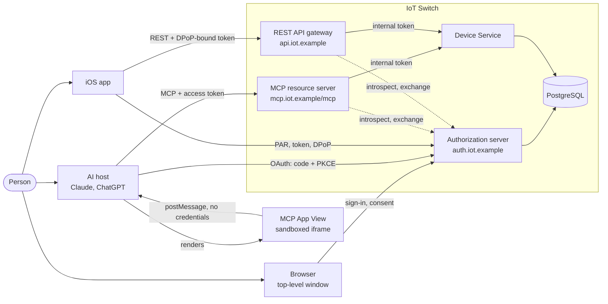

- **Authorization server (AS):** the only component that sees credentials, and
  the only issuer of tokens.
- **MCP resource server (RS):** the MCP endpoint. Accepts only tokens whose
  audience is `https://mcp.iot.example/mcp`.
- **REST API gateway (GW):** the iOS app's endpoint. Accepts only DPoP-bound
  tokens whose audience is `https://api.iot.example`.
- **Device Service (DS):** the one implementation of the device rules. It takes
  a verified identity, never an HTTP request or a tool call, and accepts only
  an internal token. That keeps the two surfaces from drifting apart.

### 3.2 Trust zones

| Zone | Contents | Trust | What may cross out of it |
|---|---|---|---|
| User device | Browser top-level window, host page, sandbox proxy, View, iOS app | Untrusted | Typed credentials (top-level window only), DPoP-bound app tokens, postMessage carrying no credentials |
| Host cloud | Host MCP client and its token store | Trusted by the user, not by us | Access and refresh tokens, the PKCE verifier (to our token endpoint only) |
| Identity | AS, its tables, the KMS | Most sensitive | Tokens, metadata, introspection results |
| Edge | RS, GW, Redis | Ours, holds no long-lived secrets | Internal tokens to the Device Service only |
| Core | Device Service, device tables, audit events | Ours, not Internet-reachable | Nothing outward |

Two placement decisions carry most of the weight.

- **The AS has its own origin.** Its browser-session cookie
  (`__Host-as_session`) can never be sent to, or read by, the MCP or API
  origins, and its pages carry a strict CSP and `frame-ancestors 'none'`
  without affecting anything else. Requests for another origin's host are not
  routed to the AS router at all (`onHost` in `http/app.ts`).
- **The Device Service is not an edge.** A request that skips the edge
  adapters still needs a valid internal token, and in profile M a client
  certificate the Device Service accepts.

### 3.3 Token landscape

| Token | Issued by → to | Audience | Lifetime | Bound to | Format | Stored |
|---|---|---|---|---|---|---|
| AS session | AS → browser cookie | AS only | Idle 30 min, absolute 12 h | Browser cookie jar | Opaque | HMAC in `as_sessions` |
| Pending authorization | AS → browser | AS | 15 min | `__Host-pa` cookie of the browser that started it | Opaque id | `oauth_pending_authorizations` |
| Pushed request | AS → iOS app | AS | 60 s, single use | The client that pushed it | `urn:ietf:params:oauth:request_uri:…` | `par_requests` |
| Authorization code | AS → client via browser | AS token endpoint | 60 s, single use | client_id, redirect_uri, PKCE challenge, resource, `dpop_jkt` | Opaque | HMAC |
| **Host access token** | AS → host | `https://mcp.iot.example/mcp` | 1 h | DPoP key if the host offers one, else bearer | Opaque reference | HMAC |
| **App access token** | AS → iOS app | `https://api.iot.example` | 10 min | The app's Secure Enclave key, always | Opaque reference | App memory only; HMAC on the server |
| Refresh token | AS → host or app | AS | 30 days, rotated on every use | client_id, and the DPoP key if the grant is bound | Opaque | HMAC; the app keeps it in the Keychain (this device only) |
| **Internal token** | AS → RS or GW (exchange) | `https://device.internal` | 60 s, never longer than its subject | The calling workload (`cnf`) | JWT, `typ: at+jwt`, ES256 | Edge memory cache only |

**Why the edge tokens are opaque and the internal token is a JWT.**
Requirement §7.1 needs a revoked token to stop working on the next request.
Opaque reference tokens give that on every check, and leak nothing if logged.
The internal token lives for a minute, is minted only after a live edge check,
and is verified on every Device Service call; a short-lived signed JWT means no
Device Service call waits on the AS.

Every opaque token has the form `iotsw_<kind>_<random><checksum>` (§6.2).

### 3.4 Deployment profiles

The same code runs in two profiles, with the same token formats.

| | Profile S: one process | Profile M: one process per component |
|---|---|---|
| Entry point | `src/index.ts` | `src/entry/{as,rs,gw,ds}.ts` |
| Layout | One Node process serving three hostnames by `Host` header; AS, RS, GW and DS as modules | AS, RS, GW and DS as separate processes |
| Token validation | RS and GW verify against the database in-process | RS and GW call `/introspect` on the AS's internal listener over mTLS; answers cached up to 30 s and dropped on any revocation event |
| Token exchange | In-process call that still mints and verifies a real internal token | `/token-exchange` over mTLS |
| Workload binding | Each adapter's workload has a per-process key (`cnf.jkt`) | Each workload has a certificate (`spiffe://iot-switch/<name>`); internal tokens carry `cnf.x5t#S256` |
| Shared state | In memory, or Redis when `REDIS_URL` is set | Redis, required |
| Database | PGlite, or PostgreSQL with `DATABASE_URL` | PostgreSQL; only the AS and DS hold credentials |

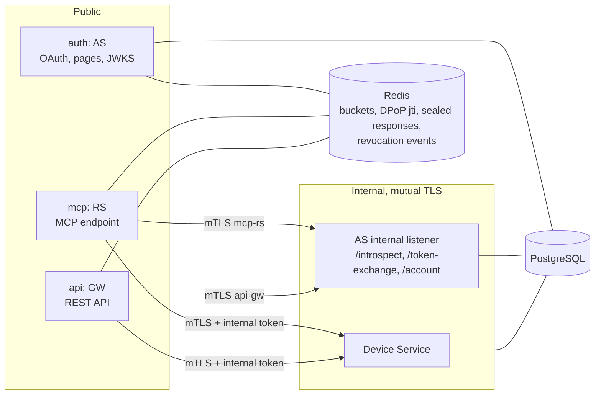

Profile S keeps the module boundaries honest: the Device Service module accepts
only a verified internal token even in-process, so moving to profile M changes
transport, not trust.

---

## 4. Components

Each component is described by what it does, what it holds, what it trusts and
how it fails. **Everything fails closed:** an exception in any authentication
step produces a refusal, never a request with an empty or default identity.

### 4.1 Host MCP client (external: Claude, ChatGPT)

| | |
|---|---|
| Does | Discovers our AS from the 401, runs authorization code + PKCE S256 in a top-level window, stores tokens in its backend, forwards View `tools/call` requests over its own connection |
| Holds | Access token, refresh token, PKCE verifier, DPoP key (if it uses DPoP) |
| We rely on | Exact `iss` and `state` comparison; `resource` on authorize and token requests; never exposing tokens to Views |
| Observed | Both register by CIMD: `https://claude.ai/oauth/mcp-oauth-client-metadata` and `https://chatgpt.com/oauth/client.json`. Neither sends DPoP. Claude chooses CIMD only when the AS advertises `client_id_metadata_document_supported` **and** `none` client authentication. See [host compatibility](./host-compatibility.md) |

### 4.2 MCP App View (ours, inside the host's sandbox)

| | |
|---|---|
| Does | Renders data from tool results, sends `tools/call` through the host bridge, requests display modes |
| Holds | Nothing secret. No token, code, verifier or identity in storage |
| Controls | Inline assets only, with an empty `_meta.ui.csp`, so no external origin is reachable. `event.source === window.parent` on every inbound message. Every outbound message after the handshake goes to the origin recorded from the host's reply. `textContent` only. No `ui/message` and no `ui/update-model-context` |
| Fails | An unexpected message is dropped. A handshake timeout shows "Could not reach the host" and nothing else |

### 4.3 iOS app

| Part | Responsibility |
|---|---|
| `SessionController` | Runs PAR → `ASWebAuthenticationSession` → code exchange (§5.6), owns sign-in and sign-out, and refreshes single-flight (§7.4) |
| `WebAuthenticator` | The system browser sheet, ephemeral, with the universal-link or custom-scheme callback |
| `DPoPKey` | Creates and loads the Secure Enclave P-256 key, computes its JWK thumbprint, signs proofs, tracks the server nonce |
| `TokenStorage` | The refresh token in the Keychain; the access token in memory only |
| `APIClient` | Attaches `Authorization: DPoP <token>` and a fresh `DPoP` proof to each request; retries once on `use_dpop_nonce` |

The app signs out **only** when the AS answers `invalid_grant`. A transport
failure keeps the session and reports "offline".

### 4.4 Authorization server

| Part | Responsibility | Key controls |
|---|---|---|
| **Metadata** (`oauth/metadata.ts`) | RFC 8414 document, OIDC discovery alias, JWKS for internal tokens | `issuer` equals the URL it is fetched from. Advertises exactly what is enforced (Appendix A) |
| **PAR endpoint** (RFC 9126) | Accepts authorization parameters over the back channel and returns a 60 s `request_uri` | Required for the iOS client |
| **Authorization endpoint** (`oauth/authorize.ts`) | Validates the request once, creates a pending authorization, renders sign-in or consent | Rules in §5.3. Errors render on our own page until `redirect_uri` is proven, so it is never an open redirector |
| **Client registry** (`oauth/clients.ts`) | Resolves `client_id` to redirect URIs and a trust class | CIMD resolver with SSRF rules (§5.2). The pre-registered iOS client. DCR with caps and eviction |
| **Authenticator** | Verifies the person | Passkeys (WebAuthn). Password: Argon2id over an HMAC under a pepper. Generic errors, decoy hashing, throttles |
| **AS session** (`oauth/session.ts`) | `__Host-as_session` cookie | `Secure; HttpOnly; SameSite=Lax; Path=/`. Idle 30 min, absolute 12 h. Always a fresh session on sign-in. Stored as an HMAC |
| **Consent** (`oauth/consents.ts`) | Shows and records what is granted, per client | Names the client host, redirect host and scopes. Fresh sign-in needed to approve write scopes on an older session (§5.5) |
| **Token endpoint** (`oauth/token.ts`) | `authorization_code` and `refresh_token` grants | Form-encoded. `Cache-Control: no-store`. `client_id` required even for public clients. DPoP proofs verified here (§5.6) |
| **Internal listener** (`split/servers.ts`) | `/introspect`, `/token-exchange` and `/account` for RS and GW | mTLS peers named on an allowlist only. Each edge is told only about tokens for its own resource |
| **Revocation** (RFC 7009) | Revokes a token's grant | Always answers 200. Publishes a revocation event (§7.7) |
| **Account pages** (`oauth/account-routes.ts`) | Passkeys, connected apps, sign out everywhere, password change | Same session, CSRF and header rules as the sign-in pages |

### 4.5 MCP resource server

The RS is an adapter. It validates, translates and exchanges, but holds no
business rules and no long-lived secrets.

- **Protected Resource Metadata** at `/.well-known/oauth-protected-resource/mcp`
  and at the bare path.
- **The gate** (`mcp/gate.ts`), which runs on the parsed JSON-RPC body before
  the MCP SDK (§8.2).
- **Tool policy table** (`mcp/policy.ts`): tool → scope → annotations → write
  budget (§8.5).
- **Exchange client** (`exchange-client.ts`) with its internal-token cache.
- **UI resources**: four `ui://` templates, static, identical for every user,
  readable without a token, and addressed by a hash of their content.

### 4.6 REST API gateway

It runs the same verification as the RS, with three differences:

- **DPoP is mandatory.** A token without `cnf.jkt`, a bound token sent as
  `Bearer`, or a request without a valid proof is refused with `401`.
- **Challenges are always HTTP.** There is no host adapter.
- **It answers who the caller is** (`GET /v1/me`) and serves `/v1/devices`.
  Sign-in, refresh and sign-out happen at the AS.

### 4.7 Device Service

- Accepts calls only with a valid internal token, and in profile M only over
  mTLS from the `mcp-rs` or `api-gw` workload.
- Validation checklist in §8.6.
- Derives the identity from `sub`, never from a request field: requirement
  §7.2's "do not authorize by … a device owner parameter".
- Writes an audit event for every mutation (§8.7).

### 4.8 Shared infrastructure

| Component | Role | Controls |
|---|---|---|
| PostgreSQL (PGlite in development) | Accounts, credentials, clients, consents, grants, token hashes, devices, audit | Only the AS and DS processes hold credentials in profile M |
| Redis | Rate-limit and budget buckets, DPoP `jti`, sealed refresh responses, revocation events | Fails closed: with Redis unreachable, requests get `503` |
| KMS | Token and password peppers, the internal MAC key, internal-token signing keys | Signing keys never leave it. Start-up fails closed on any key that does not open (§6.4) |
| Revocation bus | `grant.revoked`, `account.revoked`, `client.blocked` | In-process hub, bridged across processes by Redis pub/sub |
| Observability | Allowlisted logger, Prometheus metrics, in-process alerts | No token value can reach a log line (§6.7) |

---

## 5. Receiving the first token

### 5.1 Host flow

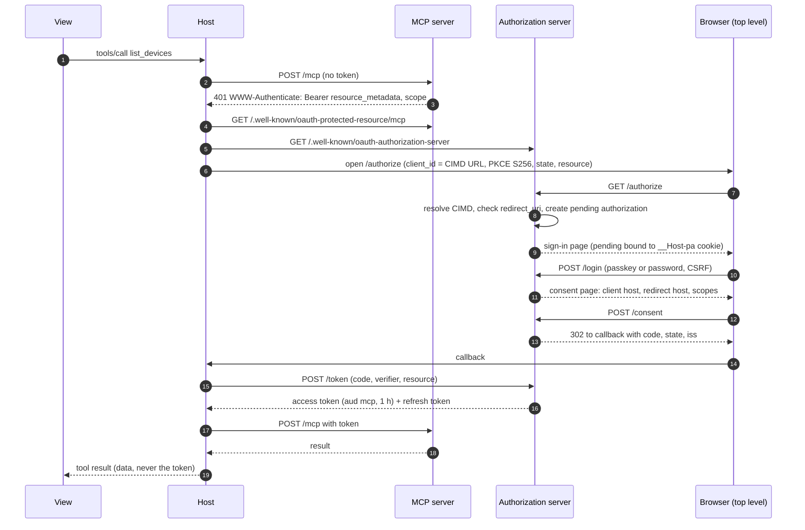

| Steps | What happens | Control | Risk |
|---|---|---|---|
| 1–3 | The View calls `list_devices`, a read-only protected tool; the RS answers **HTTP 401** with `resource_metadata` and the full `scope` hint | The challenge comes from the HTTP layer before the MCP SDK runs. The `scope` hint stops Claude requesting every advertised scope | R13 |
| 4–5 | Discovery | `resource` equals the connector URL exactly, including `/mcp`. `issuer` equals the AS origin. `S256` is the only PKCE method | R2, R3 |
| 6–8 | Authorization request | CIMD resolved (§5.2). Validated once (§5.3). The pending authorization is an opaque id bound to the browser that started it, so a link to someone else's pending id cannot be completed elsewhere | R4, R5 |
| 9–10 | Sign-in (§5.4) | `frame-ancestors 'none'`, CSRF token, generic errors | R7, R16 |
| 11–12 | Consent (§5.5) | Client host, redirect host and scopes in plain words | R1, R6 |
| 13 | Redirect | `iss` always present (RFC 9207). `302`, never `307`, so form bodies are not re-sent | R3 |
| 15–16 | Code redemption (§5.6) | Atomic single use. Client, redirect, resource and DPoP key must match | R3 |
| 17–19 | Retry | The View receives data, never the token | R10 |

### 5.2 Resolving client identity

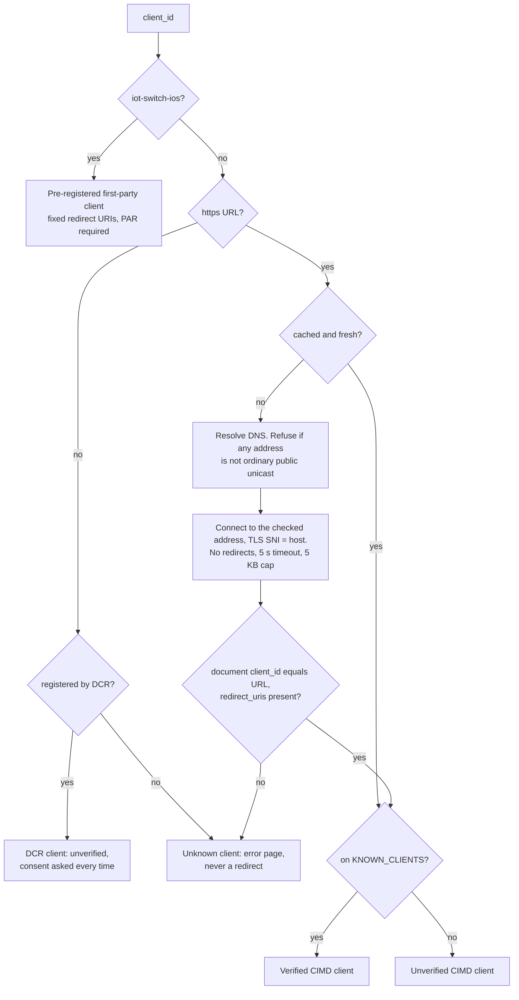

Every client is sorted into a **trust class**, which the consent page shows.

| Trust class | How it is reached | Consent page shows | Remembered consent |
|---|---|---|---|
| Verified | A CIMD URL on `KNOWN_CLIENTS` (Claude's and ChatGPT's by default), or the pre-registered iOS app | Host name and a "verified" badge | For a year, for the same client, redirect host and the same or narrower scopes |
| Unverified CIMD | Any other `https://` `client_id` whose document validates | The `client_id` host in bold, an "unverified application" warning, and the redirect host | For 30 days |
| DCR | A `client_id` returned by `/register` | "Unverified application" and the selected **redirect destination**. The self-asserted name is never shown alone | **Never.** Asked every time |

CIMD fetch rules:

- HTTPS only, no fragment.
- Every resolved address must be ordinary public unicast. Private, loopback,
  link-local, carrier-grade NAT, benchmarking and documentation ranges,
  multicast, unique-local IPv6, and the IPv6 forms that embed an IPv4 address
  (mapped, NAT64, 6to4, Teredo) are refused, classified by `ipaddr.js` rather
  than hand-written parsing. The connection goes to the address that was
  checked, so DNS cannot answer differently the second time.
- No redirects. 5 s timeout. 5 KB response cap, counted in bytes.
- The document's `client_id` must equal the URL. `redirect_uri` must appear in
  `redirect_uris`; loopback URIs match with the port ignored (RFC 8252 §7.3).
- Cached by the document's own `Cache-Control`, for at most a day. The
  document's digest is stored with a remembered consent, so a changed document
  asks again.
- Redirect schemes: `https`, loopback `http`, or a reverse-DNS private-use
  scheme. Never `javascript:`, `data:`, `file:` or any other scheme.

DCR (deprecated by MCP 2026-07-28, kept for hosts without CIMD):

- `/register` is rate-limited per address, with a global cap of 500 clients;
  clients that never completed a grant are evicted after a day.
- `application_type` is required and constrains redirects: `web` clients use
  https on a non-loopback host, `native` clients use loopback http or a
  private-use scheme.
- DCR clients are always unverified and never get remembered consent, which
  removes the precondition of the confused-deputy attack.

### 5.3 Authorization request validation

The checks run in this order. Until step 2 passes, every error renders on our
own page. After it, errors go back to the validated `redirect_uri` with `iss`.

1. Resolve `client_id` (§5.2). Unknown: error page.
2. Check `redirect_uri` against the client's list. No match: error page,
   **never a redirect**.
3. `response_type` must be `code`: otherwise `unsupported_response_type`.
4. `code_challenge_method` must be `S256` with a 43–128 character challenge:
   otherwise `invalid_request`. `plain` is never accepted.
5. `resource` must equal the resource this client may ask for: the MCP
   resource for hosts, the REST API for the iOS app. Otherwise
   `invalid_target`.
6. Keep only known scopes. If none remain, `invalid_scope`.
7. `state` is bounded in size, stored server-side and echoed back.
8. `dpop_jkt`, if present, is stored and enforced at the token endpoint.
9. The iOS client's request **must** arrive through PAR, and the pushed
   parameters win over anything in the query string.

### 5.4 Sign-in

- **Passkeys** (WebAuthn, `userVerification: required`). A passkey is bound to
  the AS origin and cannot be phished onto a look-alike domain. Only the public
  key, credential id and signature counter are stored; a counter that stops
  advancing is refused as a cloned authenticator.
- **Password.** Argon2id (m = 64 MiB, t = 3, p = 1), applied to an HMAC of the
  password under a pepper held outside the database. A stolen accounts table
  alone cannot be brute-forced offline.
- **Enumeration resistance.** One message, "Invalid username or password", for
  both an unknown username and a wrong password, and the same work for both (a
  decoy hash).
- **Throttles.** `AUTH_RATE_LIMIT_PER_MINUTE` (20) credential submissions per
  minute per address; `AUTHORIZE_VIEW_RATE_LIMIT_PER_MINUTE` (60) page views.
- **Page hardening** on every AS HTML response:

```http
Content-Security-Policy: default-src 'none'; script-src 'nonce-…'; style-src 'nonce-…';
                         img-src 'self'; form-action 'self' <validated redirect origin>;
                         frame-ancestors 'none'; base-uri 'none'
X-Frame-Options: DENY
Cross-Origin-Opener-Policy: same-origin
Referrer-Policy: no-referrer
Cache-Control: no-store
X-Content-Type-Options: nosniff
```

`frame-ancestors 'none'` and `X-Frame-Options` satisfy RFC 9700's clickjacking
requirement. `form-action` lists the validated redirect URI's origin as well as
`'self'`, because browsers apply it to the redirect that follows a form POST.

### 5.5 Consent

- Shown after sign-in, in the same top-level window, with a CSRF token bound to
  the pending authorization and the browser.
- Names three things the person can verify: the **client host** with its trust
  badge, the **redirect host**, and each **scope in plain words**.
- **Fresh sign-in for writes.** If the AS session is older than 15 minutes,
  approving `devices:control` or `devices:create` requires signing in again. A
  stolen browser session cannot quietly approve a new writer.
- **Remembered consent** applies only when client, redirect host and scopes
  (the same or narrower) all match, and the CIMD document is unchanged.
- **Cancel** returns `access_denied` to the validated redirect URI and deletes
  the pending authorization.
- **Scope strategy.** All three device scopes are requested up front, as
  requirement §7.3 decides for usability. Least privilege comes from narrowing
  each internal token to the scope of the single call (§7.5).

### 5.6 Code issuance and redemption

A code is stored as an HMAC with its account, client, redirect URI, PKCE
challenge, resource, scope, `dpop_jkt`, `auth_time`, consent id and expiry.

"First one wins" is a property of the statement itself: only a caller whose
`UPDATE` finds `consumed_at IS NULL` gets an unflagged record, so two
concurrent redemptions on a PostgreSQL server cannot both succeed. A replayed
code revokes exactly the grant it produced, recorded on the code; a code that
failed redemption produced no grant and revokes nothing.

The token endpoint then checks, in order:

1. `client_id` is present and equals the code's client.
2. `redirect_uri` equals the authorized one.
3. PKCE S256, compared in constant time.
4. `resource`, if sent, equals the code's.
5. A DPoP proof, if present, is valid, and its key thumbprint equals the code's
   `dpop_jkt`. A code bound to a key without a proof is refused. The iOS client
   must always present one. Proofs are checked before the code is touched, so a
   failed proof spends nothing.
6. Grant creation, code → grant linkage and token issuance happen in one
   transaction (`establishGrant`).

```http
HTTP/1.1 200 OK
Content-Type: application/json
Cache-Control: no-store

{ "access_token": "iotsw_at_…", "token_type": "DPoP", "expires_in": 600,
  "refresh_token": "iotsw_rt_…", "scope": "devices:read devices:control devices:create offline_access" }
```

### 5.7 iOS app first token

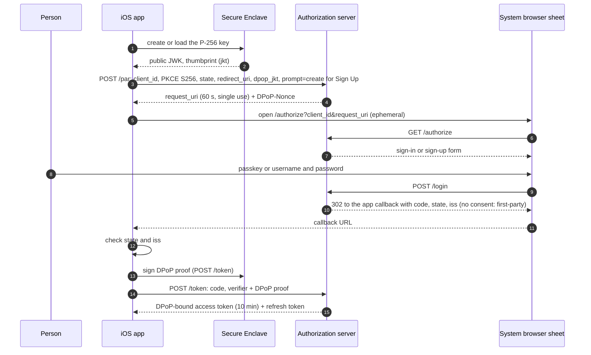

| Element | Choice | Why |
|---|---|---|
| User agent | `ASWebAuthenticationSession`, `prefersEphemeralWebBrowserSession = true` | An external user agent, as RFC 8252 requires. The app cannot read the page. Passkeys and password autofill work |
| Callback | Universal link `https://<api host>/oauth/callback` (`.https(host:path:)`, iOS 17.4+) when signed with the associated-domains entitlement; the `com.example.iotswitch:` custom scheme otherwise | Another app cannot register a universal link. The server publishes `apple-app-site-association` only when `APPLE_TEAM_ID` is set |
| Request integrity | PAR, required for this client | Parameters never travel through the browser |
| PKCE | S256, a fresh verifier per attempt, held in memory | Code interception |
| Key binding | DPoP with a Secure Enclave P-256 key; `dpop_jkt` sent at PAR | A token or refresh token copied off the phone is useless without the chip |
| Consent | Skipped for this pre-registered first-party client with fixed scopes | The person is signing into our own app |

### 5.8 What the View does during sign-in

Nothing that touches credentials. The auth card (`show_auth`) is cosmetic, as
requirement §7.4 says.

1. Its **Log In** and **Sign Up** buttons call `list_devices`, a read-only
   protected tool.
2. The host receives the 401, runs the flow in its own top-level window, and
   retries the call.
3. The card receives the result.

The card never opens a login URL of its own and never claims that a browser tab
signed the connection in. Claude and ChatGPT both start sign-in with their own
Connect before the card is ever shown ([host compatibility](./host-compatibility.md), Q1).

### 5.9 Risks addressed while receiving the first token

| Risk | Addressed by |
|---|---|
| R1 Confused deputy | Per-client consent. DCR consent never remembered. No upstream token proxying |
| R3 Theft (code interception, mix-up) | PKCE S256 only. Atomic single-use code. `iss` on every response. DPoP `jkt` bound at authorization |
| R4 Hijacking of the pending flow | Pending authorization bound to a `__Host-` cookie. `state` stored server-side |
| R5 SSRF | Public-unicast check after resolution, pinned address, no redirects, size and time caps |
| R6 Consent phishing | Client host and redirect host shown. Trust classes |
| R7 Clickjacking | `frame-ancestors 'none'`, `X-Frame-Options: DENY`. Fresh sign-in for write scopes |
| R10 Credential entry in Views | Sign-in only on the AS origin, in a top-level window or the system sheet. The View has no form |
| R16 Enumeration and stuffing | Generic errors, decoy hashing, throttles, passkeys |

---

## 6. Keeping tokens secure

### 6.1 Where every secret lives

Raw tokens exist only in the holder's memory, in transit under TLS, and in the
one store the holder needs. Every IoT Switch store keeps a keyed hash, never the
token.

| Secret | Holder | IoT Switch keeps |
|---|---|---|
| Host access and refresh tokens | Host backend | HMAC |
| App access token | App memory | HMAC |
| App refresh token | Keychain, this device only, not synchronised | HMAC |
| App DPoP key | Secure Enclave, non-exportable | Thumbprint on the grant |
| AS session | Browser cookie | HMAC |
| Internal token | Edge memory cache | Nothing (verified by signature) |
| Password | The person | Argon2id over HMAC under the password pepper |
| Passkey private key | The person's authenticator | Public key, counter |
| Peppers, MAC key | Key file or KMS envelope | Ciphertext and KMS key ids only (KMS) |
| Signing keys | KMS (or the key file without one) | KMS key ids only (KMS) |

### 6.2 Token format

```
iotsw_<kind>_<base64url of 256 random bits><checksum>
```

- **The prefix** lets secret scanners and the log scrubber recognise a leaked
  token, and names its kind: a refresh token presented as an access token is
  refused.
- **The checksum** lets the gate reject garbage without a database round trip.
- The token carries no meaning beyond its kind. It is a reference.

### 6.3 Storage at rest

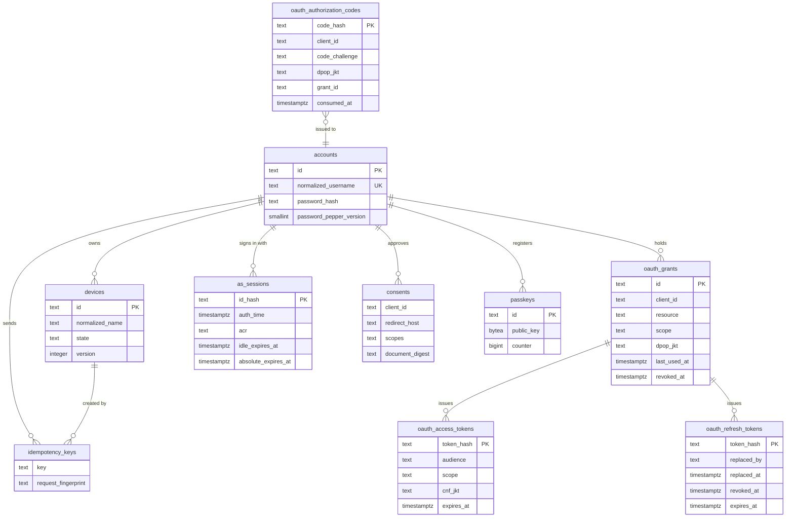

The tables not drawn are `oauth_clients` (DCR and pre-registered clients),
`cimd_cache`, `oauth_pending_authorizations`, `par_requests`,
`webauthn_challenges` and `audit_events`. The full schema is
`server/src/db/migrations.ts`.

- **HMAC, not plain SHA-256.** Each token is stored as
  `HMAC-SHA256(pepper_v, token)`. An unkeyed hash would let anyone holding a
  database dump check whether a token found elsewhere is live; with the pepper
  outside the database, a leak alone reveals nothing usable (R14).
- **Pepper rotation without downtime.** New tokens use the newest pepper.
  Lookups try every pepper still held, current first, and two generations are
  kept, so a token keeps working until it expires.
- **Retention.** Expired tokens, codes, pending authorizations, pushed requests
  and WebAuthn challenges are swept hourly. Revoked refresh rows are kept until
  they expire, so reuse is still recognised as reuse.
- **Sealed refresh responses** (§7.2) are kept for the grace window only,
  AES-256-GCM encrypted, in memory or in Redis.

### 6.4 Keys

| Key | Algorithm | Lives in | Used for | Rotation |
|---|---|---|---|---|
| Token pepper | HMAC-SHA256, 256-bit | KMS envelope (or `TOKEN_PEPPERS`) | Token, code and session hashes | `npm run keys -- rotate-pepper`, every 90 days; the previous generation keeps verifying |
| Password pepper | HMAC-SHA256 | KMS envelope (or `PASSWORD_PEPPER`) | Pre-hash before Argon2id | On compromise only |
| Internal MAC key | HMAC-SHA256 | KMS envelope (or `INTERNAL_MAC_KEY`) | CSRF tokens, browser binding | On compromise only |
| Internal-token signing | ES256 (P-256) | KMS, non-exportable (or `SIGNING_KEYS`) | Signing internal tokens | `npm run keys -- rotate-signing`, every 30 days; the JWKS keeps publishing the previous key |
| mTLS identities | X.509, P-256 | Service mesh (local CA in development) | AS, RS, GW, DS workloads | Mesh-managed |
| App DPoP key | P-256 | Secure Enclave | DPoP proofs | A new key on every fresh sign-in |

With `KMS_PROVIDER` set, the key file holds only ciphertext and KMS key ids;
the server decrypts the peppers and MAC key at start-up and asks the KMS for
every signature. Start-up fails closed if any key does not open. `local` is a
software KMS for development and tests; a cloud provider is an adapter that
implements the `Kms` interface in `security/kms.ts`.

### 6.5 iOS storage

- **The access token is never persisted.** After a cold start the app refreshes
  once.
- **The refresh token** is a Keychain item,
  `kSecAttrAccessibleAfterFirstUnlockThisDeviceOnly`, not synchronised.
- **The DPoP key** is created in the Secure Enclave
  (`kSecAttrAccessibleWhenUnlockedThisDeviceOnly`, `.privateKeyUsage`); only its
  encrypted handle, usable by this device's chip alone, is stored. A Keychain
  dump yields a refresh token bound to a key the attacker cannot extract.
- **Log Out** revokes the app's grant at the AS, deletes the Keychain item and
  the key, and clears memory. It does not touch the person's host grants
  (requirement §7.2).

### 6.6 Tokens held by the host

We cannot control the host's store, so we limit what a leak from it is worth:

- one-hour access tokens and rotating refresh tokens;
- DPoP binding whenever the host offers a key;
- revocation the person controls, on the connected-apps page (§7.7).

### 6.7 The View stores nothing

| Rule | Implementation |
|---|---|
| No token, code or verifier ever reaches a View | Tool results carry device data only. Error codes travel in `_meta['iot/error']`, which never contains a secret |
| `_meta` is not private | ChatGPT exposes the whole result envelope to widgets, so nothing sensitive goes in any `_meta` |
| Templates are shared across users | `ui://` HTML is built once at start-up with no user data, because hosts cache it by URI |
| No identity in browser storage | No `localStorage` or `sessionStorage`. The View keeps state in memory and re-reads through tools |
| Pinned target origin | `ui/initialize` goes to `'*'`, because the parent's origin is unknown and the message carries nothing sensitive. Every later message goes to the origin recorded from the host's reply |
| Source check | `event.source === window.parent`, and a shape check per method |
| No model steering from untrusted data | The View never sends `ui/message` or `ui/update-model-context`. Device names are user-controlled and could carry injected instructions |

### 6.8 Logs and telemetry

- **The logger uses an allowlist, not a redaction list** (`observability/log.ts`).
  Only named fields are written. `Authorization`, `DPoP`, `Cookie`,
  `Set-Cookie`, `code`, `code_verifier`, `refresh_token`, `password` and
  anything that looks like an `iotsw_` token never appear, even if a whole
  request is logged.
- **Metrics** (`observability/metrics.ts`) count refusals, refresh reuse, DPoP
  replays, budget exhaustion and outages, in the Prometheus text format on a
  separate listener. `ops/alerts.yml` turns them into alerts.
- **The audit log** records `grant_id` and `client_id`, never a token.

### 6.9 Risks addressed while tokens are held

| Risk | Addressed by |
|---|---|
| R3 Theft and replay | DPoP for the app (always) and hosts (when offered). Memory-only app access token. Short lifetimes |
| R9 postMessage | Pinned target origin, source and shape checks, no secrets in `_meta` |
| R10 Credentials in Views | Structural: there is nothing to store |
| R14 Database leak | Keyed HMAC under a pepper outside the database |
| R15 Key compromise | KMS-held signing keys, rotation with overlap |

---

## 7. Refreshing and exchanging tokens

### 7.1 Lifetimes

| Token | Lifetime | Refresh behaviour |
|---|---|---|
| Host access token | 1 h | The host refreshes ahead of expiry or on 401 |
| App access token | 10 min | Proactively when a quarter of its life remains, single-flight |
| Refresh tokens | 30 days | Rotated on every use |
| Internal token | 60 s | Re-exchanged when under 10 s remain. Never refreshed |
| DPoP nonce | 5 min | The server rotates it; the client retries once on `use_dpop_nonce` |
| Sealed refresh response | 30 s (`REFRESH_GRACE_SECONDS`) | Expires with the grace window |

### 7.2 Refresh: atomic, theft-detecting, race-tolerant

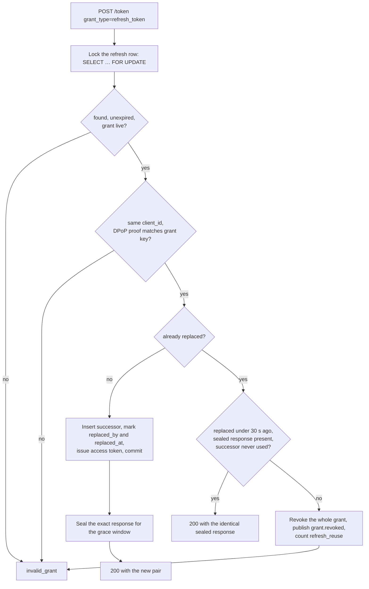

A presented token that was already replaced is benign only if it was replaced
under 30 seconds ago, the sealed response still exists, the successor has never
been presented, and it comes from the same client, with a proof from the same
key if the grant is bound. Then the AS returns **the identical response** it
gave the first time:

- **Two workers race:** both get the same pair, and the family stays linear.
- **The response was lost in transit:** the retry gets what was lost.
- **A thief replays inside the window:** they get a copy of tokens the client
  also holds, which against a DPoP-bound grant is useless.

Outside the window the replay is treated as theft: the grant is revoked, an
event is published and an alert is raised.

### 7.3 Host refresh

The AS answers `invalid_grant` for every dead refresh token, which is what
Claude and ChatGPT expect before they ask the person to reconnect.
`REQUIRE_OFFLINE_ACCESS_FOR_REFRESH` (off by default) restricts refresh tokens
to clients that request `offline_access`.

### 7.4 iOS refresh

`SessionController.validAccessToken()` returns the in-memory token while more
than a quarter of its life remains. Otherwise it starts one refresh task, which
every concurrent caller joins. The rotated refresh token is written to the
Keychain before the new access token is used. Only `invalid_grant` signs the
person out; a transport failure propagates unchanged and the session survives.

### 7.5 Token exchange at every trust boundary

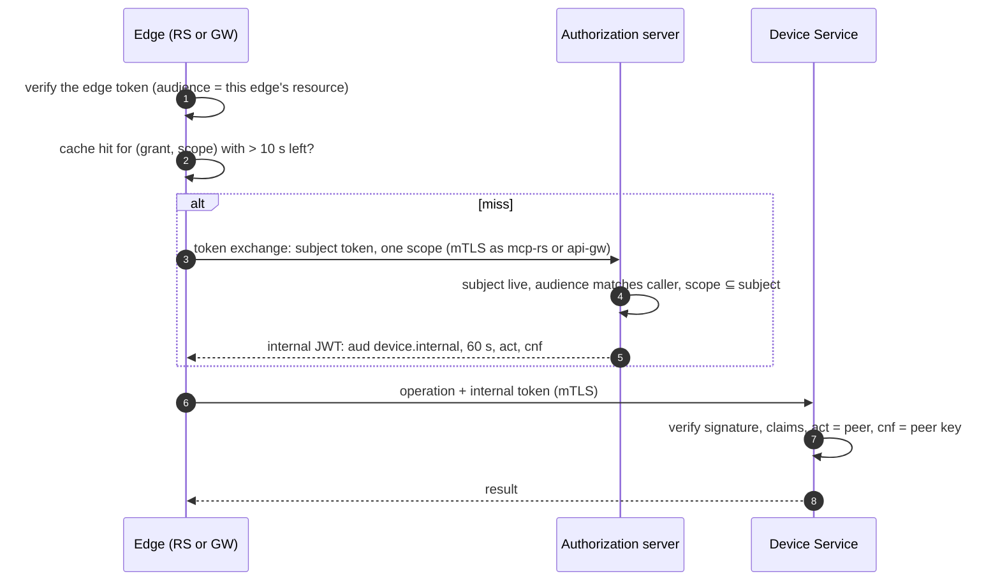

```json
{
  "header":  { "typ": "at+jwt", "alg": "ES256", "kid": "…" },
  "payload": {
    "iss": "https://auth.iot.example",
    "aud": "https://device.internal",
    "sub": "acc_…",
    "client_id": "https://claude.ai/oauth/mcp-oauth-client-metadata",
    "grant_id": "grant_…",
    "scope": "devices:control",
    "channel": "mcp",
    "auth_method": "oauth",
    "act": { "sub": "spiffe://iot-switch/mcp-rs" },
    "cnf": { "x5t#S256": "…" },
    "iat": 1792310400, "exp": 1792310460, "jti": "tb_…"
  }
}
```

| Check | Rule |
|---|---|
| Caller | The workload is `mcp-rs` or `api-gw` |
| Subject token | Live, and its audience matches the caller: the RS presents only MCP tokens, the GW only REST API tokens |
| Scope | **Exactly one** scope, which the subject already holds |
| Result | `aud = https://device.internal`, at most 60 s and never past the subject's own expiry, `act.sub` = caller, `cnf` bound to the caller |
| Never | A refresh token, a longer life than the subject, or a wider scope |

The exchange client caches by `(grant, scope)`, in memory, reuses an internal
token while more than 10 seconds remain, and drops every entry for a grant,
account or client the moment a revocation event names it.

A stolen internal token therefore works for at most a minute, for one scope,
and only from the workload it was issued to. Every Device Service action carries
the full chain (person, client, grant, adapter), so the audit answers "who
changed this, through what, from where" (R1, R2).

### 7.6 Rotating keys without downtime

| Key | Procedure |
|---|---|
| Internal-token signing | Rotate; the JWKS publishes both keys. The Device Service caches the JWKS for 10 minutes and refetches on an unknown `kid`, at most every 30 s |
| Token pepper | New version for new tokens; the previous one keeps verifying until its tokens expire |
| mTLS identities | Mesh-managed. The Device Service checks `cnf` against the presented certificate, so rotation needs no coordination |

### 7.7 Revocation and logout

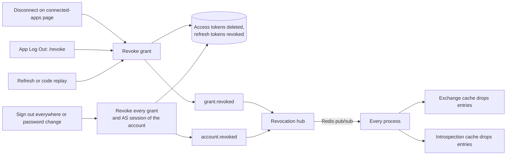

| Trigger | Revokes |
|---|---|
| Disconnecting an app on the connected-apps page | That app's grant |
| iOS Log Out | The app's grant only (requirement §7.2: separate sessions) |
| "Sign out everywhere" or a password change | Every grant and AS session of the account |
| Refresh replay outside the grace window, or code replay | The affected grant, with an alert |

Every revocation is visible on the next request. Edge tokens are verified live,
and in profile M the cached introspection answers and internal tokens for that
grant are dropped across processes within milliseconds.

### 7.8 Risks addressed by refresh and exchange

| Risk | Addressed by |
|---|---|
| R2 Passthrough | Token exchange at every boundary. The Device Service accepts only `aud = device.internal` |
| R3 Theft and replay | Rotation with reuse detection. DPoP-bound refresh. One-minute, workload-bound internal tokens |
| R11 Refresh races | Row lock, guarded update, idempotent 30 s window. The iOS client is single-flight and never signs out on network errors |
| R15 Key compromise | Rotation procedures. JWKS refetch on unknown keys |

---

## 8. Calling the MCP server and the REST API

### 8.1 Request anatomy

```http
POST /mcp HTTP/1.1
Host: mcp.iot.example
Content-Type: application/json
Accept: application/json, text/event-stream
Authorization: Bearer iotsw_at_…        (or "DPoP …" with a DPoP header when the host binds its token)
MCP-Protocol-Version: 2026-07-28

{"jsonrpc":"2.0","id":7,"method":"tools/call",
 "params":{"name":"control_device","arguments":{"deviceId":"dev_x","state":"on","expectedVersion":7}}}
```

A DPoP proof carries `htm` and `htu` for exactly this request, a fresh `jti`, an
`iat` within 60 s, `ath` (the base64url SHA-256 of the access token) and the
current server `nonce`. Credentials are accepted only in the `Authorization`
header.

### 8.2 The gate

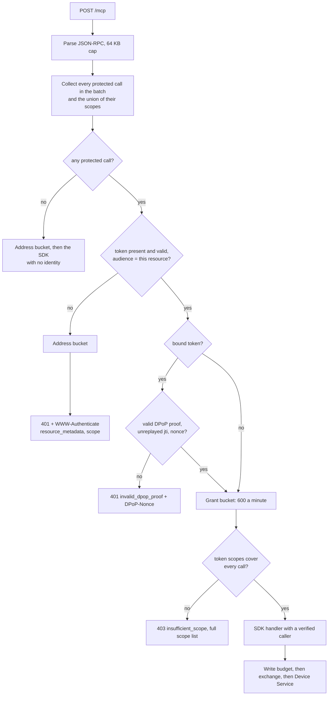

| Stage | Check | On failure |
|---|---|---|
| Body | `application/json`, at most 64 KB, a JSON-RPC shape | 400, 413 or 415 |
| Classifier | **Every** protected call in the body and the union of their scopes. Authorizing only the first call of a batch would let others ride in behind it | — |
| Unknown tools | A `tools/call` for a name missing from the policy table is treated as protected | Challenge |
| Credential | `Authorization: Bearer` or `DPoP`, header only | 401 challenge |
| Token | Live, audience exactly this resource | 401 `invalid_token` |
| DPoP | Required when the token has `cnf.jkt`. A bound token sent as `Bearer` is refused | 401 `invalid_dpop_proof` + `DPoP-Nonce` |
| Rate limit | 60 a minute per address until a token verifies, then 600 a minute per **grant**. A random bearer string cannot buy a fresh bucket | 429 `Retry-After` |
| Scope | The token's scopes cover every call | 403 `insufficient_scope` |
| Handler | Receives a verified caller only. The caller type is a discriminated union, so a protected handler cannot be given an anonymous caller without a compile error | — |
| Write budget | §8.5 | Tool error `RATE_LIMITED` |
| Exchange | An internal token for the call's single scope | 503 if the AS is unreachable. Never proceeds without one |

The REST API runs the same token, DPoP and scope checks in
`http/middleware.ts`, with DPoP mandatory (§4.6).

### 8.3 Challenges that work in both hosts

**The standard path: HTTP status.**

```http
HTTP/1.1 401 Unauthorized
WWW-Authenticate: Bearer error="invalid_token",
  resource_metadata="https://mcp.iot.example/.well-known/oauth-protected-resource/mcp",
  scope="devices:read devices:control devices:create offline_access"
```

```http
HTTP/1.1 403 Forbidden
WWW-Authenticate: Bearer error="insufficient_scope",
  scope="devices:read devices:control devices:create offline_access",
  resource_metadata="https://mcp.iot.example/.well-known/oauth-protected-resource/mcp"
```

**ChatGPT's tool-level challenge.** Every protected tool declares
`securitySchemes` in `tools/list`, which other hosts ignore. With
`CHATGPT_TOOL_CHALLENGE=trusted-header`, a request that a proxy we control has
marked as ChatGPT's (after verifying its mTLS client certificate) gets the same
refusal as a tool result carrying `_meta["mcp/www_authenticate"]`. Everything
else gets the HTTP 401. The header is otherwise forgeable, which is why it is
honoured only behind `TRUST_PROXY`.

### 8.4 Model-initiated and View-initiated calls

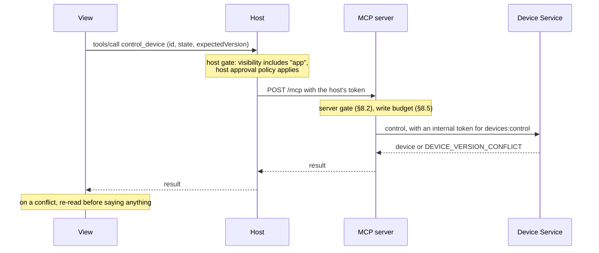

The server treats both identically: it cannot tell them apart, and does not
try. The server gate assumes the host gate may have been skipped; in practice
neither host confirms switch flips made inside the card.

The View's own rules for calls:

- Capture the device id, desired state and `expectedVersion` at tap time.
- Disable that one switch until the result arrives.
- On `DEVICE_VERSION_CONFLICT`, re-read before saying anything.
- On an unknown outcome, never send the inverse command.
- Never retry a write on the person's behalf after sign-in.

### 8.5 Tool policy and least privilege

| Tool | Visibility | Scope | Internal token scope | Annotations | Write budget |
|---|---|---|---|---|---|
| `list_devices` | model, app | `devices:read` | `devices:read` | read-only | — |
| `get_device` | model, app | `devices:read` | `devices:read` | read-only | — |
| `control_device` | model, app | `devices:control` | `devices:control` | not read-only, not destructive, not idempotent | 20 a minute per grant, 6 a minute per device |
| `add_device` | model, app | `devices:create` | `devices:create` | not read-only, not destructive, not idempotent | 10 an hour per grant |
| `get_auth_status` | app | none | none | read-only | — |
| `show_auth`, `show_add_device` | model, app | none | none | read-only | — |

Write budgets are the server's deterministic answer to prompt injection (R8). A
model steered by a hostile device name into flapping a switch, or into creating
hundreds of devices, hits a hard ceiling whatever the host's approval settings
say. Budgets are per grant, so one host's runaway agent cannot exhaust the iOS
app's allowance; the per-device limit holds across grants. The REST API answers
an exhausted budget with `429` and `Retry-After`. `WRITE_BUDGETS=report` logs
instead of refusing, for measuring a changed limit.

### 8.6 What the Device Service checks

1. In profile M, the mTLS peer is `mcp-rs` or `api-gw`.
2. Header: `typ = at+jwt`, `alg = ES256` only, `kid` in the cached JWKS.
3. Claims: `iss` = the AS, `aud` = `https://device.internal`, `exp` and `iat`
   within 30 s of skew, `act.sub` = the peer's identity, `cnf` = the peer's key
   or certificate.
4. `scope` covers the operation.
5. Identity = `{ accountId: sub, channel, clientId, grantId }`. Ownership is
   checked in SQL with `owner_id = sub`. The version check and the write are
   one statement.

### 8.7 Audit

Every mutation, and every refused attempt (version conflicts, policy refusals,
exhausted budgets), is written to `audit_events` with:

| Field | From |
|---|---|
| `actor_account_id` | `sub` |
| `client_id`, `grant_id` | The internal token |
| `channel` | `mcp` or `native` |
| `via` | The calling workload (`spiffe://iot-switch/mcp-rs` or `…/api-gw`) |
| `auth_method` | `oauth` or `oauth-dpop` |
| `device_id`, `action`, `old_state`, `new_state`, `outcome`, `request_id` | The operation |

Refusals are recorded after the transaction, so they are never rolled back.
Credentials never appear.

### 8.8 Fail-closed rules

- No identity fallback exists. A validator exception is a refusal (401 or 503),
  never an anonymous call on a protected path.
- If the AS is unreachable, introspection and exchange fail, so protected calls
  fail with 503. Public discovery keeps working.
- If Redis or PostgreSQL is unreachable, requests are refused quickly with 503
  (bounded connect and command timeouts), and service recovers by itself.
- An unknown tool name is not public by default.
- Handlers re-check that the caller is verified as a second line of defence.

### 8.9 Risks addressed when calling the server

| Risk | Addressed by |
|---|---|
| R2 Passthrough | Audience check at the gate. Token exchange before the Device Service |
| R3 Replay | DPoP `jti`, `ath` and nonce. Short-lived tokens |
| R4 State-handle hijacking | Stateless MCP. Identity only from the token. Device ids checked against `owner_id = sub` |
| R8 Prompt injection | Per-tool scopes, narrowed internal tokens, write budgets, honest annotations |
| R12 Limit evasion | Address buckets until verification, grant buckets after |
| R13 Fail-open | Discriminated caller type. No fallback identity. Unknown tools are protected |

---

## 9. Risk-to-control matrix

| Risk | AS | RS / GW | DS | View | iOS | Infrastructure |
|---|---|---|---|---|---|---|
| R1 Confused deputy | Per-client consent, DCR never remembered | — | `act` chain audited | — | — | — |
| R2 Passthrough | Exchange policy | Audience check, no forwarding | Accepts only `device.internal` | — | — | — |
| R3 Theft and replay | PKCE, single-use code, `iss`, rotation, DPoP binding | DPoP verification | Workload-bound internal token | Holds nothing | Secure Enclave key, memory-only access token | TLS, token prefixes |
| R4 Hijacking | Pending authorization bound to cookie, `__Host-` session | Stateless, identity from token | `owner_id = sub` | — | — | — |
| R5 SSRF | CIMD rules | — | — | — | — | — |
| R6 Consent phishing | Trust classes, client and redirect host shown | — | — | No sign-in UI | The system sheet shows the domain | — |
| R7 Clickjacking | `frame-ancestors 'none'`, fresh sign-in for writes | — | — | — | — | — |
| R8 Prompt injection | Scopes | Policy table, write budgets | Narrow internal token | No `ui/message` | — | — |
| R9 postMessage | — | — | — | Pinned origin, source and shape checks | — | — |
| R10 Credentials in Views | Sign-in only on its own origin | — | — | No forms | `ASWebAuthenticationSession` | — |
| R11 Refresh races | Row lock, idempotent window | Single re-exchange | — | — | Single-flight | — |
| R12 Limit evasion | Throttles on every credential endpoint | Address until verified, then grant | — | — | — | Shared buckets in Redis |
| R13 Fail-open | Exceptions refuse | Discriminated caller | Validation checklist | — | — | Outages are 503 |
| R14 Database leak | HMAC under a pepper | No database access in profile M | — | — | — | — |
| R15 Key compromise | KMS, rotation | JWKS refetch | `kid` checks | — | Per-sign-in key | KMS-held signing keys |
| R16 Enumeration | Generic errors, decoy hash, passkeys | — | — | — | — | — |

---

## 10. Design decisions

| ID | Decision | Alternatives considered | Why |
|---|---|---|---|
| ADR-1 | Opaque edge tokens verified on every request | JWT access tokens validated locally | Requirement §7.1 needs immediate revocation. Opaque tokens leak nothing if logged |
| ADR-2 | A one-minute JWT internal token via exchange at each boundary | Pass the edge token to the Device Service. Share a database session | Passthrough is forbidden. Exchange narrows scope per call and records `act` |
| ADR-3 | Views never hold credentials | A View running its own OAuth | Brings back browser-token risks with no benefit. Everything a View needs is served by app-visible tools |
| ADR-4 | DPoP mandatory for the app, optional for hosts | Mandatory everywhere. Bearer everywhere | Neither host sends DPoP, so requiring it would lock hosts out. The app is ours, with a Secure Enclave |
| ADR-5 | A 30 s idempotent refresh window with sealed responses | No grace (false revocations). A grace that forks the family | Keeps the family linear, survives lost responses, and is harmless for DPoP-bound grants |
| ADR-6 | The app signs in in the system browser sheet, not a native form | A native password form. The first-party-apps draft | RFC 8252, passkeys, and no credential handling in app code |
| ADR-7 | Three device scopes up front, narrowed per call by exchange | A minimal initial scope with step-up | Keeps requirement §7.3's usability decision while restoring least privilege at the hop that matters |
| ADR-8 | Separate origins for AS, RS and GW | One origin, path-separated | Cookie isolation, independent CSP and framing policy |
| ADR-9 | Passkeys alongside passwords | Passwords only | Phishing-resistant, and removes the credential-stuffing surface for those who use them |

---

## Appendix A: Metadata documents

**Protected Resource Metadata:** `https://mcp.iot.example/.well-known/oauth-protected-resource/mcp`
(also served at the bare well-known path)

```json
{
  "resource": "https://mcp.iot.example/mcp",
  "authorization_servers": ["https://auth.iot.example"],
  "scopes_supported": ["devices:read", "devices:control", "devices:create", "offline_access"],
  "bearer_methods_supported": ["header"],
  "dpop_signing_alg_values_supported": ["ES256", "EdDSA"],
  "dpop_bound_access_tokens_required": false
}
```

**Authorization Server Metadata:** `https://auth.iot.example/.well-known/oauth-authorization-server`
(`/.well-known/openid-configuration` redirects to it)

```json
{
  "issuer": "https://auth.iot.example",
  "authorization_endpoint": "https://auth.iot.example/authorize",
  "token_endpoint": "https://auth.iot.example/token",
  "revocation_endpoint": "https://auth.iot.example/revoke",
  "pushed_authorization_request_endpoint": "https://auth.iot.example/par",
  "jwks_uri": "https://auth.iot.example/.well-known/jwks.json",
  "registration_endpoint": "https://auth.iot.example/register",
  "scopes_supported": ["devices:read", "devices:control", "devices:create", "offline_access"],
  "response_types_supported": ["code"],
  "response_modes_supported": ["query"],
  "grant_types_supported": ["authorization_code", "refresh_token"],
  "code_challenge_methods_supported": ["S256"],
  "token_endpoint_auth_methods_supported": ["none"],
  "client_id_metadata_document_supported": true,
  "authorization_response_iss_parameter_supported": true,
  "dpop_signing_alg_values_supported": ["ES256", "EdDSA"],
  "revocation_endpoint_auth_methods_supported": ["none"]
}
```

The internal endpoints (`/introspect`, `/token-exchange`, `/account`) are not
advertised. In profile M they listen on the AS's internal port only and require
mTLS.

## Appendix B: Configuration

| Setting | Default | Notes |
|---|---|---|
| Host access token | 3600 s | |
| `NATIVE_ACCESS_TOKEN_TTL_SECONDS` | 600 | The app's access token |
| Internal token | 60 s | |
| Refresh token | 30 days | Rotated on every use |
| `REFRESH_GRACE_SECONDS` | 30 | Idempotent window |
| Code / pending authorization / PAR | 60 s / 15 min / 60 s | |
| AS session | 30 min idle / 12 h absolute | |
| Fresh sign-in for write consent | 15 min | |
| DPoP `iat` skew / `jti` memory / nonce | 60 s / 120 s / 5 min | |
| Introspection cache (profile M) | 30 s | Dropped on any revocation event |
| CIMD timeout / size / cache | 5 s / 5 KB / 24 h | |
| `AUTH_RATE_LIMIT_PER_MINUTE` | 20 | Credential submissions per address |
| `AUTHORIZE_VIEW_RATE_LIMIT_PER_MINUTE` | 60 | Authorization page views per address |
| `WRITE_BUDGETS` | `enforce` | `report` logs instead of refusing |
| `CHATGPT_TOOL_CHALLENGE` | `off` | `trusted-header` behind a proxy that verifies ChatGPT's certificate |
| `REQUIRE_OFFLINE_ACCESS_FOR_REFRESH` | `false` | |
| `KNOWN_CLIENTS` | Claude's and ChatGPT's CIMD URLs | Shown as verified |
| `TRUST_PROXY` | unset | Only behind a proxy we control |
