# IoT Switch Authentication Architecture v2

**Status:** Proposed · **Date:** 18 October 2026 · **Replaces:** §5 and §6 of [`docs/architecture.md`](../architecture.md) once adopted · **Evidence base:** [MCP Apps authentication security](../../reports/MCP%20Apps%20authentication%20security.md) (research report, sources current to 17 October 2026)

This document redesigns how IoT Switch authenticates people, clients and services. It combines the layered approaches from the research report into one architecture, then follows a token through its whole life:

1. how the **first token** is obtained,
2. how tokens are **kept** safe,
3. how tokens are **refreshed and exchanged** without user involvement, and
4. how the **MCP server is called** with them.

Hostnames such as `auth.iot.example` are placeholders. Each control is labelled **[Now]** (fixes a gap in the current code), **[Core]** (part of the target design) or **[Optional]** (enabled per deployment or tenant).

---

## 1. Summary

The current server already gets the fundamentals right: an audience-bound resource server, PKCE S256, CIMD with a DCR fallback, a gate that runs at the HTTP layer, opaque tokens checked on every request, and Views that never see a token. The redesign keeps all of that and adds four things the research shows a production MCP App needs.

1. **Separate origins and a real consent step.** The authorization server moves to its own hostname. It gets a framing-proof login page, passkeys, a per-client consent registry and an AS browser session.
2. **Tokens bound to keys.** DPoP is mandatory for the iOS app and accepted from any host that presents it. Internal tokens are bound to the calling workload's mTLS certificate.
3. **Token exchange at every trust boundary.** Neither edge adapter (MCP or REST) forwards the token it received. Each one exchanges it for a 60-second internal token whose audience is the Device Service, narrowed to the one scope the operation needs.
4. **Refresh that cannot fork or false-alarm.** Refresh-token rotation is atomic. A 30-second idempotent replay window lets concurrent refreshes or a lost response succeed. A replay outside it revokes the whole grant.

### Eight rules the design never breaks

| # | Rule | Why |
|---|---|---|
| 1 | The View never authenticates and never holds a credential. | A View is the least-trusted code in the system and can speak as the user. |
| 2 | Credentials are typed only in a top-level window on `auth.iot.example`. | RFC 8252 and OAuth 2.1 forbid embedded user agents for login. |
| 3 | Every token has exactly one audience, and every receiver checks it. | This defeats token passthrough and token redirection. |
| 4 | No token crosses a trust boundary unchanged. | CoSAI: "perform token exchange at every trust boundary". |
| 5 | Tokens are bound to a key wherever the client can hold one. | A stolen bearer token works for anyone; a bound token does not. |
| 6 | Refresh is rotating, atomic and theft-detecting. | It is required for public clients (MCP 2026-07-28, RFC 9700). |
| 7 | Every request is verified, nothing fails open, and no session is identity. | This is the lesson of LiteLLM CVE-2026-59822 and of MCP's state-handle hijacking. |
| 8 | Least privilege is enforced by the server, whatever the host prompts. | Host approval of View-initiated calls is a MAY in the spec. |

### Which research approaches are combined, and how

| Approach (research report) | Role here | Sections |
|---|---|---|
| 1. Audience-bound resource server | Foundation for every edge request | §5, §8 |
| 1b. Client ID Metadata Documents | Primary client identity; DCR kept, hardened, until it can be removed after July 2027 | §5.2 |
| 2. Host-mediated View authentication | The only way a View reaches protected data | §5.9, §8.4 |
| 2b. Double-iframe sandbox and CSP | View bridge hardening on our side of the boundary | §6.7, §8.4 |
| 3. Credentials held by the View | **Rejected** | §10, ADR-3 |
| 4c. Token exchange (RFC 8693) | Every hop from an edge adapter to the Device Service | §7.6 |
| 4b. URL-mode elicitation and token vault | Reserved for future third-party device clouds | §7.8 |
| 5. Enterprise-Managed Authorization (ID-JAG) | Optional path for enterprise tenants | §5.8 |
| 6. Machine and local credentials | No machine clients; local-development rules only | §4.9 |
| 7. DPoP, mTLS and rotation | DPoP for iOS (mandatory) and hosts (when offered); mTLS internally; atomic rotation | §6, §7 |
| *Beyond the report:* passkeys (WebAuthn) | Phishing-resistant primary login at the authorization server | §5.4 |

---

## 2. Scope and threat model

### Goals

- Authenticate people for two client families: AI hosts (Claude, ChatGPT and any MCP host) and the first-party iOS app.
- Keep the guarantee from requirement §3: one account directory, one set of device rules, and no copy of a user's devices per surface.
- Satisfy the MCP authorization specification revision 2026-07-28 and the MCP Apps extension (stable 2026-01-26).
- Make the theft of any single artefact (token, database row, device, View) insufficient to act as the user for long.

### Non-goals

- Controlling how a host stores its tokens. We design to limit the damage if a host's store leaks.
- Machine-to-machine clients. Neither consumer host supports `client_credentials`.
- Third-party device clouds. The pattern is reserved in §7.8 but not built.

### Assets

| Asset | Why it matters |
|---|---|
| Account credentials: passwords, passkey private keys (on the user's devices) | Full account takeover |
| Edge tokens A (host) and N (iOS), and their refresh tokens | Act as the user until expiry or revocation |
| Internal token B | Act on the Device Service for 60 seconds |
| Signing keys and token-hash peppers | Mint or recognise any token |
| Device state and the audit log | The product's actual data, and the evidence of who changed it |

### Adversaries

| Adversary | Capability assumed |
|---|---|
| Internet attacker | Sends any HTTP request and registers OAuth clients through DCR or a CIMD URL it controls |
| Malicious website | Frames our pages, opens popups, posts messages to windows it can reach |
| Hostile content | Device names and other user-controlled strings rendered in a View or read by the model (prompt injection) |
| Malicious MCP client | Completes the OAuth flow under a misleading name and redirect URI |
| Compromised host token store | Holds valid token A and refresh tokens for many users |
| Stolen or jailbroken phone | Reads app memory and Keychain items, but cannot extract Secure Enclave keys |
| Insider or database leak | Reads tables in the auth or device database |
| Network attacker | Sits on a hostile Wi-Fi network, but TLS holds |

### Risks tracked

These are the research report's ten risks plus six that arise in this codebase.

| ID | Risk | ID | Risk |
|---|---|---|---|
| R1 | Confused deputy | R9 | iframe and postMessage abuse |
| R2 | Token passthrough | R10 | Credential entry in Views |
| R3 | Token theft and replay | R11 | Refresh races causing a forked family or false revocation |
| R4 | Session and state-handle hijacking | R12 | Rate-limit evasion and resource exhaustion |
| R5 | SSRF via metadata discovery | R13 | Fail-open validation |
| R6 | Consent phishing | R14 | Database leak of token tables |
| R7 | Clickjacking | R15 | Signing-key or pepper compromise |
| R8 | Prompt injection driving tool calls | R16 | Account enumeration and credential stuffing |

---

## 3. High-level architecture

### 3.1 System context


Five external parties talk to four IoT Switch components:

- the **person**,
- the **AI host** (a third-party OAuth client that renders our Views),
- the **iOS app** (a first-party OAuth client),
- an optional **enterprise IdP**, and
- the person's **browser**, which is the only place credentials are typed.

The four IoT Switch components are:

- **Authorization Server (AS):** the only component that sees credentials, and the only issuer of tokens.
- **MCP Resource Server (RS):** the MCP endpoint, which accepts only tokens whose audience is `https://mcp.iot.example/mcp`.
- **REST API Gateway (GW):** the iOS app's endpoint, which accepts only DPoP-bound tokens whose audience is `https://api.iot.example`.
- **Device Service (DS):** the one implementation of device rules. It is reachable only from RS and GW, only over mTLS, and only with an internal token B.

The structural guarantee from the current design survives. Both edges call the same Device Service, which takes a verified identity and never an HTTP request or tool call. That keeps the two surfaces from drifting apart.

### 3.2 Trust zones


| Zone | Contents | Trust | What may cross out of it |
|---|---|---|---|
| 0: user device | Browser top-level window, host page, sandbox proxy, View, iOS app | Untrusted | Typed credentials (top-level window only), DPoP-bound token N, postMessage carrying no credentials |
| 1: host cloud | Host MCP client and its token store | Trusted by the user, not by us | Token A, refresh tokens, the PKCE verifier (to our token endpoint only) |
| 2: public edge | CDN, WAF, TLS termination | Ours, Internet-facing | Requests to exactly three hostnames |
| 3: identity | AS, Auth DB, KMS access | Most sensitive | Tokens, metadata, introspection results |
| 4: resource | RS, GW, Redis | Ours, holds no long-lived secrets | Token B to the Device Service only |
| 5: core | Device Service, Device DB, audit store | Ours, not Internet-reachable | Nothing outward |

Two placement decisions carry most of the weight.

- **The AS gets its own origin.** Its login cookie (`__Host-as_session`) can then never be sent to, or read by, the MCP or API origins. Its pages can carry a strict CSP and `frame-ancestors 'none'` without affecting anything else.
- **The Device Service is not reachable from the edge.** A request that skips the edge adapters, for example through SSRF from a compromised dependency, still needs a valid token B and a client certificate from the mesh.

### 3.3 Token landscape


| Token | Issued by → to | Audience | Lifetime | Bound to | Format | Lives where |
|---|---|---|---|---|---|---|
| AS session | AS → browser cookie | AS only | Idle 30 min, absolute 12 h | Browser cookie jar | Opaque, HMAC'd at rest | `__Host-as_session` cookie |
| Pending authorization / PAR handle | AS → browser or iOS | AS | 10 min / 60 s | `__Host-` cookie for browser flows | Opaque | Auth DB (HMAC) |
| Authorization code | AS → client via browser | AS token endpoint | 60 s, single use | client_id, redirect_uri, PKCE challenge, resource, `dpop_jkt` | Opaque | Auth DB (HMAC) |
| **Token A** (host access) | AS → host | `https://mcp.iot.example/mcp` | 15 min | DPoP key if the host offers one, else bearer | Opaque reference | Host backend. Auth DB (HMAC) |
| Host refresh token | AS → host | AS | Idle 14 d, family 30 d | client_id (+ DPoP key) | Opaque, rotating | Host backend. Auth DB (HMAC) |
| **Token N** (iOS access) | AS → iOS | `https://api.iot.example` | 10 min | DPoP key in Secure Enclave, always | Opaque reference | iOS memory only. Auth DB (HMAC) |
| iOS refresh token | AS → iOS | AS | Idle 14 d, family 30 d | DPoP key, always | Opaque, rotating | Keychain (this device only). Auth DB (HMAC) |
| **Token B** (internal) | AS → RS or GW (exchange) | `https://device.internal` | 60 s | Caller's mTLS certificate (`cnf.x5t#S256`) | JWT, `typ: at+jwt`, ES256 | RS/GW memory cache only |
| ID-JAG | Enterprise IdP → host | AS issuer | ≤ 5 min | Client ID named in it | JWT (IdP-signed) | Never stored. `jti` remembered for replay |

**Why the edge tokens are opaque and the internal token is a JWT.** Requirement §7.1 needs logout to stop tokens that were already issued, and to stop them immediately. Opaque reference tokens give that on every check. Token B lives for 60 seconds, is minted only after a live edge check, and is verified by the Device Service on every call. A short-lived signed JWT is the right trade there: no Device Service call has to wait on the AS.

### 3.4 Deployment


Two deployment profiles share the same code and the same token formats.

| | Profile S: single process | Profile M: split services |
|---|---|---|
| Fits | Today's repository, development, small production | Production at scale |
| Process layout | One Node process serving three hostnames by `Host` header; AS, RS, GW and DS as modules | Separate deployments per component |
| Token validation | RS and GW call the AS module's `introspect()` in-process (direct DB, no cache) | RS and GW call `/introspect` over mTLS, with a ≤ 5 s cache for reads only |
| Token exchange | In-process call that still mints and verifies a real token B | `/token-exchange` over mTLS |
| mTLS to DS | Replaced by an in-process capability object; token B still verified | Service-mesh mTLS (SPIFFE-style identities) |
| Database | One Postgres instance, separate schemas and roles | Separate databases for auth and devices |

Profile S keeps the module boundaries honest. The Device Service module accepts only a verified token B, even in-process, so moving to Profile M changes transport, not trust.

---

## 4. Components

Each component is described by what it does, what it holds, what it trusts, and how it fails. **Everything fails closed:** an exception in any authentication step produces a refusal, never a request with an empty or default identity.

### 4.1 Host MCP client (external: Claude, ChatGPT)

| | |
|---|---|
| Does | Discovers our AS from the 401, runs authorization code + PKCE S256 in a top-level window, stores tokens in its backend, forwards View `tools/call` requests over its own connection |
| Holds | Token A, refresh token, PKCE verifier, DPoP key (if it uses DPoP) |
| We rely on | Exact `iss` and `state` comparison; `resource` on authorize and token requests; never exposing tokens to Views |
| Known behaviour | Claude: CIMD only if we advertise `client_id_metadata_document_supported` **and** `none` auth; refreshes reactively on 401 and proactively up to 5 min before expiry; callback `https://claude.ai/api/mcp/auth_callback`; egress from `160.79.104.0/21`. ChatGPT: CIMD client `https://chatgpt.com/oauth/client.json`; callback `https://chatgpt.com/connector_platform_oauth_redirect`; rejects mismatched `iss`; optional mTLS client certificate with SAN `mtls.prod.connectors.openai.com` |
| Unknowns | Whether either host sends DPoP proofs. Whether View-initiated calls get the same approval prompts as model calls. Whether a plain HTTP 401 starts ChatGPT's account linking. See §14 |

### 4.2 Sandbox proxy (external) and MCP App View (ours)

The host renders each View in an inner iframe behind a sandbox proxy on a separate origin. Our View code is responsible for its side of the channel.

| | |
|---|---|
| Does | Renders data from tool results, sends `tools/call` through the host bridge, requests display modes and links |
| Holds | Nothing secret. No token, no code, no verifier, no identity in storage |
| Controls | Inline-only assets with an empty `_meta.ui.csp`, so no external origin is reachable. `event.source === window.parent` on every inbound message. **Pinned target origin** for every outbound message after the handshake (see §6.7). Schema check on every inbound message. `textContent` only. No `ui/message` and no `ui/update-model-context` |
| Fails | Any unexpected message is dropped. A handshake timeout shows "Could not reach the host" and nothing else |

### 4.3 iOS auth module (ours)

| Sub-component | Responsibility |
|---|---|
| `AuthCoordinator` | Runs PAR → `ASWebAuthenticationSession` → code exchange (§5.7). Owns sign-in and sign-out. |
| `DPoPKeyManager` | Creates and loads the Secure Enclave P-256 key, computes its JWK thumbprint, signs DPoP proofs, and tracks the server nonce. |
| `TokenStore` | Keeps token N in memory and the refresh token in the Keychain (§6.5). |
| `RefreshCoordinator` | Single-flight, proactive refresh. Separates "server rejected" from "network failed" (§7.5). |
| `APIClient` | Attaches `Authorization: DPoP <N>` and a fresh `DPoP` proof to each request. Retries once on `use_dpop_nonce`. |

It holds token N (memory), the refresh token (Keychain) and a non-exportable signing key (Secure Enclave). It fails by signing out **only** when the AS says `invalid_grant`. A transport failure keeps the session and reports "offline".

### 4.4 Edge

- **[Core]** TLS 1.3 only, HSTS with preload, and three hostnames: `auth.`, `mcp.` and `api.iot.example`.
- **[Core]** WAF rules against obvious abuse. Body size capped at the edge as well as in the app.
- **[Core]** Strips any inbound `X-Verified-*` headers. Then sets `X-Verified-Client: chatgpt` **only** when the TLS client certificate validates and carries SAN `mtls.prod.connectors.openai.com`. The challenge adapter (§8.3) keys off this header.
- **[Optional]** Bot management on `auth.` for sign-up.

### 4.5 Authorization Server


| Sub-component | Responsibility | Key controls |
|---|---|---|
| **Metadata** | RFC 8414 document, OIDC discovery alias, JWKS for token B | `issuer` equals the URL it is fetched from. Advertises exactly what is enforced (Appendix A) |
| **PAR endpoint** (RFC 9126) | Accepts authorization parameters by back channel and returns a 60 s `request_uri` | Required for the first-party iOS client. Optional for hosts |
| **Authorization endpoint** | Validates the request once, creates a pending authorization, renders login or consent | Rules in §5.3. Errors go to our own page until `redirect_uri` is proven valid, so it is never an open redirector |
| **Client registry** | Resolves `client_id` to redirect URIs and a trust class | CIMD resolver behind the egress proxy (§5.2). Pre-registered clients. DCR (deprecated) with caps and eviction |
| **Authenticator** | Verifies the person | Passkeys first. Password (Argon2id + pepper) with optional TOTP. Generic errors. Per-account and per-IP throttles |
| **AS session manager** | `__Host-as_session` cookie | `Secure; HttpOnly; SameSite=Lax; Path=/`. Idle 30 min, absolute 12 h. Rotated on login. Stored as HMAC |
| **Consent service** | Shows and records what is granted, per client | Per-user registry of approved clients. Shows the client host, redirect host and scopes. Re-authentication for write scopes on stale sessions (§5.5) |
| **Code service** | Issues and redeems codes | 60 s, single use, atomic consume, every binding stored (§5.6) |
| **Token endpoint and grant handlers** | `authorization_code`, `refresh_token`, `urn:ietf:params:oauth:grant-type:jwt-bearer` (ID-JAG), token exchange (internal only) | Form-encoded. `Cache-Control: no-store`. A `client_id` is required even for public clients |
| **DPoP verifier** (RFC 9449) | Validates proofs at the token endpoint | `typ: dpop+jwt`, ES256/EdDSA only, `htm`/`htu` match, `iat` ±60 s, `jti` unique for 120 s, server nonce |
| **Token minter** | Creates opaque tokens and signs token B | 256-bit randomness. Typed prefixes. HMAC at rest. JWTs signed by KMS keys |
| **Introspection** (RFC 7662) | Tells RS and GW whether a token is live | mTLS-authenticated callers only, so it is not a token-scanning oracle |
| **Token exchange** (RFC 8693) | Edge token → token B | Only RS and GW workloads may call it. Scope can only narrow (§7.6) |
| **Revocation** (RFC 7009) + event publisher | Kill switch per token or grant | Always answers 200. Publishes `grant.revoked` so caches drop |
| **Rate limiter and risk engine** | Throttles every credential-bearing and resource-creating endpoint | Keys described in §8.2. Never keyed by an unverified token |

### 4.6 MCP Resource Server


The RS is an adapter. It validates, translates and exchanges, but **it holds no business rules and no long-lived secrets**. Its stages are specified in §8.2. Its other parts:

- **Protected Resource Metadata** at `/.well-known/oauth-protected-resource/mcp` and at the bare path.
- **Challenge adapter**, which formats refusals for the caller (§8.3).
- **Tool policy engine**, a deterministic table of tool → scope → write budget (§8.6).
- **Exchange client** with the token B cache.
- **UI resource server**, which serves the four `ui://` templates. They are static, identical for every user, and readable without a token.

### 4.7 REST API Gateway

It runs the same pipeline as the RS with three differences:

- **DPoP is mandatory:** `dpop_bound_access_tokens_required: true` for the `api` resource.
- **Challenges are always HTTP.** There is no host adapter.
- **Rate limits** are keyed by grant, not by IP, so users behind one NAT don't share a budget.

It replaces today's `/v1/auth/*` endpoints with the AS (§11) and keeps `/v1/devices/*`.

### 4.8 Device Service

- It accepts calls only over mTLS from the RS or GW workload identities, and only with a valid token B.
- **Validation checklist** (§8.7): `typ`, `alg`, `kid`, `iss`, `aud`, `exp`, `scope`, that `act.sub` equals the peer identity, and that `cnf.x5t#S256` equals the peer certificate.
- It derives the `Identity` from `sub`, never from a request field. That keeps requirement §7.2's "do not authorize by … a device owner parameter".
- Every mutation writes an audit record inside the same transaction (§8.8).

### 4.9 Shared infrastructure

| Component | Role | Controls |
|---|---|---|
| Auth DB | Accounts, credentials, clients, consents, grants, token HMACs | Separate schema and roles. RS, GW and DS roles have **no** access. Encrypted at rest |
| Device DB | Devices, idempotency keys | Only the DS role can write |
| Redis | Rate-limit buckets, DPoP `jti` and nonces, introspection cache (Profile M), sealed refresh responses | TLS, AUTH, no persistence for sealed responses, key TTLs everywhere |
| KMS / HSM | Token-hash pepper keys, password pepper, ES256 signing keys, sealing key | Non-exportable keys. Rotation in §6.4. Access logged |
| Egress proxy | The only route from the AS to the Internet (CIMD, IdP JWKS) | Denies private, loopback, link-local, CGNAT, NAT64 and multicast ranges after resolution. Pins the resolved address |
| Revocation bus | Pub/sub of `grant.revoked`, `account.revoked` and `client.blocked` | At-least-once delivery. Consumers are idempotent |
| Audit store | Append-only, write-once storage | Records are hashed per batch so tampering is detectable |
| Local development | No machine clients, so no static keys | `localhost` binding only, `Origin` and `Host` checks, never `0.0.0.0` |

---

## 5. Phase 1: receiving the first token securely

### 5.1 Host flow (Claude, ChatGPT and any MCP host)

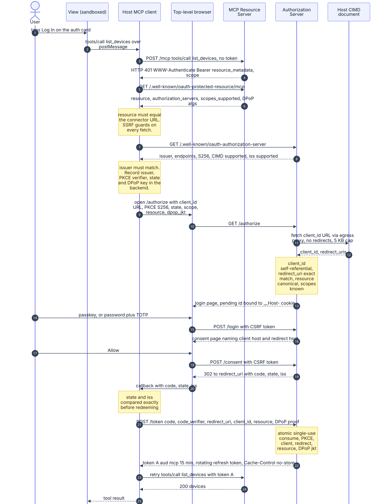

The table walks the diagram's steps and names the control that makes each one safe.

| Steps | What happens | Control | Risk closed |
|---|---|---|---|
| 1–2 | User taps **Log In** on the `show_auth` card. The View calls `list_devices`, a read-only protected tool | The View never shows a form and never initiates with a mutation (req. §7.4) | R10, R8 |
| 3–4 | RS answers **HTTP 401** with `WWW-Authenticate: Bearer resource_metadata=…, scope="devices:read devices:control devices:create offline_access"` | The challenge comes from the HTTP layer before the MCP SDK runs. The `scope` hint avoids Claude's request-everything fallback | R13 |
| 5–6 | Host fetches Protected Resource Metadata | `resource` equals the connector URL exactly, including `/mcp` | R2 |
| 7–8 | Host fetches AS metadata | `issuer` equals `https://auth.iot.example`. `code_challenge_methods_supported: ["S256"]` is present | R3 (mix-up) |
| 9 | Host opens `/authorize` in a **top-level** browser | It carries `client_id` (CIMD URL), PKCE S256, `state`, `scope`, `resource=https://mcp.iot.example/mcp`, and `dpop_jkt` if the host uses DPoP | R10, R7 |
| 10–12 | AS resolves the CIMD document (§5.2) | Egress proxy, no redirects, 5 KB cap, self-referential `client_id`, exact `redirect_uri` | R5, R6 |
| 13 | AS creates a **pending authorization** and binds it to the browser | Opaque id, 10 min. A `__Host-pa` cookie ties it to this browser, so a link to someone else's pending id cannot be completed in another browser | R4 |
| 14–16 | User authenticates (§5.4) | Passkey or password + TOTP, `frame-ancestors 'none'`, CSRF token | R7, R16 |
| 16–18 | Consent (§5.5) names the **client host**, **redirect host** and scopes | Per-client registry. Unverified clients are flagged. Loopback-only clients get a warning | R1, R6 |
| 19–20 | AS redirects `302` with `code`, `state`, `iss` | `iss` is always present (RFC 9207). `302`, never `307`, so form bodies are not re-sent | R3 (mix-up) |
| 21–22 | Host redeems the code | Atomic single use. PKCE verified in constant time. Client, redirect, resource and DPoP key must match what was authorized | R3 |
| 22 | AS returns token A (aud `mcp`, 15 min) and a rotating refresh token | `Cache-Control: no-store`. `token_type: DPoP` when bound | R3 |
| 23–25 | Host retries `list_devices` and returns the result to the View | The View receives data, never the token | R10 |

### 5.2 Resolving client identity


The AS resolves `client_id` before anything is sent to a redirect URI. It sorts every client into a **trust class** that the consent page shows.

| Trust class | How it is reached | Consent page shows | Remembered consent |
|---|---|---|---|
| Verified | CIMD URL on our allowlist of known hosts: `https://chatgpt.com/oauth/client.json`, Claude's CIMD URL, and the iOS app (pre-registered) | Host name and a "verified" badge | Yes, same client, redirect host and scope set or narrower |
| Unverified CIMD | Any other `https://` `client_id` whose document validates | Host of the `client_id` URL in bold, an "unverified application" warning, and the redirect host | Yes, but re-asked after 30 days |
| DCR (deprecated) | `client_` id from `/register` | "Unverified application" and the **full redirect URI**. The self-asserted name is never shown alone | **Never.** Consent is asked every time |

CIMD fetch rules, from the CIMD draft -02 and MCP security best practices:

- **[Core]** HTTPS only, `client_id` at most 2 KB, no fragment.
- **[Core]** Resolve through the egress proxy and reject if **any** resolved address is private, loopback, link-local, CGNAT, NAT64 (`64:ff9b::/96`), unique-local, the whole of `fe80::/10`, `198.18.0.0/15` or multicast. Use a vetted IP-range library, not hand-written parsing. Connect to the checked address, with TLS SNI set to the hostname.
- **[Core]** No redirects. 5 s timeout. 5 KB response cap. JSON only.
- **[Core]** The document's `client_id` must equal the URL exactly. `redirect_uri` must appear exactly in `redirect_uris`. Loopback URIs match with the port ignored, per RFC 8252 §7.3.
- **[Core]** Cache by HTTP cache headers, for at most 24 h. A changed document invalidates remembered consent for that client.
- **[Core]** Redirect schemes: `https`, loopback `http`, or a reverse-DNS private-use scheme. Never `javascript:`, `data:`, `file:` or any other scheme.

DCR hardening, kept until DCR can be removed in the first MCP revision on or after 28 July 2027:

- **[Now]** Rate limit `/register` by IP. **[Core]** Global cap with eviction of clients that never completed a grant (already implemented).
- **[Core]** A registered `redirect_uri` must pass the same scheme rules. Store `application_type`, which MCP 2026-07-28 requires DCR clients to send.
- **[Core]** DCR clients are always "unverified" and never get remembered consent. That removes the precondition of the confused-deputy attack (an attacker reusing cached consent).

### 5.3 Authorization request validation

The checks run in this order. Before step 3 passes, every error renders on our own page. After it, errors go back to the validated `redirect_uri` with `iss` attached.

1. Resolve `client_id` (§5.2). If it is unknown, show the error page.
2. Check `redirect_uri` against the client's list. If it doesn't match, show the error page and **never redirect**.
3. Check that `response_type` is `code`. Otherwise return `unsupported_response_type`.
4. Check that `code_challenge_method` is `S256` and the challenge is 43–128 characters. Otherwise return `invalid_request`. `plain` is never accepted. If a token request later carries a verifier for an authorization that had no challenge, it is refused, per RFC 9700.
5. Check that `resource` equals the RS or GW canonical URI exactly. Otherwise return `invalid_target`. The resource is required. We do not default it.
6. Keep only known scopes. If none remain, return `invalid_scope`. `offline_access` controls whether a refresh token is issued.
7. `state` may be at most 2 KB. It is stored server-side and echoed back.
8. If `dpop_jkt` is present, it is stored and later enforced at the token endpoint.
9. For the iOS client, the request **must** arrive through PAR. Front-channel parameters are ignored.

### 5.4 Login

- **[Core] Passkeys first** (WebAuthn, `userVerification: required`). A passkey cannot be phished onto a look-alike domain, because it is bound to `auth.iot.example`. It also replaces the shared secret that credential-stuffing attacks need. Store only the public key, credential id and sign count.
- **[Core] Password fallback.** Argon2id (m = 64 MiB, t = 3, p = 1), applied to an HMAC of the password under a KMS-held pepper. A stolen hash database alone then cannot be brute-forced offline. Keep requirement §7.2's length rules and add a breached-password check at sign-up and password change.
- **[Optional] TOTP** as a second factor for password logins. Required before granting `devices:create` if no passkey is registered.
- **[Core] Enumeration resistance.** One message, "Invalid username or password", for both cases. Equal work on unknown usernames (the decoy hash in `accounts.ts`). Sign-up collisions are reported only after the CSRF and rate checks pass.
- **[Core] Throttles.** 10 attempts per minute per IP, 5 failed attempts per 15 minutes per account (then a delay, never a lockout an attacker can trigger), and a global circuit breaker.
- **[Core] Page hardening** on every AS HTML response:

```http
Content-Security-Policy: default-src 'none'; script-src 'nonce-…'; style-src 'nonce-…';
                         img-src 'self'; form-action 'self' <validated redirect origin>;
                         frame-ancestors 'none'; base-uri 'none'
X-Frame-Options: DENY
Cross-Origin-Opener-Policy: same-origin
Referrer-Policy: no-referrer
Cache-Control: no-store
X-Content-Type-Options: nosniff
```

`frame-ancestors 'none'` and `X-Frame-Options` satisfy RFC 9700's clickjacking MUST. Today's `/authorize` page sends neither. That is **[Now]** item 1 in §12.

`form-action` must list the validated redirect URI's origin as well as `'self'`. Browsers apply `form-action` to the redirect that follows a form submission, so `'self'` alone would block the `302` back to the host's callback. Private-use schemes (`com.example.app:`) are listed by scheme.

### 5.5 Consent

- Shown after authentication, inside the same top-level window, with its own CSRF token bound to the pending authorization and the AS session.
- It names three things the user can verify: the **client host** (with its trust badge), the **redirect host**, and each **scope in plain words**.
- **Re-authentication.** If the AS session is older than 15 minutes, granting `devices:control` or `devices:create` requires a fresh passkey or password. A stolen browser session therefore cannot quietly approve a new writer.
- **Remembered consent** (verified and unverified CIMD only) applies only when client id, redirect host and scope set (or a narrower one) all match. Any change asks again.
- **Deny** returns `access_denied` to the validated redirect URI and deletes the pending authorization (already implemented as `/authorize/cancel`).
- **[Core] Scope strategy.** All three device scopes are requested up front, as requirement §7.3 decides for UX reasons. Server-side least privilege comes from narrowing each token B to the scope of the single call (§7.6). If riskier device classes such as locks are added later, they get their own scope behind RFC 9470 step-up (§8.5).

### 5.6 Code issuance and redemption

Each code is a 256-bit random value. It is stored as an HMAC together with: `account_id`, `client_id`, `redirect_uri`, `code_challenge`, `resource`, `scope`, `dpop_jkt`, `auth_time`, `acr`, the consent id and the expiry.

**[Now] Atomic consume.** The current `consumed_at < now()` comparison is safe only while PGlite serialises statements. On a real Postgres server, two concurrent redemptions can both read the code as unconsumed. The redesign makes "first one wins" a property of the statement itself.

```sql
-- Exactly one caller can flip consumed_at from NULL.
UPDATE auth_codes
   SET consumed_at = now()
 WHERE code_hmac = $1
   AND consumed_at IS NULL
   AND expires_at > now()
RETURNING account_id, client_id, redirect_uri, code_challenge, resource, scope, dpop_jkt;

-- Zero rows: a separate read tells unknown, expired and replayed apart.
-- Replayed (consumed_at set and grant_id set): revoke that grant only.
```

The token endpoint then checks, in order:

1. `client_id` is present and equals the code's client.
2. `redirect_uri` equals the authorized one (if sent).
3. PKCE S256, compared in constant time.
4. `resource` equals the code's resource (if sent).
5. If a DPoP proof is present, it is valid and its `jkt` equals the code's `dpop_jkt`. If the code has a `dpop_jkt` and there is no proof, the request is refused.
6. Grant creation, code → grant linkage and token issuance happen in **one transaction** (already the case in `establishGrant`).

```http
HTTP/1.1 200 OK
Content-Type: application/json
Cache-Control: no-store

{ "access_token": "iotsw_at_…", "token_type": "DPoP", "expires_in": 900,
  "refresh_token": "iotsw_rt_…", "scope": "devices:read devices:control devices:create" }
```

### 5.7 iOS app first token

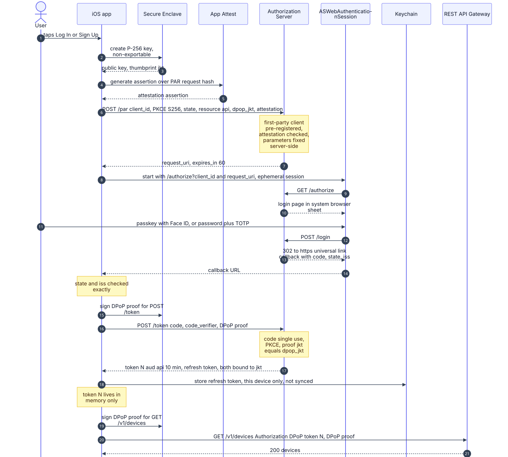

The iOS app stops posting the password to `/v1/auth/login`. That is a first-party password grant, which OAuth 2.1 removes. It becomes a public OAuth client that uses the platform's system browser sheet.

| Element | Choice | Why |
|---|---|---|
| User agent | `ASWebAuthenticationSession` with `prefersEphemeralWebBrowserSession = true` | It is an external user agent, as RFC 8252 requires. The app cannot read the page. It supports passkeys and iCloud Keychain autofill |
| Redirect | Universal link `https://app.iot.example/oauth/callback` using the `.https(host:path:)` callback (iOS 17.4+) | Unlike a custom URL scheme, another app cannot register it |
| Request integrity | PAR, required for this client | Parameters never travel through the browser, so they cannot be tampered with or logged |
| PKCE | S256, fresh verifier per attempt, held in memory | Code interception |
| Key binding | DPoP with a Secure Enclave P-256 key. `dpop_jkt` is sent at PAR | A token or refresh token copied off the phone is useless without the chip |
| Client attestation | **[Optional]** App Attest assertion over the PAR request hash | Proves the request came from our signed app on a real device. Interoperable OAuth attestation (draft-ietf-oauth-attestation-based-client-auth) is still a draft, so this is a deployment-specific check |
| Consent | Skipped for this pre-registered first-party client, which has fixed scopes | The user is signing into our own app |

**Requirement change:** §5.2's native username/password form becomes native **Log In** and **Sign Up** buttons that open the system sheet. §11 lists the edits. An embedded form is still possible with the IETF first-party-apps draft (Authorization Challenge Endpoint), but it would bring back credential handling in app code. It is rejected in ADR-6.

### 5.8 Enterprise tenants: Enterprise-Managed Authorization **[Optional]**

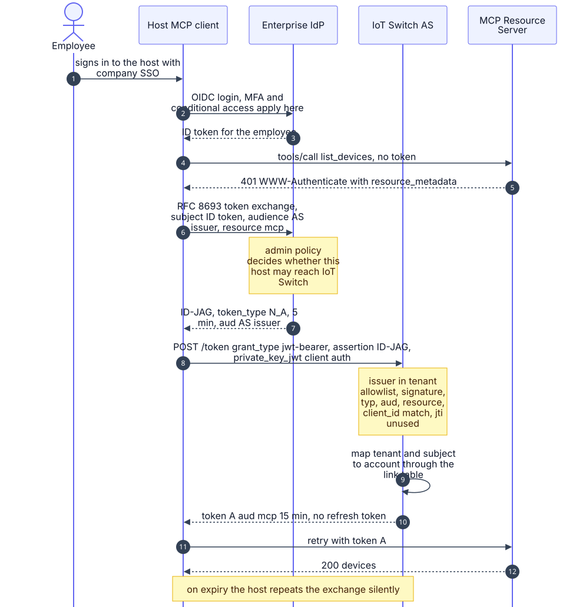

For tenants whose employees use Claude through company SSO, the AS accepts an ID-JAG at the token endpoint with `grant_type=urn:ietf:params:oauth:grant-type:jwt-bearer`. Checks:

- **Tenant allowlist.** The ID-JAG `iss` must be on the tenant's trusted-issuer list. Otherwise the request fails with `invalid_grant`, even if the signature is valid, following Anthropic's multi-tenant guidance.
- **Signature** verified against the IdP JWKS, fetched through the egress proxy.
- **Claims.** The ID-JAG `typ` defined by the draft. `aud` equals our issuer. `resource` equals the MCP resource. `exp` is at most 5 min away. `jti` has not been seen before.
- **Client.** The ID-JAG's `client_id` must equal the authenticated client. ID-JAG requires confidential clients, so authentication is `private_key_jwt`.
- **Subject mapping** goes through `SUBJECT_LINK`, created by an admin or SCIM. It is **never** an automatic email match. Email collisions are a known account-takeover path.
- **No refresh token.** The host re-exchanges silently when token A expires.

Trade-off: there is no consent screen to phish, but also no visible authentication moment. In these tenants the host's tool-approval gate and our server-side policy (§8.6) are the only controls the user experiences. Audit records therefore carry `auth_method: id-jag` and the IdP issuer.

### 5.9 What the View does during sign-in

Nothing that touches credentials. The auth card (`ui://iot/auth.html`) is cosmetic, as requirement §7.4 says.

1. Its **Log In** and **Sign Up** buttons call `list_devices`, a read-only protected tool.
2. The host receives the 401, runs the flow in its own top-level window, and retries the call.
3. The card receives the result.

The card never opens a login URL of its own and never claims that a browser tab signed the connection in. Because the hosted page offers both Log In and Sign Up, the mode chosen on the card doesn't need to survive the round trip.

### 5.10 Risks closed in phase 1

| Risk | Closed by |
|---|---|
| R1 Confused deputy | Per-client consent registry. DCR never remembered. No upstream proxying at all |
| R3 Theft (code interception, mix-up) | PKCE S256 only. Atomic single-use code. `iss` on every response. DPoP `jkt` bound at authorize time |
| R4 Hijacking of the pending flow | Pending authorization bound to a `__Host-` cookie. `state` stored server-side |
| R5 SSRF | Egress proxy, IP-range denylist after resolution, pinned address, no redirects, size and time caps |
| R6 Consent phishing | Client host and redirect host shown. Trust classes. Loopback warning |
| R7 Clickjacking | `frame-ancestors 'none'`, `X-Frame-Options: DENY`. Re-authentication for write scopes |
| R10 Credential entry in Views | Login only on `auth.iot.example` in a top-level window or system sheet. The View has no form |
| R16 Enumeration and stuffing | Generic errors, decoy hashing, throttles, passkeys |

---

## 6. Phase 2: keeping tokens secure

### 6.1 Where every secret lives


The rule is simple: **raw tokens exist only in the holder's memory, in transit under TLS, and in the one store the holder needs**. Every IoT Switch store keeps a keyed hash, never the token.

### 6.2 Token format

```
iotsw_<type>_<43 chars base64url = 256 random bits><6 chars base62 CRC-32>
types: at (token A or N), rt (refresh), ac (authorization code), ss (AS session), pa (pending)
```

- **The prefix** lets GitHub-style secret scanners, our log scrubber and the WAF recognise a leaked token with no false positives. A token pasted into a public repository can be reported and revoked automatically. RFC 7009's revocation endpoint accepts these reports.
- **The checksum** lets the gate reject garbage without a database round trip, which slows brute-force probing and keeps junk out of the cache.
- The token carries no meaning beyond its type. It is a reference, so nothing can be learned by decoding it.

### 6.3 Server-side storage at rest


- **[Core] HMAC, not plain SHA-256.** Each token is stored as `HMAC-SHA256(pepper_v, token)` with the pepper version kept beside it.
  - Today's unkeyed SHA-256 lets anyone holding a database dump check whether a token found elsewhere (in logs, say) is live, and look up its grant.
  - With a KMS-held pepper, a database leak alone reveals nothing usable (R14).
  - Lookups stay O(1) on the primary key.
- **[Core] Pepper rotation** without downtime. New tokens use `v+1`. Lookups try the current version, then the previous one, for as long as the longest token lifetime (30 days). After that, the old version is retired.
- **[Core] Separate schema and least-privilege roles.**

| Role | Auth tables | Device tables |
|---|---|---|
| `as_rw` | read/write | none |
| `rs_ro`, `gw_ro` | none (Profile M uses introspection) | none |
| `ds_rw` | none | read/write |
| `audit_append` | none | `INSERT` only on `audit_events` |

- **[Core] Encryption at rest** for every volume and backup. Backups inherit the same KMS keys.
- **[Core] Retention.** Expired access tokens and codes are pruned hourly (already implemented). Revoked refresh rows are kept until their family's absolute expiry, so reuse is still recognised as reuse. Pending authorizations are pruned after 10 min.
- **Sealed refresh responses** (§7.3) live only in Redis, encrypted with AES-256-GCM under a KMS data key, with a 30 s TTL and no persistence.

### 6.4 Keys and rotation

| Key | Algorithm | Lives in | Used for | Rotation |
|---|---|---|---|---|
| Token pepper | HMAC-SHA256, 256-bit | KMS. Loaded into AS memory at start | Token, code, session hashes | 90 days, with overlap (§6.3) |
| Password pepper | HMAC-SHA256 | KMS | Pre-hash before Argon2id | On compromise only; rehash on next login |
| Token B signing | ES256 (P-256) | KMS/HSM, non-exportable | Signing token B | 30 days. The JWKS publishes current and next keys. Old key kept 1 day after retirement |
| Sealing key | AES-256-GCM data key | KMS envelope | Sealed refresh responses | Daily |
| mTLS identities | X.509, P-256 | Mesh issuer | RS, GW, DS, AS workloads | 24 h, automatic |
| iOS DPoP key | P-256 | Secure Enclave | DPoP proofs | Per sign-in. A new key on every fresh login |

### 6.5 iOS storage

```swift
// DPoP key: generated inside the Secure Enclave and never exportable.
// Only an encrypted handle (usable by this device's chip alone) is persisted.
let key = try SecureEnclave.P256.Signing.PrivateKey(
    accessControl: SecAccessControlCreateWithFlags(
        nil, kSecAttrAccessibleWhenUnlockedThisDeviceOnly, .privateKeyUsage, nil)!)
keychain.set(key.dataRepresentation, for: "dpop-key-handle")

// Refresh token: Keychain, this device only, never in iCloud Keychain or backups.
let attributes: [String: Any] = [
    kSecClass as String: kSecClassGenericPassword,
    kSecAttrService as String: "com.iotswitch.auth",
    kSecAttrAccount as String: "refresh-token",
    kSecAttrAccessible as String: kSecAttrAccessibleAfterFirstUnlockThisDeviceOnly,
    kSecAttrSynchronizable as String: false,
    kSecValueData as String: refreshToken
]
```

- **Token N is never persisted.** After a cold start the app refreshes once. Losing a 10-minute token costs one round trip.
- **Both the refresh token and the key are needed.** A Keychain dump from a jailbroken phone yields a refresh token that is DPoP-bound to a key the attacker cannot extract.
- **Logout** revokes the iOS grant at the AS, deletes the Keychain item and the key handle, and clears memory. It does not touch the user's host grants (requirement §7.2).
- **[Now]** The project builds with ad-hoc signing today. Keychain access groups and App Attest both need a real team identity before this section can work outside the simulator.

### 6.6 Tokens held by the host

We cannot control the host's store, so we limit what a leak from it is worth:

- A **15-minute** token A, and refresh tokens that rotate.
- **DPoP binding** whenever the host offers a key.
- **[Optional] Egress pinning for verified hosts.** Claude documents that its tool calls leave from `160.79.104.0/21`. For grants issued to Claude's CIMD client, a token A arriving from outside the published ranges is treated as a high-risk signal. In strict mode it is refused. Published ranges change, so the range list is configuration and the default mode is "alert".
- **Revocation the user controls**, on the AS "Connected apps" page (§7.10).

### 6.7 The View stores nothing

| Rule | Implementation |
|---|---|
| No token, code or verifier ever reaches a View | Tool results carry device data only. Error codes travel in `_meta['iot/error']`, which never contains a secret |
| `_meta` is not private | ChatGPT exposes the whole result envelope to widgets. Nothing sensitive goes in any `_meta` |
| Templates are shared across users | `ui://` HTML is built once at startup with no user data, because hosts cache it by URI |
| No identity in browser storage | No `localStorage` or `sessionStorage` use. The View keeps state in memory and re-reads through tools |
| **[Now] Pinned target origin** | The bridge sends `ui/initialize` with `'*'`, because the parent's origin is unknown and the message carries nothing sensitive. It records `event.origin` from the handshake reply (when not `"null"`) and posts every later message to that origin. This closes the CVE-2026-76894 pattern |
| Source check | `event.source === window.parent` (already implemented). Plus a schema check per method |
| No model-steering from untrusted data | The View never sends `ui/message` or `ui/update-model-context`. Device names are user-controlled and could carry injected instructions |

### 6.8 Logs, telemetry and leak response

- **[Core] Logging uses an allowlist, not a redaction list.** Only named fields are logged. `Authorization`, `DPoP`, `Cookie`, `Set-Cookie`, `code`, `code_verifier`, `refresh_token`, `assertion`, `password` and `client_assertion` can never appear, even if a developer logs a whole request.
- **[Core]** The log pipeline runs the same `iotsw_` prefix scanner. A hit revokes the token and opens an incident.
- **[Core]** Crash reports from the iOS app exclude memory regions holding tokens. Network debugging is compiled out of release builds.
- **[Core]** The audit log records `grant_id` and `client_id`, never a token.

### 6.9 Risks closed in phase 2

| Risk | Closed by |
|---|---|
| R3 Theft and replay | DPoP for iOS (always) and hosts (when offered). Memory-only access tokens. Short lifetimes |
| R9 postMessage | Pinned target origin, source and schema checks, no `_meta` secrets |
| R10 Credentials in Views | Structural: nothing to store |
| R14 Database leak | Keyed HMAC with a KMS pepper. Least-privilege roles. Encryption at rest |
| R15 Key compromise | KMS/HSM non-exportable keys. Short rotation. JWKS overlap |

---

## 7. Phase 3: refreshing and exchanging tokens automatically

### 7.1 Lifetimes

| Token | Lifetime | Refresh behaviour |
|---|---|---|
| Token A (host) | 15 min | The host refreshes up to 5 min early (Claude) or on 401 |
| Token N (iOS) | 10 min | Proactive at 75 % of its life, single-flight |
| Refresh tokens | Idle 14 d, family absolute 30 d | Rotated on every use. At the 30-day absolute limit the user signs in again |
| Token B (internal) | 60 s | Re-exchanged when under 10 s remain. Never refreshed |
| Token A from ID-JAG | 15 min | No refresh token. The host re-exchanges silently |
| DPoP nonce | 5 min | Server rotates it. The client retries once on `use_dpop_nonce` |
| Sealed refresh response | 30 s | Deleted on expiry, or when the successor is used |

### 7.2 Refresh-token lifecycle


### 7.3 Refresh algorithm: atomic, theft-detecting, race-tolerant


The current OAuth refresh reads the token outside any transaction, then rotates in a separate transaction with no row lock. On today's PGlite, four concurrent refreshes revoked the grant in 15 of 15 runs. On a real Postgres server the same code could fork the family. The first-party `refreshSession` already does this correctly, and the OAuth path adopts its shape.

```sql
BEGIN;
SELECT r.*, g.client_id, g.revoked_at AS grant_revoked, g.dpop_jkt
  FROM refresh_tokens r JOIN grants g ON g.id = r.grant_id
 WHERE r.token_hmac = $1
   FOR UPDATE OF r;                       -- concurrent callers queue here

-- not replaced: rotate
INSERT INTO refresh_tokens (...) VALUES (... successor ...);
UPDATE refresh_tokens
   SET replaced_by = $successor, replaced_at = now()
 WHERE token_hmac = $1 AND replaced_by IS NULL;   -- guard, even under the lock
INSERT INTO access_tokens (...) VALUES (...);
COMMIT;
-- then: seal the exact response body in Redis under HMAC(presented token), TTL 30 s
```

**The 30-second idempotent window.** A presented token that is already replaced is benign only if all of these hold:

1. it was replaced under 30 s ago,
2. the sealed response still exists,
3. the successor refresh token has never been presented, and
4. it comes from the same `client_id`, and with a proof from the same DPoP key if the grant is bound.

In that case the AS returns **the identical response** it gave the first time. Three cases are covered:

- **Two workers race:** both get the same pair, and the family stays linear.
- **The response was lost in transit:** the retry gets what was lost.
- **A thief replays inside the window:** they get a copy of tokens the client also holds. Against a DPoP-bound grant this is useless, because the copy is bound to a key the thief lacks.

Outside the window the replay is treated as theft: the grant is revoked, an event is published and an alert is raised. This follows the grace-window practice the research found at WorkOS (30 s) and Endurain (60 s), without forking the family.

### 7.4 Host refresh behaviour

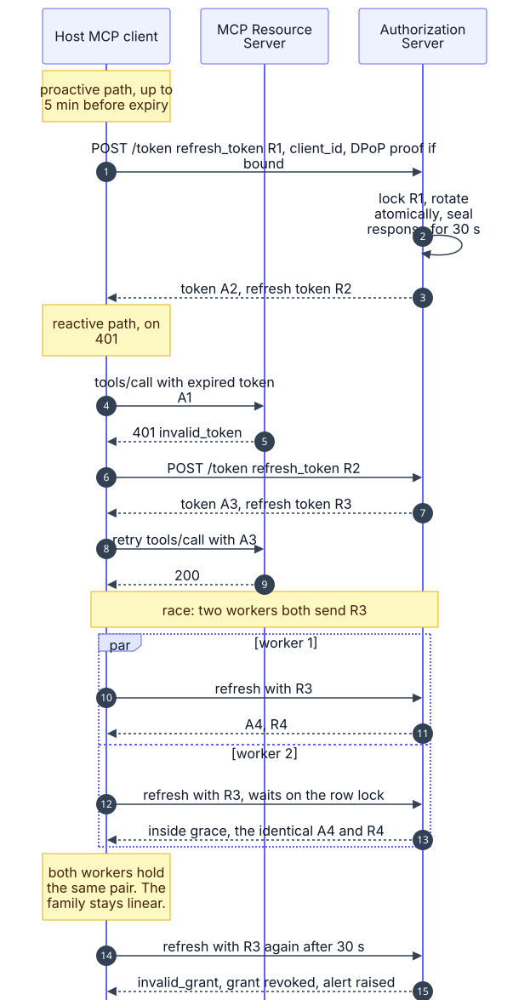

The AS returns `invalid_grant` for every dead refresh token, as Claude expects. A 15-minute token A with Claude's 5-minute proactive margin means about one refresh per 10 minutes of active use.

### 7.5 iOS refresh coordinator

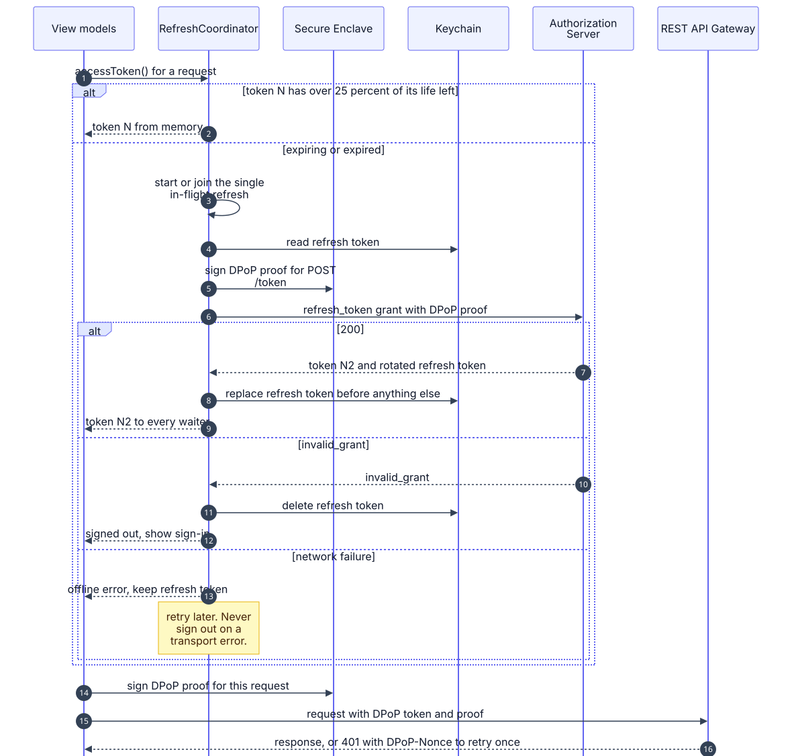

```swift
actor RefreshCoordinator {
    private var inFlight: Task<AccessToken, Error>?

    func validToken() async throws -> AccessToken {
        if let token = store.accessToken, token.remainingFraction > 0.25 { return token }
        if let task = inFlight { return try await task.value }          // join, never duplicate
        let task = Task { try await refreshOnce() }
        inFlight = task
        defer { inFlight = nil }
        return try await task.value
    }

    private func refreshOnce() async throws -> AccessToken {
        guard let refresh = store.refreshToken else { throw AuthError.signedOut }
        do {
            let pair = try await api.refresh(refresh, proof: dpop.proof(htm: "POST", htu: tokenURL))
            store.save(refresh: pair.refreshToken)   // persist the rotated token first
            store.accessToken = pair.accessToken
            return pair.accessToken
        } catch OAuthError.invalidGrant {
            store.clear()                            // the only path that signs out
            throw AuthError.signedOut
        }
        // URLError and other transport failures propagate unchanged: the session survives.
    }
}
```

This fixes the defect found in review. Today any refresh failure, including being offline, wipes the Keychain (`SessionController.swift:77`).

### 7.6 Token exchange at every trust boundary

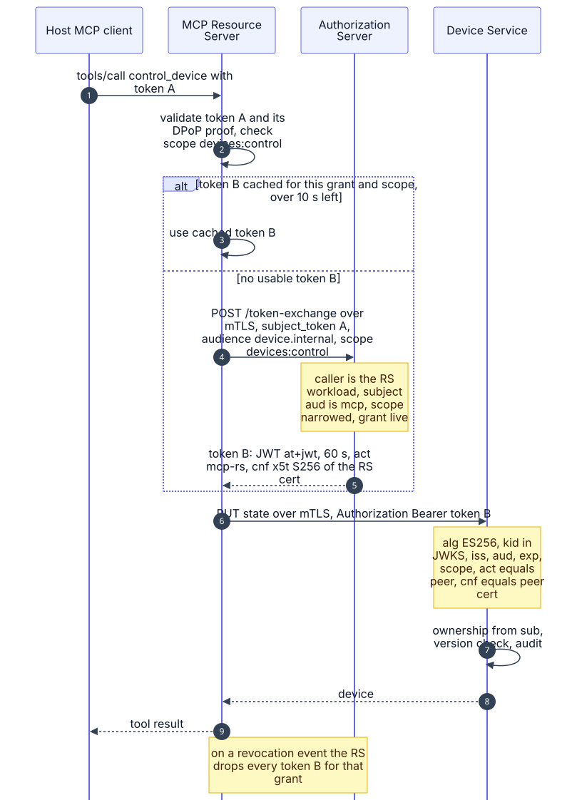

The RS and GW never forward the token they received. Before calling the Device Service, they exchange it.

```http
POST /token-exchange HTTP/1.1
Host: auth.internal                     (mTLS: client certificate identity mcp-rs)
Content-Type: application/x-www-form-urlencoded

grant_type=urn:ietf:params:oauth:grant-type:token-exchange
&subject_token=iotsw_at_…
&subject_token_type=urn:ietf:params:oauth:token-type:access_token
&audience=https://device.internal
&scope=devices:control
&requested_token_type=urn:ietf:params:oauth:token-type:access_token
```

```json
{
  "header":  { "typ": "at+jwt", "alg": "ES256", "kid": "2026-10-b" },
  "payload": {
    "iss": "https://auth.iot.example",
    "aud": "https://device.internal",
    "sub": "acc_Yk2…",
    "client_id": "https://claude.ai/…/client.json",
    "grant_id": "grant_9Qx…",
    "scope": "devices:control",
    "act": { "sub": "spiffe://iot/mcp-rs" },
    "cnf": { "x5t#S256": "q3o…" },
    "auth_method": "passkey",
    "iat": 1792310400, "exp": 1792310460, "jti": "tb_…"
  }
}
```

AS exchange policy:

| Check | Rule |
|---|---|
| Caller | mTLS identity is `mcp-rs` or `api-gw`. Anyone else gets `unauthorized_client` |
| Subject token | Live, and its audience matches the caller: RS accepts only `mcp` subjects, GW only `api` |
| Scope | Requested ⊆ subject scopes, **exactly one** scope per exchange |
| Result | `aud = device.internal`, 60 s, `act.sub` = caller, `cnf` bound to the caller's certificate |
| Never | A refresh token, a lifetime longer than the subject's remaining life, or a wider scope |

Cache rules (RS and GW):

- Key by `(grant_id, scope)`. Reuse while more than 10 s remain.
- Memory only.
- Drop on `grant.revoked`.
- On a Device Service 401 (key rotation or expiry), re-exchange once and retry once.

**What this buys.** A stolen token B works for at most 60 seconds, for one scope, only from a workload holding the RS or GW private key, and only inside the mesh. Every Device Service action carries the full chain (user, client, grant, adapter), so the audit can answer "who changed this, through what, from where" (R1, R2).

### 7.7 Enterprise re-exchange

ID-JAG grants have no refresh token. When token A expires, the host repeats the IdP exchange and the JWT-bearer grant (steps 6–11 of LL-6). An IdP administrator who removes the employee's access stops the next exchange, so revocation follows the IdP within one token lifetime (15 min).

### 7.8 Future: third-party device clouds **[Optional]**

If IoT Switch later controls devices through a vendor cloud (the untracked Samsung research in `docs/` points that way), the two-token rule extends rather than bends:

- **Consent:** the RS obtains the vendor token through **URL-mode elicitation**. The user completes the vendor's consent in a secure browser. The server checks that the user who finishes is the user who started, and never sends a pre-authenticated URL.
- **Storage:** the vendor token lives in a **token vault**, encrypted per grant with a KMS envelope key and keyed by `(account, vendor)`. It is never returned to any client.
- **Revocation:** revoking our grant revokes the vendor grant too, as part of the revocation cascade.
- **Never:** token A or token N is never passed to the vendor.

### 7.9 Rotating keys without downtime

| Key | Procedure |
|---|---|
| Token B signing | Publish the next key in JWKS 24 h ahead. Switch signing. Keep the old key in JWKS for 1 day. The DS caches JWKS for 10 min and refetches on an unknown `kid` (rate-limited) |
| Token pepper | New version for new tokens. Dual lookup until the longest-lived token issued under the old version expires (30 days) |
| mTLS identities | Mesh-managed, 24 h. The DS checks `cnf` against the *presented* certificate, so rotation needs no coordination |

### 7.10 Revocation cascade and logout

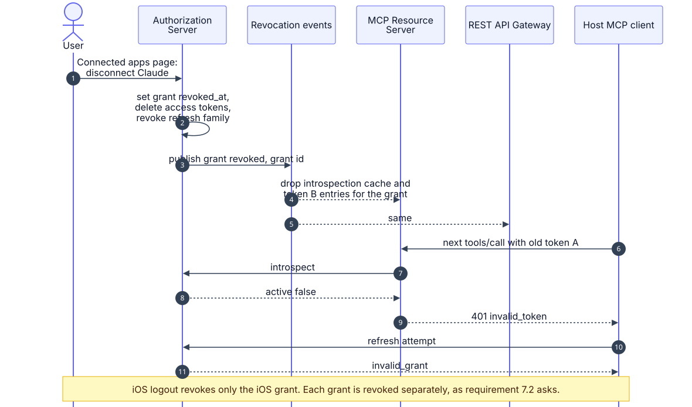

| Trigger | Revokes |
|---|---|
| User disconnects a host on the "Connected apps" page | That host's grant: access tokens deleted, refresh family revoked, event published |
| iOS logout | The iOS grant only (requirement §7.2: separate sessions) |
| "Sign out everywhere" or password change | Every grant and AS session for the account |
| Refresh replay outside grace, or code replay | The affected grant, plus a security alert |
| Leaked-token report (scanner, RFC 7009 call) | The grant behind that token |
| Client blocked by an operator | Every grant held by that `client_id` |

Every revocation becomes visible on the next request. In Profile S, introspection reads the database directly. In Profile M, the event bus clears the ≤ 5 s read cache, and writes are never cached.

### 7.11 Risks closed in phase 3

| Risk | Closed by |
|---|---|
| R2 Passthrough | Token exchange at every boundary. The DS accepts only `aud = device.internal` |
| R3 Theft and replay | Rotation with reuse detection. DPoP-bound refresh. 60 s mTLS-bound token B |
| R11 Refresh races | Row lock, guarded update, idempotent 30 s window. The iOS client is single-flight and never signs out on network errors |
| R15 Key compromise | Rotation procedures. A JWKS `kid` refetch on unknown keys |

---

## 8. Phase 4: calling the MCP server with tokens

### 8.1 Request anatomy

```http
POST /mcp HTTP/1.1
Host: mcp.iot.example
Content-Type: application/json
Accept: application/json, text/event-stream
Authorization: DPoP iotsw_at_kq3…          (or "Bearer …" when the host does not use DPoP)
DPoP: eyJ0eXAiOiJkcG9wK2p3dCIsImFsZyI6IkVTMjU2IiwiandrIjp7…
MCP-Protocol-Version: 2026-07-28

{"jsonrpc":"2.0","id":7,"method":"tools/call",
 "params":{"name":"control_device","arguments":{"deviceId":"dev_x","state":"on","expectedVersion":7}}}
```

The DPoP proof carries:

- `htm: POST` and `htu: https://mcp.iot.example/mcp`,
- a fresh `jti`, and an `iat` within 60 s,
- `ath` (the base64url SHA-256 of the access token), and
- the current server `nonce`.

Credentials are accepted **only** in the `Authorization` header. A token in a query string or body is refused and logged as a leak.

### 8.2 The gate, stage by stage


| Stage | Check | On failure |
|---|---|---|
| 1 Origin guard | A browser `Origin` header not on the allowlist is rejected (DNS rebinding, MCP 2025-11-25). Hosts call server-to-server, without `Origin` | 403 |
| 2 Pre-auth limiter | **[Now]** Bucket by client IP for **every** request until a token verifies. A random bearer token no longer buys a fresh bucket | 429 `Retry-After` |
| 3 Body parser | `application/json` only, 64 KB, JSON-RPC shape | 400 / 413 / 415 |
| 4 RPC classifier | Collect **every** protected call in the batch and the union of their scopes (already implemented) | n/a |
| 5 Credential extractor | `Authorization: Bearer` or `DPoP`, header only | Challenge (401) |
| 6 Token validator | Introspection: `active`, `aud` exactly this resource, `iss`, `exp`, `client_id` not blocked | Challenge `invalid_token` |
| 7 DPoP verifier | Required when the token has `cnf.jkt`. Proof checked as in §8.1. `jti` stored for 120 s. A bound token sent as `Bearer` is refused | 401 `invalid_dpop_proof` + `DPoP-Nonce` |
| 8 Post-auth limiter | 600 requests per minute per **grant** | 429 |
| 9 Tool policy | Scopes cover every call. Write budget left (§8.6) | 403 `insufficient_scope` / 429 |
| 10 Handler | Receives a `VerifiedCaller` only | n/a |
| 11 Exchange | Token B for the call's single scope (§7.6) | 503 if the AS is unreachable. Never proceed without token B |

The identity passed onward is a discriminated type. A protected handler cannot be called with an anonymous caller without a compile error.

```ts
type Caller =
  | { kind: 'anonymous'; requestId: string }
  | { kind: 'verified'; sub: string; clientId: string; grantId: string;
      scopes: Scope[]; jkt?: string; channel: 'mcp' | 'native'; requestId: string };

// Protected tool handlers are typed (caller: Extract<Caller, {kind: 'verified'}>) => …
```

### 8.3 Challenges that work in both hosts

**Claude and the standard path: HTTP status.**

```http
HTTP/1.1 401 Unauthorized
WWW-Authenticate: Bearer error="invalid_token",
  resource_metadata="https://mcp.iot.example/.well-known/oauth-protected-resource/mcp",
  scope="devices:read devices:control devices:create offline_access"
WWW-Authenticate: DPoP algs="ES256 EdDSA", error="invalid_token"
```

```http
HTTP/1.1 403 Forbidden
WWW-Authenticate: Bearer error="insufficient_scope",
  scope="devices:read devices:create",
  resource_metadata="https://mcp.iot.example/.well-known/oauth-protected-resource/mcp"
```

**ChatGPT: tool-level challenge.** ChatGPT starts linking from per-tool `securitySchemes` plus an error result carrying `_meta["mcp/www_authenticate"]`. Every protected tool therefore declares its scheme in `tools/list`, which other hosts ignore:

```json
{ "name": "list_devices",
  "securitySchemes": [{ "type": "oauth2", "scopes": ["devices:read"] }],
  "annotations": { "readOnlyHint": true, "destructiveHint": false, "openWorldHint": false } }
```

When the edge has verified ChatGPT's mTLS certificate (§4.4), the challenge adapter answers the same refusal as a tool result:

```json
{ "jsonrpc": "2.0", "id": 7, "result": {
    "isError": true,
    "content": [{ "type": "text", "text": "Sign in to IoT Switch to continue." }],
    "_meta": { "mcp/www_authenticate": [
      "Bearer resource_metadata=\"https://mcp.iot.example/.well-known/oauth-protected-resource/mcp\", error=\"invalid_token\", error_description=\"Sign in to IoT Switch to continue.\""
    ] } } }
```

Without a verified certificate, the standard HTTP 401 is used. Whether ChatGPT also links from a plain 401 is undocumented, so the adapter is behind a flag. Verifying it is a `host-check` item (§13).

### 8.4 Model-initiated and View-initiated calls

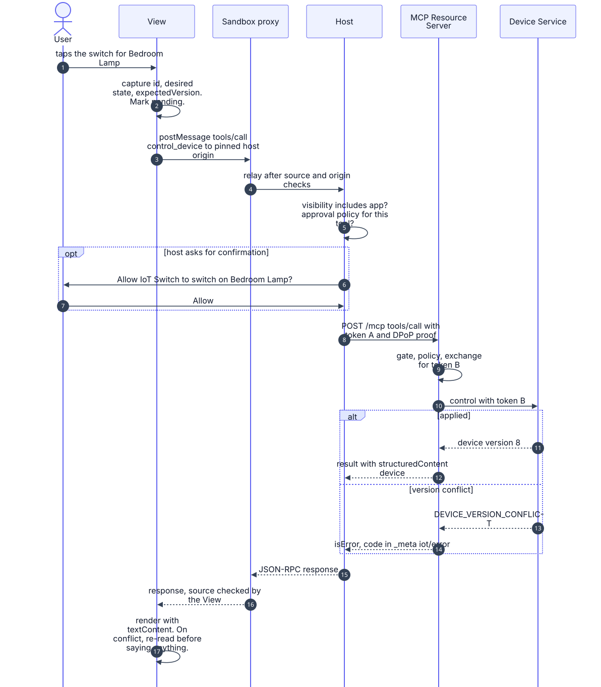

The server treats both identically. It cannot tell them apart, and it does not try. Two independent gates guard a View-initiated write:

1. **Host gate.** Visibility must include `"app"`, and the host's approval policy applies.
2. **Server gate.** The full pipeline in §8.2.

The second gate is the one we own. It assumes the first may have been skipped.

The View's own rules for calls:

- Capture the device id, desired state and `expectedVersion` at tap time.
- Disable that one switch until the result arrives.
- On `DEVICE_VERSION_CONFLICT`, re-read before saying anything.
- On an unknown outcome, never send the inverse command.
- Never retry a write on the user's behalf after sign-in. Requirement §7.5 calls for a fresh user action.

### 8.5 Step-up

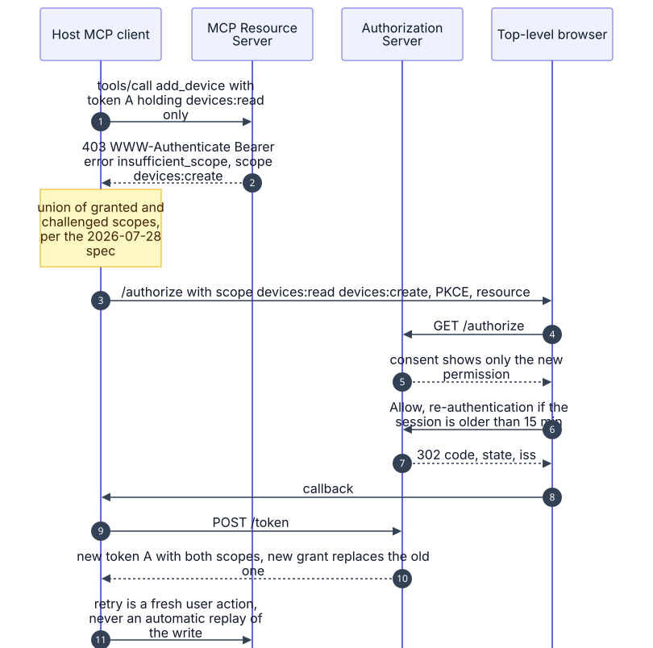

Under the scope strategy in §5.5, step-up is not on the normal path. It exists for two cases:

- a grant that was narrowed (a user unticked a permission, or a refresh asked for less), and
- future high-risk device classes.

For the second, the RS answers a `403 insufficient_scope` naming the new scope. If fresh strong authentication is also needed, it adds RFC 9470's `acr_values` or `max_age`. The host unions scopes, as MCP 2026-07-28 requires, and runs a new authorization. The consent page shows only what is new. The interrupted write is **not** replayed.

### 8.6 Tool policy and least privilege

| Tool | Visibility | Scope (token A) | Token B scope | Annotations | Write budget |
|---|---|---|---|---|---|
| `list_devices` | model, app | `devices:read` | `devices:read` | readOnly | n/a |
| `get_device` | model, app | `devices:read` | `devices:read` | readOnly | n/a |
| `control_device` | model, app | `devices:control` | `devices:control` | not readOnly, not destructive, not idempotent | 20 per minute per grant, 6 per minute per device |
| `add_device` | model, app | `devices:create` | `devices:create` | not readOnly, not destructive, not idempotent | 10 per hour per grant |
| `get_auth_status` | app | none | none | readOnly | n/a |
| `show_auth`, `show_add_device` | model, app | none | none | readOnly | n/a |

Write budgets are the server's deterministic answer to prompt injection (R8). A model steered by a hostile device name into flapping a switch, or into creating hundreds of devices, hits a hard ceiling whatever the host's approval settings say. Budgets apply per grant, so one host's runaway agent cannot exhaust the iOS app's allowance.

### 8.7 The internal hop: what the Device Service checks

1. The mTLS peer is `mcp-rs` or `api-gw`.
2. Token B header: `typ = at+jwt`, `alg = ES256` (no other algorithm and never `none`), `kid` in the cached JWKS.
3. Claims: `iss` = AS, `aud` = `https://device.internal`, `exp` and `iat` within 30 s skew, `act.sub` = peer identity, `cnf.x5t#S256` = peer certificate thumbprint.
4. `scope` covers the operation, exactly as the RS policy table says.
5. Identity = `{ accountId: sub, channel, clientId, grantId }`. Ownership is checked in SQL with `owner_id = sub`. The version check and the write remain one statement.

### 8.8 Audit record

```json
{ "at": "2026-10-18T09:14:03.112Z", "request_id": "req_4f1c…", "action": "device.control",
  "outcome": "ok", "device_id": "dev_x", "old_state": "off", "new_state": "on",
  "actor": { "account_id": "acc_Yk2…", "client_id": "https://claude.ai/…", "grant_id": "grant_9Qx…",
             "channel": "mcp", "via": "spiffe://iot/mcp-rs", "auth_method": "passkey", "dpop": true } }
```

Rejected attempts (version conflicts, policy refusals, budget exhaustion) are recorded after the transaction, so they are never rolled back (already the pattern in `devices.ts`). Credentials never appear.

### 8.9 Fail-closed rules

- No identity fallback exists. A validator exception is a refusal (401 or 503), never `anonymous` on a protected path (LiteLLM CVE-2026-59822).
- If the AS is unreachable, introspection and exchange fail, so protected calls fail with 503. Public discovery keeps working.
- An unknown tool name is not "public by default". The classifier treats any `tools/call` for a name missing from the policy table as protected and unknown. It returns a JSON-RPC error, not anonymous execution.
- Handlers re-check `caller.kind === 'verified'` as a second line of defence. This is the existing `unauthenticated()` guard, kept.

### 8.10 Risks closed in phase 4

| Risk | Closed by |
|---|---|
| R2 Passthrough | `aud` check at the gate. Token exchange before the DS |
| R3 Replay | DPoP `jti`, `ath`, nonce. Short token A |
| R4 State-handle hijacking | No sessions (stateless MCP, as 2026-07-28 removed them). Identity only from the token. Device ids checked against `owner_id = sub` |
| R8 Prompt injection | Deterministic per-tool scopes, narrowed token B, write budgets, honest annotations for host prompts |
| R12 Limit evasion | IP buckets until verification, grant buckets after |
| R13 Fail-open | Discriminated caller type. No fallback identity. Unknown tools are protected |

---

## 9. Consolidated risk-to-control matrix

| Risk | AS | RS / GW | DS | View | iOS | Edge / infra |
|---|---|---|---|---|---|---|
| R1 Confused deputy | Per-client consent, DCR never remembered | n/a | `act` chain audited | n/a | n/a | n/a |
| R2 Passthrough | Exchange policy | `aud` check, no forwarding | Accepts only `device.internal` | n/a | n/a | n/a |
| R3 Theft and replay | PKCE, single-use code, `iss`, rotation, DPoP binding | DPoP verification | mTLS-bound token B | Holds nothing | Secure Enclave key, memory-only token | TLS 1.3, prefixes and scanning |
| R4 Hijacking | Pending authorization bound to cookie, `__Host-` session | Stateless, identity from token | `owner_id = sub` | n/a | n/a | n/a |
| R5 SSRF | CIMD rules | n/a | n/a | n/a | n/a | Egress proxy |
| R6 Consent phishing | Trust classes, host and redirect shown | n/a | n/a | No login UI | System sheet shows the domain | n/a |
| R7 Clickjacking | `frame-ancestors 'none'`, re-auth for writes | n/a | n/a | n/a | n/a | n/a |
| R8 Prompt injection | Scopes | Policy table, write budgets | Narrow token B | No `ui/message` | n/a | n/a |
| R9 postMessage | n/a | n/a | n/a | Pinned origin, source and schema checks | n/a | n/a |
| R10 Credentials in Views | Login only on own origin | n/a | n/a | No forms | `ASWebAuthenticationSession` | n/a |
| R11 Refresh races | Row lock, idempotent window | Single re-exchange | n/a | n/a | Single-flight | n/a |
| R12 Limit evasion | Throttles on every credential endpoint | IP until verified, then grant | n/a | n/a | n/a | WAF |
| R13 Fail-open | Exceptions refuse | Discriminated caller | Validation checklist | n/a | n/a | n/a |
| R14 DB leak | HMAC + pepper, roles | No DB access | No auth tables | n/a | n/a | Encryption at rest |
| R15 Key compromise | KMS, rotation | JWKS refetch | `kid` checks | n/a | Per-login key | HSM |
| R16 Enumeration | Generic errors, decoy hash, passkeys | n/a | n/a | n/a | n/a | Bot management |

---

## 10. Design decisions

| ID | Decision | Alternatives considered | Why |
|---|---|---|---|
| ADR-1 | Opaque edge tokens with per-request introspection | JWT access tokens validated locally | Requirement §7.1 needs immediate revocation. Opaque tokens leak nothing if logged |
| ADR-2 | 60 s JWT token B via exchange at each boundary | Pass the edge token to the DS. Share a DB session | Passthrough is forbidden. Exchange narrows scope per call and records `act` |
| ADR-3 | Views never hold credentials | View runs its own OAuth on a stable `ui.domain` | Brings back browser-token risks with no benefit. All View needs are served by app-visible tools |
| ADR-4 | DPoP mandatory for iOS, optional for hosts | Mandatory everywhere. Bearer everywhere | Host DPoP support is unverified. Requiring it would lock hosts out. iOS is ours, with a Secure Enclave |
| ADR-5 | 30 s idempotent refresh window with sealed responses | No grace (false revocations). Grace that forks the family | Keeps the family linear, survives lost responses, and is harmless for DPoP-bound grants |
| ADR-6 | iOS uses the system browser sheet, not a native password form | Keep the native form. First-party-apps draft | RFC 8252, passkeys, and no credential handling in app code. Costs a requirement change (§11) |
| ADR-7 | Three device scopes up front, narrowed per call by exchange | Minimal initial scope with step-up | Keeps requirement §7.3's UX decision while restoring least privilege at the hop that matters |
| ADR-8 | Separate origins for AS, RS and GW, even in Profile S | One origin, path-separated | Cookie isolation, independent CSP and framing policy, simpler WAF rules |
| ADR-9 | Passkeys as primary authenticator | Password + TOTP only | Phishing-resistant, and removes the credential-stuffing surface |

---

## 11. Required changes to `requirement.md`

| Section | Change |
|---|---|
| Revision notes, line 15 | Correct the claim that 2026-07-28 makes `scope` *required* in the 401. It is a SHOULD. Note that `resource` has been required since 2025-06-18 |
| §5.2 | Replace the two-field native form with Log In / Sign Up buttons that open `ASWebAuthenticationSession`. Keep the autofill, validation and no-replay rules, now applied to the hosted page |
| §7.1 | Retire `/v1/auth/signup`, `login`, `refresh` and `logout` in favour of the AS: PAR, authorize, token, revoke. Keep `/v1/auth/me` (or `/userinfo`). iOS access tokens become 10 min and DPoP-bound |
| §7.2 | Add: DPoP binding for native tokens. HMAC-peppered token storage. Passkeys. Framing protection on every AS page |
| §7.3 | Add `offline_access` to `scopes_supported` and to the 401 scope hint. Add `iss` to error redirects (already implemented). Add trust classes for consent |
| §7.5 | Add the ChatGPT tool-level challenge (§8.3) alongside the HTTP 401 |
| §11 | Count introspection and exchange (cached) against the latency target. Add write budgets |
| New | Token exchange to an internal Device Service audience. Enterprise-Managed Authorization as an optional tenant feature |

---

## 12. Migration from the current implementation

| Phase | Work | Files today |
|---|---|---|
| **0 [Now]** | Fixes from the code review that need no redesign. **1** CSP `frame-ancestors 'none'` and the other headers on AS pages. **2** Rate limit `GET /authorize`. **3** MCP limiter keyed by IP until the token verifies. **4** Atomic OAuth refresh (lock + guard) and atomic code consume. **5** iOS: sign out only on `invalid_grant`. **6** `securitySchemes` on tools and the ChatGPT challenge adapter behind a flag. **7** Bridge pins the target origin after the handshake | `oauth/pages.ts`, `oauth/routes.ts`, `mcp/routes.ts`, `oauth/token.ts`, `oauth/store.ts`, `ios/…/SessionController.swift`, `mcp/tools.ts`, `mcp/gate.ts`, `ui/assets/bridge.js` |
| **1** | Token prefixes and checksums. HMAC with a pepper (dual lookup during migration). Separate login and consent steps. `__Host-` AS session and pending-flow cookie. Consent registry and trust classes. `offline_access`. Three hostnames with host-based routing | `oauth/*`, `domain/sessions.ts`, `db/migrations.ts` |
| **2** | Device Service module accepting only token B. In-process token exchange. Discriminated `Caller`. Policy table with write budgets. Audit actor chain | new `device-service/`, `mcp/tools.ts`, `http/routes-devices.ts`, `domain/devices.ts` |
| **3** | iOS moves to PAR + `ASWebAuthenticationSession` + DPoP (Secure Enclave). RS and GW DPoP verifiers. Retire `/v1/auth/*`. Real signing identity for the app | `ios/IoTSwitch/Session/*`, `Networking/APIClient.swift`, `http/routes-auth.ts` |
| **4** | Passkeys. KMS-held keys. Redis. Revocation bus. "Connected apps" page. Move to Profile M with a real Postgres server, which also proves the concurrency claims under real row contention | AS, infra |
| **5 [Optional]** | Enterprise-Managed Authorization (ID-JAG). App Attest. Host egress pinning in alert mode | AS |

Phases 0–2 can ship on today's single-process server. Nothing in them depends on new infrastructure.

---

## 13. Verification plan

| Area | How it is proven |
|---|---|
| Atomicity (codes, refresh) | Concurrency tests on **real Postgres**, not PGlite: N parallel redemptions give exactly one grant, and N parallel refreshes give one family with identical responses |
| Grace window | Replay at 5 s returns an identical body. Replay at 31 s revokes the grant. Replay after the successor was used revokes the grant |
| DPoP | Bound token sent as Bearer → 401. Wrong `htu`/`htm` → 401. Reused `jti` → 401. Stale nonce → `use_dpop_nonce` and a successful retry |
| Exchange | RS cannot obtain `devices:create` with a token lacking it. Token B is rejected by the DS from a different mTLS peer. Expired token B → single re-exchange |
| Framing | Every AS response carries `frame-ancestors 'none'` and `X-Frame-Options: DENY` (header snapshot test) |
| SSRF | CIMD resolver unit tests over every denied range, including NAT64, `fe80::/10` and mapped IPv4. Redirect refused. Oversize refused |
| Fail-closed | Fuzz the gate with malformed tokens, odd content types and batch mixes. No protected handler runs without a verified caller (type test plus runtime assertion) |
| Rate limits | Random bearers cannot escape the IP bucket. Grant buckets do not cross grants |
| Hosts | `npm run host-check` extended: Claude Connect card from a View-initiated 401. ChatGPT linking via the `_meta` adapter and via a plain 401. Whether either host sends DPoP. Recorded in `spike/FINDINGS.md` |
| iOS | Offline refresh keeps the session. `invalid_grant` signs out. Keychain item attributes asserted. Key not exportable |
| Acceptance | `npm run acceptance` gains criteria for every [Core] control, mapped to tests as the existing report does |

---

## 14. Open questions

1. **ChatGPT linking trigger.** Does a plain HTTP 401 start ChatGPT's per-tool linking, or only the `_meta` form? This decides whether the mTLS-keyed adapter is needed.
2. **Host DPoP support.** If neither host sends DPoP, the host-side theft window is the 15-minute token A plus rotation. Revisit when the MCP roadmap's DPoP work lands.
3. **Approval of View-initiated writes.** Neither vendor documents it. Our write budgets assume no host prompt at all.
4. **`ui/message` and `ui/update-model-context`.** The spec leaves consent at MAY. We avoid both, but other servers' Views in the same conversation may not.
5. **ID-JAG maturity.** The draft is at -04, and `act` semantics are undefined. Keep enterprise support optional until the RFC.
6. **Host egress ranges.** Claude's published range makes a strong signal. Whether ChatGPT publishes an equivalent is unknown.

---

## Appendix A: Metadata documents

**Protected Resource Metadata:** `https://mcp.iot.example/.well-known/oauth-protected-resource/mcp`

```json
{
  "resource": "https://mcp.iot.example/mcp",
  "resource_name": "IoT Switch",
  "authorization_servers": ["https://auth.iot.example"],
  "scopes_supported": ["devices:read", "devices:control", "devices:create", "offline_access"],
  "bearer_methods_supported": ["header"],
  "dpop_signing_alg_values_supported": ["ES256", "EdDSA"],
  "dpop_bound_access_tokens_required": false
}
```

The REST resource (`https://api.iot.example`) publishes the same shape with `dpop_bound_access_tokens_required: true`.

**Authorization Server Metadata:** `https://auth.iot.example/.well-known/oauth-authorization-server`

```json
{
  "issuer": "https://auth.iot.example",
  "authorization_endpoint": "https://auth.iot.example/authorize",
  "token_endpoint": "https://auth.iot.example/token",
  "pushed_authorization_request_endpoint": "https://auth.iot.example/par",
  "revocation_endpoint": "https://auth.iot.example/revoke",
  "registration_endpoint": "https://auth.iot.example/register",
  "jwks_uri": "https://auth.iot.example/.well-known/jwks.json",
  "scopes_supported": ["devices:read", "devices:control", "devices:create", "offline_access"],
  "response_types_supported": ["code"],
  "response_modes_supported": ["query"],
  "grant_types_supported": ["authorization_code", "refresh_token",
                            "urn:ietf:params:oauth:grant-type:jwt-bearer"],
  "code_challenge_methods_supported": ["S256"],
  "token_endpoint_auth_methods_supported": ["none", "private_key_jwt"],
  "client_id_metadata_document_supported": true,
  "authorization_response_iss_parameter_supported": true,
  "dpop_signing_alg_values_supported": ["ES256", "EdDSA"],
  "revocation_endpoint_auth_methods_supported": ["none", "private_key_jwt"]
}
```

The internal endpoints (`/introspect`, `/token-exchange`) are **not** advertised publicly. They listen on the internal interface only and require mTLS.

## Appendix B: Configuration defaults

| Setting | Default | Notes |
|---|---|---|
| `HOST_ACCESS_TOKEN_TTL` | 900 s | Token A |
| `NATIVE_ACCESS_TOKEN_TTL` | 600 s | Token N |
| `INTERNAL_TOKEN_TTL` | 60 s | Token B |
| `REFRESH_IDLE_TTL` / `REFRESH_FAMILY_TTL` | 14 d / 30 d | |
| `REFRESH_GRACE_SECONDS` | 30 | Idempotent window |
| `AUTH_CODE_TTL` / `PENDING_AUTH_TTL` / `PAR_TTL` | 60 s / 600 s / 60 s | |
| `AS_SESSION_IDLE` / `AS_SESSION_MAX` | 30 min / 12 h | |
| `REAUTH_FOR_WRITE_CONSENT_AFTER` | 15 min | |
| `DPOP_IAT_SKEW` / `DPOP_JTI_TTL` / `DPOP_NONCE_TTL` | 60 s / 120 s / 300 s | |
| `INTROSPECTION_CACHE_READS` | 0 s (Profile S), 5 s (Profile M) | Writes are never cached |
| `CIMD_TIMEOUT` / `CIMD_MAX_BYTES` / `CIMD_CACHE_MAX` | 5 s / 5 KB / 24 h | |
| `CHATGPT_TOOL_CHALLENGE` | off | Enable after `host-check` confirms the trigger |
| `HOST_EGRESS_PINNING` | alert | `off`, `alert`, `enforce` |
| `TRUST_PROXY` | off | Only behind a proxy we control |
