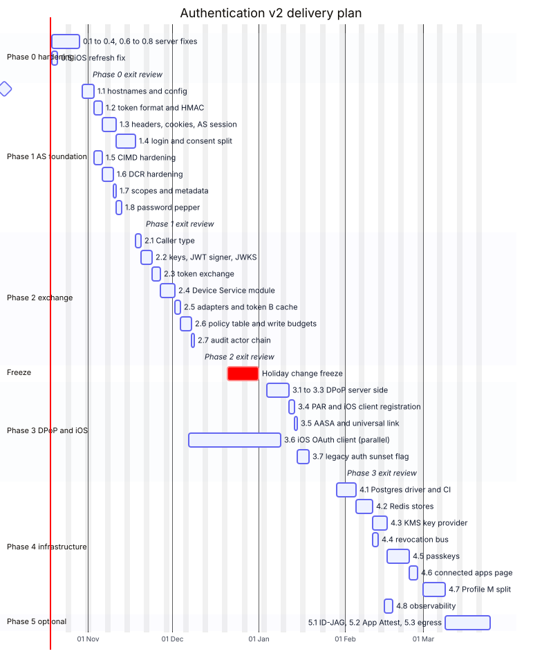

# Authentication v2 Implementation Plan

**Status:** Proposed · **Date:** 18 October 2026 · **Implements:** [Authentication Architecture v2](authentication-architecture.md) · **Codebase:** `server/` (Node 22+, TypeScript run by type-stripping, Express 5, MCP SDK 1.30, PGlite) and `ios/` (SwiftUI, iOS 17.0, Swift 5)

This plan turns the architecture into **46 pull requests across six phases** (six of them are the iOS series 3.6a–f). Every PR is small enough to review in one sitting and ships green. Every behaviour change sits behind a flag or is additive until its phase exit review. Section references such as "arch §7.3" point into the architecture document.

---

## 1. Summary

| Phase | Goal | PRs | Effort | Calendar (2 engineers) | Exit gate |
|---|---|---|---|---|---|
| **0 Hardening** | Close the seven gaps from the code review on today's architecture | 8 | 8.5 d | 19 Oct – 30 Oct 2026 | All [Now] items in arch §12 done |
| **1 AS foundation** | Separate origins, token format, HMAC storage, real login → consent, CIMD and DCR hardening | 8 | 21 d | 2 Nov – 27 Nov | Consent and session tests green. Host-check passes on both hosts |
| **2 Exchange** | Device Service behind token B, token exchange, policy table, write budgets | 7 | 15 d | 30 Nov – 18 Dec | No adapter calls domain code directly |
| **3 DPoP + iOS** | DPoP end to end, PAR, iOS moves to OAuth with the system browser and Secure Enclave | 12 | 26.5 d | 7 Dec – 29 Jan 2027 (iOS in parallel) | Legacy `/v1/auth/*` off in staging |
| **4 Infrastructure** | Real Postgres, Redis, KMS, revocation bus, passkeys, connected-apps page, Profile M | 8 | 32 d | 1 Feb – 12 Mar | Suite green on Postgres. Split deployment runs |
| **5 Optional** | Enterprise-managed authorization (ID-JAG), App Attest, host egress pinning | 3 | 12 d | 15 Mar – 2 Apr | Per-tenant enablement |

**Total:** about 103 engineer-days for phases 0–4, plus 12 optional. A server engineer and an iOS engineer finish phases 0–4 in roughly 20 weeks, including a holiday freeze from 21 December to 1 January.





### What makes this plan cheaper than it looks

- **Nothing is deployed yet.** The README states it, and the acceptance report says the same. Changing hostnames, the token format or the issuer breaks no real user, so the plan uses clean migrations instead of dual-running formats. §10 lists the two exceptions, which are local development databases and the iOS app built against the old endpoints.
- **The seams already exist.** The plan builds on four existing pieces:
  - `domain/devices.ts` already takes an `Identity` rather than a request;
  - `db/index.ts` is already a driver interface;
  - the gate already runs before the SDK;
  - the views already hold no token.

  The plan adds layers around them. It doesn't rewrite them.
- **Phases 0–3 need no new infrastructure.** Everything runs in the single process (Profile S) with in-memory stores behind interfaces. Phase 4 swaps implementations without touching call sites.

---

## 2. Working agreements

### 2.1 Conventions

- **Branches and commits** follow the repository's existing pattern: one branch per PR (`feat/auth-v2-1.4-consent`), and a follow-up `Fix defects found reviewing …` commit when review finds issues, as in phases 1–6.
- **Type-stripping constraints** still apply to all new server code: no `enum`, no `namespace`, no constructor parameter properties, `.ts` extensions on imports, `import type` for types. Algorithm identifiers stay numeric or string literals, as `password.ts` already does for Argon2.
- **New dependencies** must be pinned exact versions and must not run install scripts.

| Package | Used for | Phase |
|---|---|---|
| `jose` | JWS/JWT signing and verification, JWK thumbprints, DPoP | 2 |
| `ipaddr.js` | IP-range classification for CIMD and the egress guard | 1 |
| `@simplewebauthn/server` | Passkeys | 4 |
| `pg` | Postgres driver | 4 |
| `ioredis` | Redis stores | 4 |

  No new iOS dependencies: CryptoKit, AuthenticationServices and Security cover everything.
- **Every store is an interface first.** Rate limits, DPoP replay, nonces, sealed refresh responses, introspection cache, write budgets and revocation events each get a `Memory*` implementation in phases 0–3 and a `Redis*` one in phase 4.

### 2.2 Definition of done (every PR)

1. Unit tests for every new check, including at least one test per refusal path.
2. `npm test` and `npm run typecheck` green. `xcodebuild … test` green for iOS PRs.
3. `server/acceptance/criteria.ts` updated when a criterion gains or changes evidence (§9.3).
4. Docs touched in the same PR: the architecture section it implements, plus `server/README.md` configuration tables when a variable is added.
5. A review pass focused on the PR's security claim, with defects fixed before merge.
6. No raw token, code, verifier, password or cookie value appears in any log line the PR adds. A test asserts it where the PR touches logging.

### 2.3 Decision gates (owner sign-off needed)

| Gate | Before | Decision |
|---|---|---|
| G1 | PR 0.6 flag goes on | Results of `host-check` on ChatGPT: does a plain 401 start linking, and is `_meta.securitySchemes` read? |
| G2 | Phase 3 starts | Accept the `requirement.md` §5.2 change (native form → system browser sheet) and the iOS 17.4 minimum |
| G3 | Phase 3.5 | Apple Developer team and the `app.iot.example` domain for universal links |
| G4 | Phase 4 starts | Cloud provider for KMS, Redis and Postgres |
| G5 | Phase 5 | Whether any enterprise tenant needs ID-JAG |

---

## 3. Target source layout

New and changed modules, shown against today's tree. Unchanged files are omitted.

```
server/src/
  config.ts                     + AUTH_/MCP_/API_BASE_URL, flags (1.1)
  security/                     NEW
    headers.ts                    page headers with CSP nonce (0.1, 1.3)
    rate-limit.ts                 bucket core + middleware, store interface (0.3)
    cookies.ts                    parse/serialize, __Host- handling (1.3)
    keys.ts                       KeyProvider: peppers, signing keys, sealing key (1.2, 2.2, 4.3)
    log.ts                        allowlist logger and token scanner (4.8)
  tokens/                       NEW
    format.ts                     mint / parse / checksum / prefixes (1.2)
    hash.ts                       HMAC with versioned pepper ring (1.2)
  oauth/
    authorize.ts                  split: request validation only (1.4)
    login.ts                      NEW: login + AS session (1.4, 4.5)
    consent.ts                    NEW: consent registry + page (1.4)
    par.ts                        NEW (3.4)
    token.ts                      grant router; refresh rewritten (0.4, 3.2)
    exchange.ts                   NEW: RFC 8693 (2.3)
    introspect.ts                 NEW: in-process + internal HTTP (2.3, 4.7)
    dpop.ts                       NEW: proof verification, nonces (3.1)
    jwks.ts                       NEW (2.2)
    clients.ts                    CIMD hardening, trust classes (1.5, 1.6)
    sealed.ts                     NEW: sealed refresh responses (0.4)
    idjag.ts                      NEW, optional (5.1)
  mcp/
    gate.ts                       returns Caller, limiter keys, challenge adapter (0.3, 0.6, 2.1)
    policy.ts                     NEW: tool → scope → budget (2.6)
    tools.ts                      calls DeviceService via ExchangeClient (2.5)
  http/
    routes-devices.ts             same, for GW (2.5)
    routes-auth.ts                legacy, behind LEGACY_FIRST_PARTY_AUTH (3.7)
  device-service/               NEW (2.4)
    service.ts                    verifies token B, then calls domain/devices.ts
    verify.ts                     JWT + workload checks
  exchange-client.ts            NEW: token B cache (2.5)
  revocation.ts                 NEW: event interface, memory bus (2.5, 4.4)
  db/
    pg.ts                         NEW (4.1)
    migrations.ts                 004–009 (per PR)
  entry/                        NEW (4.7): as.ts, rs.ts, gw.ts, ds.ts
ios/IoTSwitch/
  Auth/                         NEW (3.6): AuthCoordinator, DPoPKeyManager, DPoPProof,
                                  TokenStore, RefreshCoordinator, PKCE
  Networking/APIClient.swift    DPoP authorization (3.6d)
  Session/SessionController.swift   refresh error handling (0.5), then thin wrapper (3.6)
```

---

## 4. Phase 0: hardening on today's architecture

Goal: close every defect found in the code review without waiting for the redesign. Each PR is independent and can merge in any order.

### PR 0.1: Security headers on authorization-server pages · 1 d

**Changes**
- `security/headers.ts` (new) exports `authPageHeaders(res, { nonce, formTargets })`. It sets CSP, `X-Frame-Options: DENY`, `Cross-Origin-Opener-Policy: same-origin`, `Referrer-Policy: no-referrer`, `Cache-Control: no-store` and `X-Content-Type-Options: nosniff`.
- `oauth/pages.ts`:
  - render `<style nonce="…">`;
  - move the cancel button's inline `style=` attribute into the `.cancel` class, because a nonce-based CSP blocks style attributes;
  - accept `nonce` in `AuthorizePageOptions`.
- `oauth/authorize.ts` creates a nonce per response and passes `formTargets = ["'self'", originOf(pending.redirectUri)]`.

```ts
export function formActionSource(redirectUri: string): string {
  const url = new URL(redirectUri);
  // A private-use scheme has an opaque origin ("null"); CSP matches it by scheme.
  return url.origin === 'null' ? url.protocol : url.origin;
}
```

**Why `form-action` includes the redirect origin:** browsers apply `form-action` to the redirect after a form POST. With `'self'` alone, the `302` to `https://claude.ai/api/mcp/auth_callback` is blocked.

**Tests** in `test/oauth.test.ts`:
- every HTML response (authorize, re-rendered error, expired link, cancel error) carries `frame-ancestors 'none'` and `X-Frame-Options: DENY`;
- `form-action` contains the registered redirect origin;
- no inline `style=` attribute remains in the rendered page.

**Done when** RFC 9700 §4.16's clickjacking requirement can be checked by test.

### PR 0.2: Rate limit `GET /authorize` · 0.5 d

**Changes:** `oauth/routes.ts` adds `router.get('/authorize', authorizeViewLimiter)` at 60 per minute per IP. CIMD resolution gets its own budget of 20 outbound fetches per minute per **client_id host**, so one attacker-controlled host cannot use the AS as a request amplifier.

*As built:* successful CIMD resolutions are cached in memory for 5 minutes (bounded at 1,000 entries). Otherwise the per-host budget would throttle a popular host's legitimate users. The persistent cache with digest tracking remains in 1.5.

**Tests:** the 61st `GET /authorize` within a minute → 429. The 21st CIMD fetch on one host is refused. Cache expiry and eviction.

### PR 0.3: MCP rate-limit keys that cannot be escaped · 1 d

**Problem:** `mcp/routes.ts:48` picks the per-token bucket for **any** bearer header, so random tokens buy unlimited fresh buckets (confirmed by experiment: 70 requests, 0 rejections).

**Changes**
- `security/rate-limit.ts` (new) splits today's `rateLimit` into a store-backed bucket core plus an Express middleware wrapper. `http/middleware.ts` re-exports the middleware for current callers.

```ts
export interface BucketStore { hit(key: string, windowMs: number): Promise<{ count: number; resetAt: number }> }
export function bucket(store: BucketStore, limit: number, windowMs: number) {
  return async (key: string) => {
    const { count, resetAt } = await store.hit(key, windowMs);
    return count <= limit ? { ok: true as const } : { ok: false as const, retryAfter: Math.ceil((resetAt - Date.now()) / 1000) };
  };
}
```

- `mcp/gate.ts` verifies the token **first**, then picks the bucket. A verified token (including one short of scope) counts against `mcp-grant:<grantId>` at 600 per minute. No token, or one that fails verification, counts against `mcp-ip:<ip>` at 60 per minute. An unverified token never selects a bucket.
- *As built:* an earlier draft of this plan put **every** request through an IP bucket first. That would have throttled all of a host's users together, because hosts call from shared egress ranges (Claude: `160.79.104.0/21`). Verification therefore comes before bucketing. The cost is one database lookup per junk token, which is then counted against the address.

**Tests:** `test/mcp-limits.test.ts` gains "random bearer tokens cannot escape the address bucket" and "a verified grant's budget is independent of another grant's".

### PR 0.4: Atomic code redemption and atomic refresh rotation with a grace window · 2 d

**Problem:** `consumeAuthorizationCode` uses `consumed_at < now()`, and the OAuth refresh reads outside the rotating transaction (`oauth/token.ts:98`, `oauth/store.ts:249`). Experiment: 4 concurrent refreshes revoked the grant in 15 of 15 runs.

**Migration 004**

```sql
ALTER TABLE oauth_refresh_tokens ADD COLUMN replaced_at timestamptz;
CREATE INDEX oauth_auth_codes_unconsumed ON oauth_authorization_codes (code_hash) WHERE consumed_at IS NULL;
```

**Code redemption** in `oauth/store.ts`:

```ts
const { rows } = await tx.query<CodeRow>(
  `UPDATE oauth_authorization_codes SET consumed_at = now()
    WHERE code_hash = $1 AND consumed_at IS NULL AND expires_at > now()
    RETURNING account_id, client_id, redirect_uri, code_challenge, resource, scope`,
  [fingerprint(code)]);
if (rows.length === 0) return classifyMiss(tx, code);   // unknown | expired | replayed(grantId)
```

**Refresh rotation:** a new `rotateRefresh(db, presented, clientId)` replaces `readRefreshToken` + `rotateRefreshToken` and runs entirely inside one transaction.

```ts
return db.transaction(async (tx) => {
  const row = await lockRefresh(tx, presented);                 // SELECT … FOR UPDATE OF r
  if (!row || row.grantRevoked || row.expired || row.revoked) return { kind: 'invalid' };
  if (row.clientId !== clientId) return { kind: 'invalid' };
  if (row.replacedBy === null) {
    const issued = await issueTokens(tx, row.grantId, row.audience, row.scope);
    await tx.query(
      `UPDATE oauth_refresh_tokens SET replaced_by = $1, replaced_at = now()
        WHERE token_hash = $2 AND replaced_by IS NULL`, [fingerprint(issued.refreshToken), row.tokenHash]);
    return { kind: 'rotated', issued };                         // caller seals the body after COMMIT
  }
  const successorUnused = await isUnreplaced(tx, row.replacedBy);
  const withinGrace = row.replacedAgeSeconds < REFRESH_GRACE_SECONDS;
  return withinGrace && successorUnused ? { kind: 'replay-in-grace' } : { kind: 'theft', grantId: row.grantId };
});
```

- `oauth/sealed.ts` (new) provides a `SealedResponses` interface with a memory implementation. It uses AES-256-GCM under a per-process key from `KeyProvider`, keyed by HMAC of the presented token, with a 30 s TTL.
  - `replay-in-grace` with a sealed body → return the identical body.
  - `replay-in-grace` without one (process restart) → `invalid_grant` **without** revocation.
  - `theft` → `revokeGrant` in its own transaction, then `invalid_grant`.
- `REFRESH_GRACE_SECONDS` (default 30) is added to config.
- `revokeGrant` moves inside a transaction. Today it is three bare statements.

**Tests** in `test/oauth-refresh.test.ts` (new):
- 8 parallel refreshes → all 200, all identical bodies, exactly one new row in the family;
- replay at +5 s → identical body;
- replay after `replaced_at` is moved back 31 s (via SQL) → `invalid_grant`, grant revoked;
- replay after the successor was itself refreshed → grant revoked;
- 8 parallel code redemptions → exactly one 200;
- a replayed code revokes only the grant it produced (existing test kept).

### PR 0.5: iOS keeps the session on transport failures · 1 d

**Problem:** `SessionController.swift:77` signs out on *any* refresh error, including being offline.

```swift
} catch APIError.unauthenticated {
    let renewed: String
    do {
        renewed = try await refreshOnce()
    } catch APIError.unauthenticated {
        sessionExpired()                       // the server rejected the refresh token
        throw APIError.unauthenticated
    }                                          // anything else propagates; the session survives
    …
```

**Tests** in `SessionControllerTests`:
- `testANetworkFailureDuringRefreshKeepsTheSession`: stub refresh throws `.network`, session stays signed in, storage untouched, error rethrown;
- `testARateLimitedRefreshKeepsTheSession`: 429;
- the existing `testAFailedRefreshSignsTheUserOut` is unchanged.

### PR 0.6: ChatGPT linking signal behind a flag · 1.5 d

**Changes**
- **Spike first (0.5 d), recorded in `spike/FINDINGS.md`.** Does ChatGPT read `securitySchemes` from `_meta` or only from the tool's top level? `McpServer.registerTool` accepts `_meta` but not a top-level `securitySchemes`.
  - If the top level is required, set the low-level `tools/list` handler after registration (`server.server.setRequestHandler(ListToolsRequestSchema, …)`), and have it copy `_meta.securitySchemes` up from the SDK's own listing.
  - A test pins the SDK version, so an upgrade that changes this fails loudly.
- `securitySchemesFor()` in `mcp/config.ts` derives each tool's scheme from `PROTECTED_TOOLS`, so the two cannot disagree (as built; `mcp/policy.ts` arrives in 2.6). The scheme is: `[{ type: 'oauth2', scopes: ['devices:read'] }]`, or `[{ type: 'noauth' }]` for public tools.
- `CHATGPT_TOOL_CHALLENGE = off | trusted-header` (default `off`). With `trusted-header` (honoured only when `TRUST_PROXY` is set), a request carrying `X-Verified-Client: chatgpt` from the proxy gets its refusal as a tool result instead of an HTTP 401. The gate proceeds with an anonymous caller plus a `challenge` string, and `toolError` adds:

```ts
_meta: { [ERROR_META_KEY]: { code, message },
         'mcp/www_authenticate': [ `Bearer resource_metadata="${PRM_URL}", error="invalid_token", error_description="${message}"` ] }
```

**Tests:**
- default → HTTP 401 (unchanged);
- flag on + header without `TRUST_PROXY` → HTTP 401;
- flag on + trusted header → 200 with `isError` and `_meta['mcp/www_authenticate']`;
- `tools/list` exposes the scheme for every tool.

**Gate G1** decides whether the flag is turned on.

### PR 0.7: Bridge pins the host origin · 1 d

**Changes:** `ui/assets/bridge.js`

```js
var hostOrigin = null;                                  // unknown until the handshake answers
function post(message) { window.parent.postMessage(message, hostOrigin || '*'); }
// in the message listener, after the event.source check:
if (hostOrigin && event.origin !== hostOrigin) return;   // pinned: drop anything else
// in start(), on the ui/initialize response:
if (!hostOrigin && lastEvent.origin && lastEvent.origin !== 'null') hostOrigin = lastEvent.origin;
```

Only `ui/initialize` itself, which carries no data, is ever posted with `'*'`. Add a per-method shape check for `tool-result` and `host-context-changed`.

*As built:* the bridge also clears each request's timeout when the reply arrives. Before, every request left a 60-second timer running, which kept the bridge tests alive for a minute.

**Tests** in `test/mcp-bridge.test.ts` (vm harness):
- after the handshake, `postMessage` is called with the recorded origin;
- a message from a different origin is ignored;
- a `"null"` origin leaves the target unpinned but still requires `event.source`.

### PR 0.8: Documentation corrections · 0.5 d

- `requirement.md` line 15: the 401 `scope` is SHOULD, not MUST, and `resource` has been required since 2025-06-18.
- `docs/architecture.md` §10 "Known limits" links to the v2 documents.
- No requirement changes for §5.2 or §7.1 yet. Those wait for gate G2.

**Phase 0 exit review:** rerun the review probes from the original analysis (random-bearer flood, refresh race, framing) and attach their output to the PR that closes the phase.

---

## 5. Phase 1: authorization server foundation

### PR 1.1: Three hostnames and host-based routing · 2 d

**Changes**
- `config.ts`: `AUTH_BASE_URL`, `MCP_BASE_URL` and `API_BASE_URL`, each defaulting to `BASE_URL`, so local development is unchanged. `ISSUER = AUTH_BASE_URL`, `RESOURCE_URI = ${MCP_BASE_URL}/mcp`, `API_RESOURCE = API_BASE_URL`.
- `http/app.ts`: a small `byHost(hostname, router)` guard mounts the OAuth routes only for the auth host, MCP only for the MCP host, and `/v1` only for the API host. When all three are equal (development), every router mounts as today.
- PRM `authorization_servers` = `[ISSUER]`.
- `tools/host-check` learns three tunnel hostnames, or path-preserving single-host mode for development.

**Tests:** with three distinct hosts configured, `/authorize` on the MCP host → 404, `/mcp` on the auth host → 404, and the PRM names the auth issuer.

### PR 1.2: Token format and HMAC storage · 3 d

**Changes**
- `tokens/format.ts`:

```ts
const PREFIX = { access: 'iotsw_at_', refresh: 'iotsw_rt_', code: 'iotsw_ac_', session: 'iotsw_ss_', pending: 'iotsw_pa_' } as const;
type Kind = keyof typeof PREFIX;

export function mint(kind: Kind): string {
  const body = randomBytes(32).toString('base64url');           // 256 bits
  return PREFIX[kind] + body + base62(crc32(PREFIX[kind] + body), 6);   // zlib.crc32, Node ≥ 22.2
}
export function wellFormed(kind: Kind, token: string): boolean { /* prefix, length, checksum */ }
```

- `tokens/hash.ts`: `hmacToken(token) → { digest, version }` over a `PepperRing` from `security/keys.ts`. The development key provider generates peppers into `.data/keys.json` with mode 0600, and production reads `TOKEN_PEPPER_V<n>` (KMS in 4.3).
- **Migration 005**:
  - rename the hash columns to `*_hmac`;
  - add `pepper_version smallint NOT NULL`;
  - **truncate** OAuth tokens, codes, pending authorizations and first-party sessions. This is safe only because nothing is deployed (§10).
- All mint and lookup sites switch over: `oauth/store.ts`, `oauth/crypto.ts`, `domain/sessions.ts`. The gate and middleware reject malformed tokens by checksum **before** any database access.
- Lookups try the current pepper version, then the previous one, ready for rotation in 4.3.

**Tests:** checksum rejects one-character changes. A token from one kind is refused where another is expected (a refresh token sent as a bearer → 401). A database row never equals plain SHA-256 of the token. Pepper rotation: a token minted under v1 still verifies after v2 becomes current.

### PR 1.3: Page headers, cookies and the AS session · 3 d

**Changes**
- `security/cookies.ts`: parse and serialize. It emits `__Host-` names in production and an unprefixed name when `AUTH_BASE_URL` is plain-HTTP localhost (`COOKIE_PREFIX` derived), because `__Host-` requires `Secure`.
- **Migration 006:** `as_sessions (id_hmac PK, account_id, auth_time, acr, idle_expires_at, absolute_expires_at, revoked_at)`.
- **AS session:** `__Host-as_session` (`Secure; HttpOnly; SameSite=Lax; Path=/`). It is rotated on every login, idles out at 30 min, ends absolutely at 12 h, and is revoked on logout and password change.
- **Pending authorization binding:** `__Host-pa` holds a random value whose HMAC is stored on the pending row. `POST /login` and `POST /consent` both require it, so a pending id copied to another browser is useless.
- **CSRF:** a hidden `csrf` field equal to `HMAC(key, pendingId ‖ sessionId)`, compared in constant time.
- `security/headers.ts` (from 0.1) becomes the single place every HTML response gets its headers.

**Tests:** cookie attributes snapshot. Login with a pending id but without the cookie → refused. CSRF mismatch → 403. Session idle expiry → login shown again.

### PR 1.4: Login and consent as separate steps · 5 d

**Changes**
- Split `oauth/authorize.ts`:
  - `GET /authorize` validates (arch §5.3, already mostly there), creates the pending row, then redirects to `/login?pending=` or `/consent?pending=` depending on the AS session;
  - `oauth/login.ts` handles `GET/POST /login`, including the sign-up mode;
  - `oauth/consent.ts` handles `GET/POST /consent` and `POST /consent/deny`, which replaces `/authorize/cancel` (kept as an alias).
- **Migration 007:** `consents (account_id, client_id, scopes, redirect_host, client_doc_digest, granted_at)` and `oauth_clients.trust`.
- **Consent rules** (arch §5.5):
  - show the trust badge, client host, redirect host and plain-language scopes;
  - **remembered** only for `verified` and unverified-CIMD clients with the same client, redirect host, document digest and same-or-narrower scopes;
  - DCR clients are **never** remembered;
  - write scopes on a session older than 15 min → `/login?reauth=1`.
- `claimAndIssueCode` now also stores `auth_time`, `acr` and `consent_id` on the code (migration 007).

**Tests** in `test/consent.test.ts` (new):
- first authorization shows consent;
- second authorization by a verified client with the same scopes skips it;
- a widened scope asks again;
- DCR always asks;
- a changed CIMD document asks again;
- a stale session plus a write scope forces re-authentication;
- deny → `access_denied` with `iss`;
- the consent page shows the redirect host for DCR clients.

### PR 1.5: CIMD resolver hardening · 3 d

**Changes** in `oauth/clients.ts`:
- Replace the hand-written `isPrivateAddress` with `ipaddr.js`. Allow only addresses whose `range()` is `unicast`, and explicitly deny NAT64 `64:ff9b::/96`, `198.18.0.0/15`, CGNAT and mapped IPv4.
- **Response cap from 64 KB to 5 KB**, as CIMD -02 recommends. Keep no-redirect, 5 s timeout and DNS pinning.
- **Migration 008:** `cimd_cache (client_id PK, document jsonb, digest, fetched_at, expires_at)`. TTL comes from `Cache-Control`, capped at 24 h. The document digest feeds consent invalidation (1.4).
- **Trust classification:** `KNOWN_CLIENTS` config, defaulting to `https://chatgpt.com/oauth/client.json` plus Claude's published CIMD URL once confirmed by `host-check`.
- **Egress hook:** an `EgressFetcher` interface. Profile S uses the pinned in-process fetch. Profile M (4.7) uses an HTTP CONNECT egress proxy (Smokescreen), which re-applies the IP policy.

**Tests** in `test/oauth-clients.test.ts`:
- each denied range (`::ffff:169.254.169.254`, `64:ff9b::a9fe:a9fe`, `fe90::1`, `100.64.0.1`, `198.18.0.1`) is refused;
- a 6 KB document is refused;
- a cached document is used without a fetch;
- a changed digest is reported.

### PR 1.6: DCR hardening · 2 d

**Changes:**
- require and store `application_type`;
- apply `isRegisterableRedirectUri` to every URI and refuse the whole registration if any URI fails, rather than silently dropping it;
- always set trust = `unverified`;
- the registration response no longer echoes unvalidated input.

**Tests:** a mixed valid/invalid list → `invalid_redirect_uri`. A missing `application_type` → `invalid_client_metadata`. A DCR client's consent page shows the full redirect URI.

### PR 1.7: Scopes and metadata · 1 d

**Changes**
- `offline_access` goes into `scopes_supported` in the PRM and AS metadata, and into the 401 scope hint.
- `REQUIRE_OFFLINE_ACCESS_FOR_REFRESH` defaults to `false`: public clients keep receiving refresh tokens whether or not they ask. Whether ChatGPT sends `offline_access` is unconfirmed, and dropping its refresh tokens would force frequent re-linking.
- AS metadata gains `jwks_uri` (served from 2.2), and `pushed_authorization_request_endpoint` (from 3.4) behind its flag.

**Tests:** metadata snapshots. The 401 header names `offline_access`. A request without `offline_access` still gets a refresh token while the flag is false.

### PR 1.8: Password pepper and rehash-on-login · 2 d

**Changes**
- `password.ts` computes `argon2id(HMAC(passwordPepper, password))` with parameters m = 64 MiB, t = 3, p = 1.
- **Migration 009:** `pepper_version` on credentials. Rows with a null version still verify the old way, and are rehashed transparently on the next successful login.
- **[Optional]** breached-password check with the HIBP k-anonymity range API, behind `BREACHED_PASSWORD_CHECK` (outbound through the egress fetcher).

**Tests:** old hash logs in and is upgraded. A new hash is not verifiable without the pepper. The decoy-hash timing path uses the same parameters.

### Phase 1 as built

Where the build departed from the PRs above, and why.

- **1.1:** host routing compares the `Host` header with each origin's host. Building it found that the device router authenticated *every* request reaching it, so unknown paths anywhere answered 401 instead of 404. That is now scoped to `/v1/devices`. `host-check` keeps its single-origin mode; three tunnel hostnames are deferred until a deployment exists.
- **1.2:** hash columns keep their names (`token_hash`, `code_hash`), and there is no `pepper_version` column. Lookups use the set of digests under every configured pepper (`= ANY($1::text[])`), which handles rotation without one. `reloadKeysForRotation()` makes a new pepper take effect. Migrations are numbered 005 (keyed hashes, truncating), 006 (password pepper), 007 (CIMD cache and DCR metadata) and 008 (sessions and consent).
- **1.3 and 1.4:** one CSRF token per pending authorization and browser, `HMAC(pending id, binding cookie)`, serves the sign-in, consent, deny and logout forms. `POST /authorize` is gone. The steps are `/login`, `/consent`, `/consent/deny` (with `/authorize/cancel` kept as an alias) and `/logout`. Remembered consent lasts 30 days for unverified metadata-document clients and a year for verified ones.
- **1.5:** the in-memory document cache from 0.2 is replaced by the `cimd_cache` table. Its lifetime comes from the document's `Cache-Control`, clamped to between 60 s and 24 h, with 5 minutes when absent. The size cap now counts bytes, not decoded characters. The fetcher is injectable so tests can serve documents without a public address.
- **1.6:** `application_type` follows OpenID Connect. `web` clients need https on a non-loopback host. `native` clients may use loopback http, a private-use scheme or https.
- **1.7:** with `REQUIRE_OFFLINE_ACCESS_FOR_REFRESH` false (the default), every grant still gets a refresh token. `offline_access` is advertised and recorded either way.
- **1.8:** the optional breached-password check is not built.
- **Harnesses:** `client-check` and `mock-host` sign in through a shared helper (`tools/lib/sign-in.mjs`) that keeps the binding and session cookies. `client-check` passes 18 of 18 against the new flow with the real MCP SDK client.

**Phase 1 exit review:** `npm run host-check` against Claude and ChatGPT, with a full connect, consent and tool call on each, recorded in `spike/FINDINGS.md`. The acceptance report gains AC-29 to AC-33 (§9.3).

---

## 6. Phase 2: Device Service and token exchange

### PR 2.1: Discriminated `Caller` type · 2 d

**Changes**
- `domain/types.ts` replaces `Identity | null` at the adapter boundary.

```ts
export type Caller =
  | { kind: 'anonymous'; requestId: string; challenge?: string }
  | { kind: 'verified'; accountId: string; clientId: string; grantId: string; scopes: readonly Scope[];
      jkt?: string; channel: 'native' | 'mcp'; authMethod: string; requestId: string };
export type VerifiedCaller = Extract<Caller, { kind: 'verified' }>;
```

- The gate and middleware produce a `Caller`. Protected tool handlers and routes take a `VerifiedCaller`, obtained through `requireVerified(caller)`. It throws `UNAUTHENTICATED` and keeps today's defence in depth.
- **Unknown tools fail closed.** The classifier treats a `tools/call` whose name is not in the policy table as protected. The SDK then returns its own "unknown tool" error, but only after the gate.

**Tests:** a type-level test (a `// @ts-expect-error` file under `test/types/`) proves an anonymous caller cannot reach a protected handler. A runtime test: `tools/call` for `toString` or an unknown name without a token → 401, not execution.

### PR 2.2: Key provider, JWT signer and JWKS · 2 d

**Changes**
- `security/keys.ts` gains signing keys, using `jose` with ES256 throughout.

```ts
export interface KeyProvider {
  tokenPeppers(): PepperRing;                       // 1.2
  passwordPepper(): Uint8Array;                     // 1.8
  signingKeys(): Promise<{ current: SigningKey; next?: SigningKey; retired: SigningKey[] }>;
  sealingKey(): Uint8Array;                         // 0.4
}
```

  The local provider generates P-256 keys into `.data/keys.json` (0600). The KMS provider follows in 4.3.
- `oauth/jwks.ts` serves `GET /.well-known/jwks.json` with the public current, next and retired keys, and `Cache-Control: max-age=600`.

**Tests:** JWKS contains no private members. Rotation publishes `next` before it signs. A token signed by a retired key verifies until retirement plus one day.

### PR 2.3: Token exchange service · 3 d

**Changes**
- `oauth/exchange.ts` implements arch §7.6 as a function.

```ts
export async function exchange(db: Db, keys: KeyProvider, req: {
  workload: Workload; subjectToken: string; audience: 'https://device.internal'; scope: Scope;
}): Promise<{ token: string; expiresIn: number }>
```

  **Policy:**
  - the workload is `mcp-rs` or `api-gw`;
  - the subject is live, with audience `mcp` for `mcp-rs` and `api` for `api-gw`;
  - the scope is a single scope the subject holds;
  - lifetime = min(60 s, the subject's remaining life).

  **Claims:** `iss`, `aud`, `sub`, `client_id`, `grant_id`, `scope`, `act.sub` = workload, `auth_method`, `iat`, `exp`, `jti`, with header `typ: at+jwt`. In Profile S, `cnf` carries the workload's in-process key thumbprint. In Profile M (4.7) it carries `x5t#S256` of the mTLS certificate.
- **Workloads in Profile S** are capability objects created once at boot (`createWorkload('mcp-rs')`), each with its own ephemeral P-256 key. A module that was not handed the object cannot ask for token B.
- The first-party subject token type in phase 2 is today's session access token (`urn:iot:token-type:first-party-session`) until 3.6 moves iOS to OAuth.
- The internal HTTP endpoint is not mounted until 4.7.

**Tests** in `test/exchange.test.ts` (new):
- scope widening refused;
- an `mcp` subject presented by `api-gw` refused;
- a revoked grant refused;
- lifetime never exceeds the subject's;
- claims and header snapshot;
- `act` present.

### PR 2.4: Device Service module · 3 d

**Changes**
- `device-service/verify.ts` runs `jwtVerify(tokenB, localJwks, { issuer: ISSUER, audience: 'https://device.internal', typ: 'at+jwt', algorithms: ['ES256'], clockTolerance: 30 })`, then checks:
  - `act.sub === peer.name`;
  - the `cnf` thumbprint matches the peer workload's key;
  - the required scope is present.
- `device-service/service.ts` exposes `list`, `get`, `add` and `control`, taking `(tokenB, peer, input)`. It builds the `Identity` from claims and calls the **unchanged** `domain/devices.ts`.
- The domain module stays the single home of the rules, so the device tests run untouched.

**Tests** in `test/device-service.test.ts` (new):
- wrong `aud`, wrong `typ`, `alg: none`, an HS256 key-confusion attempt, an expired token, `act` naming another workload, a missing scope, a token presented by the other workload → all refused;
- a valid token reaches `domain/devices.ts` with `accountId = sub`.

### PR 2.5: Adapters call through exchange · 2 d

**Changes**
- `exchange-client.ts` keeps a memory cache keyed `grantId:scope` and reuses an entry while more than 10 s remain. It subscribes to `revocation.ts` events and purges on `grant.revoked`. On a Device Service `UNAUTHENTICATED` it re-exchanges once.
- `mcp/tools.ts` and `http/routes-devices.ts` replace direct `domain/devices.ts` imports with `deviceService.*(await exchangeClient.tokenFor(caller, scope), workload, input)`.
- **Lint guard:** a test fails if any file under `mcp/` or `http/` imports `domain/devices.ts`.
- `INTERNAL_EXCHANGE` flag (default `on`). `off` makes the adapters call the domain directly with the old identity. It exists only as a rollback lever and is removed at the phase 2 exit.

**Tests:** the whole existing MCP and REST suites pass unchanged (the strongest evidence). Cache hit and miss counters. Revocation purges the cache. An expired cached token B triggers one re-exchange.

### PR 2.6: Policy table and write budgets · 2 d

**Changes**
- `mcp/policy.ts` becomes the single source for each tool's scope, visibility, annotations, security scheme and budget (arch §8.6). Registration in `tools.ts` reads annotations and `_meta` from it, so they cannot drift.
- **Write budgets** live in a `BudgetStore` (memory now, Redis in 4.2):
  - `control_device`: 20 per minute per grant and 6 per minute per device;
  - `add_device`: 10 per hour per grant.
- **Exhaustion on MCP** is a **tool error** with code `RATE_LIMITED` and a retry hint, not an HTTP 429. A transport 429 can make hosts retry automatically, which defeats the purpose. REST returns HTTP 429 with `Retry-After`. *(This refines arch §8.2 stage 9.)*
- `WRITE_BUDGETS = report | enforce` (default `report` for one week of telemetry, then `enforce`).

**Tests:** the 21st control in a minute → `RATE_LIMITED`. Budgets are per grant. `report` mode logs but allows. Every registered tool appears in the policy table (completeness test).

### PR 2.7: Audit actor chain · 1 d

**Changes**
- **Migration 010:** `audit_events` gains `client_id`, `grant_id`, `via`, `auth_method` and `dpop`.
- `record()` takes the verified token B claims.
- Budget refusals and policy refusals are audited outside the transaction, the same pattern as version conflicts today.

**Tests:** an MCP control writes a row naming the client, grant and `mcp-rs`. A REST control writes one naming `api-gw`. No token material appears in any column.

### Phase 2 as built

- **No `INTERNAL_EXCHANGE` flag.** The plan kept the old direct path as a rollback lever until the phase exit. The whole phase shipped as one change, so the rollback is a revert, and no code path to the device rules bypasses the exchange at any point.
- **Workload binding in one process** is a random per-boot value carried in `cnf.jkt`, held only by the adapter's frozen workload object. There is no ephemeral key pair, because nothing in-process could use one to prove possession. In Profile M the binding becomes the mTLS certificate thumbprint (`cnf.x5t#S256`) as planned.
- **Signing keys** live in the key provider. They come from `SIGNING_KEYS`, are added to an existing `keys.json` on the next start, or are generated per process. Per-process keys are accepted even in production while the components share a process, because the signer and the only verifier are the same process.
- **The exchange re-verifies the subject token** on every cache miss. That is one extra lookup per grant and scope per minute.
- **The per-device budget** is keyed by account and device, across grants. The device is what gets flapped, whoever is doing it.
- **Unknown tool names** now answer 401 without a token. An existing test that asserted the opposite was rewritten.
- **Migration numbering:** the audit actor chain is migration 009, not 010.

**Phase 2 exit review:**
- remove the `INTERNAL_EXCHANGE=off` path;
- run the review probe "can any code path reach `domain/devices.ts` without a verified token B?";
- AC-34 to AC-37.

---

## 7. Phase 3: DPoP, PAR and the iOS OAuth client

Server PRs 3.1–3.5 run January 4–15. The iOS PR series 3.6 starts on 7 December against a local server, using the phase 0–2 endpoints plus mocked PAR and DPoP until 3.4 lands.

### PR 3.1: DPoP verification library · 3 d

**Changes:** `oauth/dpop.ts`

```ts
export async function verifyProof(proof: string, opts: {
  htm: string; htu: string; accessToken?: string; expectedJkt?: string; nonce: NonceService; replay: ReplayStore;
}): Promise<{ jkt: string }> {
  const { payload, protectedHeader } = await jwtVerify(proof, EmbeddedJWK, {
    typ: 'dpop+jwt', algorithms: ['ES256', 'EdDSA'], maxTokenAge: '60s', clockTolerance: 5 });
  const jwk = protectedHeader.jwk!;
  if ('d' in jwk) throw dpopError('private key in proof');
  const jkt = await calculateJwkThumbprint(jwk);
  if (payload.htm !== opts.htm || normalizeHtu(payload.htu) !== normalizeHtu(opts.htu)) throw dpopError('htm/htu');
  if (opts.accessToken && payload.ath !== b64url(sha256(opts.accessToken))) throw dpopError('ath');
  if (!opts.nonce.valid(payload.nonce)) throw useDpopNonce(opts.nonce.current());
  if (!(await opts.replay.claim(`${jkt}:${payload.jti}`, 120))) throw dpopError('replay');
  if (opts.expectedJkt && jkt !== opts.expectedJkt) throw dpopError('key mismatch');
  return { jkt };
}
```

- **Nonces are stateless:** `nonce = b64url(HMAC(k, floor(now / 300)))`, accepting the current and previous buckets. No storage is needed, and they survive restarts.
- `normalizeHtu` compares scheme, host, port and path, ignoring query and fragment, per RFC 9449.

**Tests** in `test/dpop.test.ts` (new): one test per refusal (typ, alg, private JWK, htm, htu, iat skew, jti replay, ath, nonce, key mismatch), RFC 9449 example vectors, and the nonce-rollover window.

### PR 3.2: DPoP at the authorization server · 2 d

**Changes**
- `/authorize` and PAR accept `dpop_jkt` and store it on the pending row and the code.
- The token endpoint verifies a proof when present and stores `cnf_jkt` on the grant and tokens. It returns `token_type: DPoP` and requires a proof if the code has `dpop_jkt`.
- `refresh_token` on a bound grant requires a proof from the same key. Errors are `invalid_dpop_proof`, or `use_dpop_nonce` with a `DPoP-Nonce` header.
- Introspection returns `cnf: { jkt }`.

**Tests:** code bound at authorize + token request without proof → refused. Proof from another key → refused. Bound refresh without proof → refused. Unbound clients are unaffected (Claude and ChatGPT paths).

### PR 3.3: DPoP at the resource servers · 1.5 d

**Changes**
- Credential extraction accepts `Authorization: DPoP`. A token with `cnf.jkt` must come with the `DPoP` scheme and a valid proof (`htu` = the resource URL, `ath`). A bound token sent as `Bearer` → 401.
- Challenges include `WWW-Authenticate: DPoP algs="ES256 EdDSA"` plus a `DPoP-Nonce` header.
- `DPOP_REQUIRED_FOR_API` (default `off`) turns on `dpop_bound_access_tokens_required` for the API resource, in step with the iOS release (§10).

**Tests:** for MCP and REST alike: valid proof → 200, bound token as Bearer → 401, replayed proof → 401, stale nonce → `use_dpop_nonce` and a successful retry.

### PR 3.4: PAR and the first-party client registration · 2 d

**Changes**
- `oauth/par.ts` handles `POST /par`, returning `request_uri = urn:ietf:params:oauth:request_uri:<pending id>` with `expires_in: 60`. It reuses the pending-authorization validation from 1.4.
- **Migration 011** pre-registers `iot-switch-ios`:
  - kind `preregistered`, trust `verified`;
  - `require_pushed_authorization_requests = true`;
  - redirect `https://app.iot.example/oauth/callback`;
  - fixed scopes `devices:read devices:control devices:create offline_access`;
  - resource `API_RESOURCE`;
  - `first_party = true`, which skips consent.
- `/authorize` with `client_id=iot-switch-ios` ignores every front-channel parameter except `client_id` and `request_uri`.

**Tests:** front-channel parameters for the iOS client are ignored. A `request_uri` works once and expires after 60 s. Non-PAR authorization for the iOS client → refused.

### PR 3.5: Universal link association · 1 d

**Changes:** serve `/.well-known/apple-app-site-association` from `app.iot.example` with `applinks` for `/oauth/callback`, using the team id from gate G3. Add the `associated-domains` entitlement (`applinks:app.iot.example`).

**Tests:** the server serves the AASA JSON with `application/json` and no redirect. The iOS entitlements file contains the domain (plist test).

### PR series 3.6: iOS OAuth client · 15 d (iOS engineer, in parallel)

| PR | Content | Effort |
|---|---|---|
| **3.6a** DPoP key and proofs | `Auth/DPoPKeyManager.swift`: `SecureEnclave.P256.Signing.PrivateKey` with `.privateKeyUsage`, handle stored in the Keychain. Simulator fallback to a software `P256` key under `#if targetEnvironment(simulator)` (the Simulator has no Secure Enclave). `Auth/DPoPProof.swift` builds the compact JWS: header `{typ, alg: ES256, jwk{kty, crv, x, y}}`, claims `{jti, htm, htu, iat, ath?, nonce?}`, signature = `rawRepresentation` (r‖s), plus the RFC 7638 thumbprint | 3 d |
| **3.6b** Token store | `Auth/TokenStore.swift`: access token in memory. Refresh token in the Keychain with `kSecAttrAccessibleAfterFirstUnlockThisDeviceOnly` and `kSecAttrSynchronizable = false`. A wipe API. Migrates away the old `StoredSession` item | 1.5 d |
| **3.6c** Auth coordinator | `Auth/AuthCoordinator.swift`: PKCE pair, PAR request (with `dpop_jkt`), `ASWebAuthenticationSession(url:callback: .https(host:path:))` with an ephemeral session, exact `state`/`iss` check, code exchange with a DPoP proof. **Raises `IPHONEOS_DEPLOYMENT_TARGET` to 17.4**, which the `.https` callback requires (gate G2) | 4 d |
| **3.6d** Refresh coordinator and API client | `Auth/RefreshCoordinator.swift` (actor, arch §7.5): proactive at 75 % of life, single-flight, signs out only on `invalid_grant`. `APIClient` sends `Authorization: DPoP` and a `DPoP` proof per request, and retries once on `use_dpop_nonce` | 3 d |
| **3.6e** UI | `AuthView` becomes product copy plus **Log In** and **Sign Up** buttons; the mode becomes a hint on PAR. `AuthViewModel` drives the coordinator. Error states: cancelled, network, server | 2 d |
| **3.6f** Project | Associated-domains and keychain entitlements, a real signing team (G3), and removal of `CODE_SIGN_IDENTITY = "-"` for device builds | 1.5 d |

**iOS tests:**
- `DPoPProofTests`: the signature verifies with the public key, the thumbprint matches RFC 7638, `ath` is computed correctly.
- `RefreshCoordinatorTests`: concurrent callers share one refresh; network failure keeps the session; `invalid_grant` wipes it.
- `TokenStoreTests`: Keychain attributes asserted.
- `AuthCoordinatorTests`: `state` mismatch refused, `iss` mismatch refused, cancel handled. The web session sits behind a protocol so it can be stubbed.

### PR 3.7: Legacy first-party authentication sunset · 2 d

**Changes**
- `LEGACY_FIRST_PARTY_AUTH = on | deprecated | off`.
  - `deprecated` adds `Deprecation` and `Sunset` headers to `/v1/auth/*`.
  - `off` returns 410 for login, signup and refresh, but keeps `/v1/auth/logout` and `/v1/auth/me` working for one more release.
- After the new iOS build has shipped (§10), delete `http/routes-auth.ts` and `domain/sessions.ts`. Then remove the `first-party-session` subject type from exchange.
- Update `requirement.md` §5.2 and §7.1 (arch §11).

**Phase 3 exit review:**
- iOS on a physical device: sign up with a password, sign in again with a passkey (once 4.5 lands, or retest then), control a device, airplane-mode refresh, logout;
- the host flows unaffected;
- AC-38 to AC-42.

---

## 8. Phase 4: production infrastructure

### PR 4.1: Postgres driver and a two-database CI · 5 d

**Changes**
- `db/pg.ts` implements `Db` with `pg.Pool`. `transaction()` checks out one client and runs `BEGIN`…`COMMIT`/`ROLLBACK`. `exec()` uses the simple protocol for migrations.
- `DATABASE_URL` selects `pg`; otherwise PGlite (tests and development).
- CI matrix: the suite runs on PGlite **and** on Postgres 17 (service container).
- The concurrency tests (`concurrency.test.ts`, `oauth-refresh.test.ts`) get a `REAL_CONTENTION=1` mode that uses separate pool clients, so row-lock behaviour is actually exercised. This closes the README's standing caveat that concurrency is proven only logically.

**Tests:** existing suite green on both drivers. New: 50-way parallel refresh and code redemption on Postgres.

### PR 4.2: Redis-backed stores · 4 d

**Changes:** `Redis*` implementations of `BucketStore`, `ReplayStore` (`SET NX EX`), `SealedResponses`, `BudgetStore` and the Profile M introspection cache, selected by `REDIS_URL`. Lua scripts keep bucket hits atomic.

**Tests:** a contract test suite runs the same assertions against memory and Redis implementations.

### PR 4.3: KMS key provider · 3 d

**Changes**
- `KmsKeyProvider`. **Peppers and the sealing key** are envelope-encrypted data keys, decrypted once at boot and held in memory, because HMAC must be local for latency. **Token B signing** calls the KMS `Sign` API with an ES256 key; one signature per 60 s per grant and scope keeps volume low.
- Rotation jobs: pepper every 90 d with dual lookup, signing key every 30 d.

**Tests:** provider contract tests against a local KMS emulator. A boot fails closed if any key is unavailable.

### PR 4.4: Revocation bus · 2 d

**Changes:** the `RevocationEvents` interface gets a Redis pub/sub implementation. `grant.revoked`, `account.revoked` and `client.blocked` events go to the exchange client, introspection cache and budget store.

**Tests:** revocation in one process clears the cache in another (two app instances in a test).

### PR 4.5: Passkeys · 6 d

**Changes**
- `@simplewebauthn/server`.
- **Migration 012:** `passkeys`, `webauthn_challenges`.
- Registration from an account page (needs an AS session). Login offers "Sign in with a passkey" first, with `rpID = auth host` and `userVerification: 'required'`.
- Pages gain one nonce'd script for the WebAuthn ceremony.
- TOTP (optional factor) uses the same page framework.

**Tests:** library-level ceremony tests with recorded fixtures. A challenge is single-use. A passkey registered on another RP id is refused.

### PR 4.6: Connected apps page · 3 d

**Changes:**
- `GET /account/apps` lists grants with client host, trust badge, scopes, created and last-used times;
- `POST /account/apps/:grant/revoke` (CSRF-protected) and "Sign out everywhere";
- password change revokes every grant;
- `last_used_at` is updated at most once a minute per grant to keep writes low.

**Tests:** revoking a grant makes its token A fail on the next call. "Sign out everywhere" kills the iOS grant too. Another account's grant cannot be revoked.

### PR 4.7: Profile M split · 6 d

**Changes**
- `entry/as.ts`, `rs.ts`, `gw.ts` and `ds.ts` each mount one component.
- `/introspect` and `/token-exchange` move to an internal listener requiring mTLS. Clients use `https.Agent` with workload certificates from files (rotated by the mesh) and verify peers against a SPIFFE-style allowlist.
- Token B `cnf` switches to `x5t#S256`.
- The Device Service gets its own HTTP listener (mTLS only).
- Deployment manifests are out of scope; a reference `docker-compose.profile-m.yml` with a local CA is included for testing.

**Tests:** an end-to-end compose test (MCP control through all four processes). A Device Service call with a valid token B but the wrong client certificate → refused.

### PR 4.8: Observability and leak response · 3 d

**Changes**
- `security/log.ts` is an allowlisted structured logger. Any string matching `iotsw_[a-z]{2}_` is replaced and counted.
- **Metrics:** `refresh_rotated`, `refresh_grace_replay`, `refresh_theft_detected`, `dpop_rejected{reason}`, `challenge_issued{status}`, `exchange_cache_hit_ratio`, `budget_exhausted{tool}`, `cimd_fetch{result}`.
- **Alerts** on theft detection, DPoP replay bursts, and CIMD fetches to denied ranges.

**Tests:** logging a request object with an `Authorization` header emits no token. The scanner counts and redacts.

**Phase 4 exit review:** a load test of refresh and tool-call paths on Postgres + Redis. A failover drill (Redis down → refuse protected calls with 503, not fail open). AC-43 to AC-47.

---

## 9. Testing strategy

### 9.1 New and changed test files

| File | Phase | Proves |
|---|---|---|
| `test/oauth.test.ts` (extended) | 0, 1 | Headers, form-action, authorize throttling, PKCE downgrade refusal |
| `test/oauth-refresh.test.ts` | 0 | Atomic rotation, idempotent grace, theft revocation, code single use |
| `test/mcp-limits.test.ts` (extended) | 0 | Bucket keys cannot be escaped |
| `test/mcp-bridge.test.ts` (extended) | 0 | Origin pinning |
| `test/chatgpt-challenge.test.ts` | 0 | Flagged tool-level challenge |
| `test/tokens.test.ts` | 1 | Format, checksum, kind separation, HMAC, pepper rotation |
| `test/consent.test.ts` | 1 | Consent registry rules, re-authentication, CSRF, cookie binding |
| `test/oauth-clients.test.ts` (extended) | 1 | IP ranges, size cap, cache, trust classes, DCR strictness |
| `test/types/caller.test-d.ts` | 2 | Anonymous callers cannot reach protected handlers (compile-time) |
| `test/exchange.test.ts` | 2 | Exchange policy, claims, lifetimes |
| `test/device-service.test.ts` | 2 | JWT and workload verification |
| `test/policy.test.ts` | 2 | Completeness, budgets, report/enforce |
| `test/dpop.test.ts` | 3 | Every proof refusal, nonces, vectors |
| `test/par.test.ts` | 3 | PAR lifecycle, first-party client rules |
| `test/store-contract.test.ts` | 4 | Memory and Redis stores behave identically |
| `test/profile-m.e2e.test.ts` | 4 | Four-process path with mTLS |
| iOS `DPoPProofTests`, `RefreshCoordinatorTests`, `TokenStoreTests`, `AuthCoordinatorTests` | 3 | Client-side guarantees |

### 9.2 Probes kept as regression tests

The experiments run during the original review become permanent tests:
- the random-bearer flood (0.3);
- the 4-way and 8-way refresh race (0.4);
- the odd content-type probe, which confirms the SDK's 415 and guards against a future SDK regression.

### 9.3 Acceptance criteria additions

`server/acceptance/criteria.ts` gains these criteria, each mapped to test-name fragments as the existing ones are.

| ID | Criterion | Phase |
|---|---|---|
| AC-29 | Authorization pages cannot be framed | 0 |
| AC-30 | A refresh token is single-use, races are idempotent, replays revoke | 0 |
| AC-31 | Tokens are stored only as keyed hashes | 1 |
| AC-32 | Consent names client host and redirect host, and is never remembered for DCR | 1 |
| AC-33 | CIMD fetches cannot reach private networks | 1 |
| AC-34 | No adapter reaches device rules without an exchanged internal token | 2 |
| AC-35 | Internal tokens are audience-, scope- and workload-bound | 2 |
| AC-36 | Write budgets bound automated writes per grant and device | 2 |
| AC-37 | Every mutation's audit names user, client, grant and adapter | 2 |
| AC-38 | DPoP-bound tokens are unusable without the key | 3 |
| AC-39 | The native app never handles the user's password | 3 |
| AC-40 | Native refresh survives offline periods and ends only on rejection | 3 |
| AC-41 | PAR is mandatory for the first-party client | 3 |
| AC-42 | Legacy first-party endpoints are retired | 3 |
| AC-43 | Concurrency guarantees hold on real Postgres under contention | 4 |
| AC-44 | Revocation propagates across processes before the next request | 4 |
| AC-45 | Passkey login is phishing-resistant (RP id bound) | 4 |
| AC-46 | Users can see and revoke every connected app | 4 |
| AC-47 | Store outages fail closed | 4 |

### 9.4 Host verification (`npm run host-check`)

Extended in phase 1 and rerun at every phase exit, with results recorded in `spike/FINDINGS.md`:

1. Claude: a View-initiated 401 shows the Connect card and the call is retried.
2. ChatGPT: whether linking starts from the plain 401 or only from the `_meta` form (gate G1).
3. Whether either host sends `dpop_jkt` or DPoP proofs.
4. Whether either host requests `offline_access`.
5. The consent page renders correctly in each host's sign-in window, and the redirect to each callback passes the CSP `form-action`.

---

## 10. Rollout and compatibility

### 10.1 Flags

| Flag | Default | Introduced | Turned to final state | Removed |
|---|---|---|---|---|
| `CHATGPT_TOOL_CHALLENGE` | `off` | 0.6 | `trusted-header` after G1, if needed | Never (host behaviour may change) |
| `REFRESH_GRACE_SECONDS` | `30` | 0.4 | n/a | n/a |
| `REQUIRE_OFFLINE_ACCESS_FOR_REFRESH` | `false` | 1.7 | `true` only if both hosts send it | n/a |
| `INTERNAL_EXCHANGE` | `on` | 2.5 | n/a | Phase 2 exit |
| `WRITE_BUDGETS` | `report` | 2.6 | `enforce` after 1 week | Phase 4 |
| `DPOP_REQUIRED_FOR_API` | `off` | 3.3 | `on` when the iOS 3.6 build is the minimum supported | Phase 4 |
| `LEGACY_FIRST_PARTY_AUTH` | `on` | 3.7 | `deprecated` → `off` | After one iOS release |
| `PASSKEYS` | `off` | 4.5 | `on` | Phase 5 |
| `HOST_EGRESS_PINNING` | `alert` | 5.3 | `enforce` per verified host, optional | n/a |
| `ENTERPRISE_MANAGED_AUTH` | `off` | 5.1 | Per tenant | n/a |

### 10.2 Compatibility notes

- **Hosts.** No deployment exists, so the issuer move (1.1) and token-format change (1.2) need no migration. If a staging connector exists by then, it is simply reconnected. After any production launch, changing `AUTH_BASE_URL` would invalidate every host's stored client registration (MCP 2026-07-28 keys credentials by issuer), so the hostnames must be final before launch.
- **iOS during phase 3.** The server keeps `/v1/auth/*` (legacy) and the new OAuth path side by side. The order is:
  1. ship the 3.6 build;
  2. switch `DPOP_REQUIRED_FOR_API` on once that build is the minimum supported version;
  3. move `LEGACY_FIRST_PARTY_AUTH` to `deprecated`;
  4. after one release cycle, move it to `off`.
- **Development databases.** Migration 005 truncates tokens and sessions, and every developer signs in again once. Migrations are additive otherwise, and none rewrite device data.
- **Rollback.** Every PR reverts cleanly, because migrations only add columns and tables. The truncation in 005 is the one exception, and it is harmless to repeat. Behavioural rollbacks use the flags above, never code reverts under pressure.

---

## 11. Risks to the plan

| Risk | Likelihood | Impact | Mitigation |
|---|---|---|---|
| ChatGPT needs a challenge form we cannot produce cleanly with the SDK | Medium | Medium | 0.6 spike first. The `tools/list` override is a fallback. The flag stays off until G1 |
| Hosts do not support DPoP | High | Low | Already designed for: DPoP optional for hosts, 15 min tokens, rotation, egress alerting |
| Apple team or domain not available (G3) | Medium | High for phase 3 | Start G3 paperwork in phase 0. iOS work up to 3.6d proceeds on the Simulator with a localhost redirect fallback for development |
| iOS 17.4 minimum excludes users | Low | Low | The app is unreleased. Decide at G2 |
| PGlite and Postgres differ in locking or timestamp behaviour | Medium | Medium | 4.1 runs both in CI. Concurrency claims are re-proven on Postgres |
| Type-stripping limits trip a new library | Low | Low | `jose` and `ipaddr.js` are plain ESM with no build step. Checked at 1.5 and 2.2 |
| MCP SDK upgrade changes tool registration or errors | Medium | Medium | Pin the SDK. Snapshot tests on `tools/list` and error envelopes |
| Scope creep from optional items | Medium | Medium | Phase 5 is gated (G5) and nothing in 0–4 depends on it |
| Write budgets annoy legitimate heavy users | Low | Low | One week in `report` mode with metrics before `enforce` |

---

## 12. Checklist

### Phase 0
- [x] 0.1 AS page security headers and `form-action`
- [x] 0.2 `GET /authorize` and CIMD fetch throttles
- [x] 0.3 MCP rate-limit keys after verification
- [x] 0.4 Atomic code consume, atomic refresh, 30 s idempotent grace
- [x] 0.5 iOS signs out only on refresh rejection
- [x] 0.6 `securitySchemes` and the ChatGPT challenge (flagged)
- [x] 0.7 Bridge origin pinning
- [x] 0.8 Documentation corrections

### Phase 1
- [x] 1.1 Three hostnames
- [x] 1.2 Token format and HMAC storage
- [x] 1.3 Cookies, AS session, CSRF, pending binding
- [x] 1.4 Login and consent split, consent registry
- [x] 1.5 CIMD hardening and cache
- [x] 1.6 DCR hardening
- [x] 1.7 `offline_access` and metadata
- [x] 1.8 Password pepper

### Phase 2
- [x] 2.1 `Caller` type, unknown tools protected
- [x] 2.2 Key provider, signer, JWKS
- [x] 2.3 Token exchange
- [x] 2.4 Device Service module
- [x] 2.5 Adapters through exchange
- [x] 2.6 Policy table and write budgets
- [x] 2.7 Audit actor chain

### Phase 3
- [ ] 3.1 DPoP library
- [ ] 3.2 DPoP at the AS
- [ ] 3.3 DPoP at RS and GW
- [ ] 3.4 PAR and the iOS client registration
- [ ] 3.5 Universal-link association
- [ ] 3.6a–f iOS OAuth client
- [ ] 3.7 Legacy sunset and requirement updates

### Phase 4
- [ ] 4.1 Postgres driver and dual CI
- [ ] 4.2 Redis stores
- [ ] 4.3 KMS key provider
- [ ] 4.4 Revocation bus
- [ ] 4.5 Passkeys
- [ ] 4.6 Connected apps page
- [ ] 4.7 Profile M split
- [ ] 4.8 Observability

### Phase 5 (optional)
- [ ] 5.1 Enterprise-Managed Authorization (ID-JAG grant, tenant issuer allowlist, subject links), 6 d
- [ ] 5.2 App Attest on PAR (server-side attestation verification per Apple's documentation), 4 d
- [ ] 5.3 Host egress pinning in `alert` mode, 2 d
