# Keep Credentials Out of the Iframe

Securing authentication for MCP servers and MCP Apps rests on one rule: **the interactive `ui://` View should never authenticate anyone and never hold a credential**. The host (Claude, ChatGPT) is the only OAuth client. It finds the authorization server through a `401` challenge and runs the authorization-code flow with PKCE S256 and the RFC 8707 `resource` indicator, in a top-level browser window it controls. It keeps the token in its own backend and forwards the View's `tools/call` requests over its own authenticated connection. The MCP server acts as an OAuth 2.1 resource server. It checks audience, issuer, expiry and scope on every call, whether the model or the View started it. Calls to downstream APIs use separate tokens (held in a vault, obtained through URL-mode elicitation, or minted by RFC 8693 token exchange) and never the client's own token. Enterprises can replace per-server consent with Enterprise-Managed Authorization (ID-JAG).

The risks are real. A May 2026 scan found that **40.55% of 7,973 live remote MCP servers exposed tools with no authentication**. **Every one of the 119 testable OAuth-enabled servers had at least one flaw**, and 96.6% had flaws in Dynamic Client Registration ([Zhou et al.](https://arxiv.org/html/2605.22333v1)). The 2026-07-28 MCP revision closes most protocol-level gaps with `iss` validation, client credentials bound to one issuer, and Client ID Metadata Documents in place of the now-deprecated Dynamic Client Registration. MCP Apps, however, adds a layer that standards bodies have barely examined. Its spec has no normative ban on password fields in Views. It leaves user approval of View-initiated calls and `ui/message` injection to host discretion ("MAY"). No academic study of MCP Apps security exists yet. The approaches below are layers to be combined, not alternatives. A production deployment uses the resource-server baseline, host-mediated View authentication, sandbox isolation, downstream access without token passthrough, and sender-constrained or rotated tokens.

All findings reflect sources current to 17 October 2026.

## MCP Apps add a fourth party to an already crowded OAuth flow

Classic OAuth has three roles: a user, a client, and the servers that authorize requests and serve resources. MCP Apps add a fourth party that runs its own code. That party is the **View**: an HTML document the MCP server writes as a `ui://` resource, which the host renders inside a sandboxed iframe. The MCP Apps extension is SEP-1865, identifier `io.modelcontextprotocol/ui`, stable since 26 January 2026. It treats the View as a quasi-MCP client that speaks JSON-RPC over `postMessage` to the host, and the host "can proxy the actual MCP server" ([MCP Apps stable spec](https://github.com/modelcontextprotocol/ext-apps/blob/main/specification/2026-01-26/apps.mdx)). That makes the host a mediating policy-enforcement point. The View never contacts the MCP server directly. The host context it receives at startup includes theme, locale and display data but **no identity, user or token field** ([MCP Apps stable spec](https://github.com/modelcontextprotocol/ext-apps/blob/main/specification/2026-01-26/apps.mdx)).

In Claude, "MCP tool calls are proxied through Claude's backend and egress from Anthropic's published IP ranges, not the user's device." Requests the View makes from its own code leave the device with an `Origin` of `{hash}.claudemcpcontent.com` ([Claude: Troubleshoot MCP Apps](https://claude.com/docs/connectors/building/mcp-apps/troubleshooting)). The diagram below shows the resulting trust boundaries. Each arrow that crosses a boundary is a point where one of the risks in this report either gets through or is stopped.


The incident record shows why each boundary matters, because disclosed MCP authentication failures fall into four groups. The first is **clients that trust OAuth metadata supplied by the server**: a crafted `authorization_endpoint` gave remote code execution in `mcp-remote` (CVE-2025-6514, CVSS 9.6) ([JFrog](https://jfrog.com/blog/2025-6514-critical-mcp-remote-rce-vulnerability/)), and the official Python SDK sent a `client_secret`, authorization code and PKCE verifier to a token endpoint chosen by an attacker until versions 1.30.0 and 2.2.0 fixed it ([Mend.io](https://www.mend.io/vulnerability-database/WS-2026-0089/)). The second is **MCP servers acting as OAuth proxies** that let attackers reuse a victim's earlier consent ([Obsidian Security](https://www.obsidiansecurity.com/blog/when-mcp-meets-oauth-common-pitfalls-leading-to-one-click-account-takeover)). The third is **endpoints that are unauthenticated or fail open**, such as LiteLLM's MCP gateway, which fell back to an empty auth object when bearer validation failed ([Corgea](https://corgea.com/research/cve-2026-59822-litellm-mcp-streamable-http-auth-bypass)). The fourth is **valid but over-broad credentials steered by prompt injection**, as in the GitHub MCP "toxic agent flow", where private repository contents leaked into a public pull request ([Invariant Labs](https://invariantlabs.ai/blog/mcp-github-vulnerability)).

Measurement studies confirm a poor baseline. A July 2026 audit found that **91.8% of 414 internet-facing servers lacked OAuth** ([Padilla](https://arxiv.org/html/2608.00150)). An analysis of 5,200 open-source servers found that **53% rely on long-lived static secrets and only 8.5% use OAuth** ([Astrix](https://astrix.security/learn/blog/state-of-mcp-server-security-2025/)). Hosting choice changes the picture sharply: **95% of commercial servers hosted on PaaS platforms enforce OAuth 2.1 with PKCE at the gateway** ([Sohail](https://arxiv.org/abs/2609.19100)). That points to platform defaults, more than developer diligence, as the deciding factor.

The table below defines the ten risks this report tracks and ties each to a documented case.

| Risk | How it appears in MCP and MCP Apps | Documented case |
|---|---|---|
| Confused deputy | An MCP server that proxies OAuth uses one static upstream `client_id`, so a client registered by an attacker reuses the victim's cached upstream consent | One-click account takeover of Square's MCP server ([Obsidian](https://www.obsidiansecurity.com/blog/when-mcp-meets-oauth-common-pitfalls-leading-to-one-click-account-takeover)) |
| Token passthrough | A server forwards the client's token downstream, or accepts tokens minted for other resources | Obot tokens worked against all Obot APIs until v0.23.0 added audience validation ([VulnCheck](https://www.vulncheck.com/advisories/obot-before-0.23.0-authentication-bypass-via-oauth-dynamic-client-registration)) |
| Token theft and replay | Tokens leak from plaintext configs, go to attacker endpoints, or are replayed by a malicious resource | Python SDK leaked secret, code and verifier to an attacker's token endpoint ([CSA research note](https://labs.cloudsecurityalliance.org/wp-content/uploads/2026/09/CSA_research_note_mcp_python_sdk_oauth_flaw_20260930-csa-styled.pdf)); plaintext key files ([Trail of Bits](https://blog.trailofbits.com/2025/04/30/insecure-credential-storage-plagues-mcp/)) |
| Session hijacking | A session ID, state value or gateway token is treated as proof of identity | `state` not bound to the session and injectable session cookies ([Obsidian](https://www.obsidiansecurity.com/blog/when-mcp-meets-oauth-common-pitfalls-leading-to-one-click-account-takeover)); OpenClaw sent its stored gateway token to a URL taken from a query parameter, CVE-2026-25253 ([The Hacker News](https://thehackernews.com/2026/02/openclaw-bug-enables-one-click-remote.html)) |
| SSRF via metadata discovery | `resource_metadata`, `authorization_servers`, endpoint and CIMD URLs point at internal addresses or dangerous schemes | Example `resource_metadata` aimed at `169.254.169.254` ([MCP Security Best Practices](https://modelcontextprotocol.io/docs/2026-07-28/tutorials/security/security_best_practices)); `mcp-remote` RCE ([JFrog](https://jfrog.com/blog/2025-6514-critical-mcp-remote-rce-vulnerability/)) |
| Consent phishing | Client names that clients assert about themselves, impersonated localhost redirects, elicitation URLs forwarded to other people | 60.5% of testable OAuth servers had a consent page that omitted the redirect URI ([Zhou et al.](https://arxiv.org/html/2605.22333v1)) |
| Clickjacking | Consent or approval screens framed or overlaid by another page | No MCP-specific case disclosed; RFC 9700 makes prevention a MUST for authorization servers ([RFC 9700](https://www.rfc-editor.org/rfc/rfc9700.html)) |
| Prompt injection driving tool calls | Untrusted content steers the model, or a View's `ui/message`, into privileged writes | GitHub toxic flow ([Invariant Labs](https://invariantlabs.ai/blog/mcp-github-vulnerability)); Supabase `service_role` key exfiltration ([General Analysis](https://generalanalysis.com/blog/supabase-mcp-blog)) |
| iframe and postMessage | Wildcard `targetOrigin`, missing origin or source checks, data leaving through domains the CSP allows | CVE-2026-76894 in a CKAN MCP server View ([GitLab advisory](https://advisories.gitlab.com/npm/@aborruso/ckan-mcp-server/CVE-2026-76894/)) |
| Credential entry in Views | A View renders its own login, API-key or OTP form inside an iframe the user cannot verify | Prohibited by RFC 8252 for embedded user agents ([RFC 8252](https://www.rfc-editor.org/rfc/rfc8252.html)) and by OpenAI's store policy ([OpenAI guidelines](https://developers.openai.com/apps-sdk/app-submission-guidelines)) |

The evidence specific to MCP Apps is thin. The only advisory found for MCP Apps is CVE-2026-76894, which was low severity. No arXiv or conference paper on MCP Apps security was found through October 2026, even though MCPXKIT (IEEE TDSC), a DSN 2026 ecosystem study and an ACM TOSEM landscape paper cover MCP broadly ([MCPXKIT](https://arxiv.org/abs/2508.12538); [Li & Gao](https://arxiv.org/html/2510.16558); [Hou et al.](https://dl.acm.org/doi/10.1145/3796519)). The lack of reports reflects how new the surface is. It is not evidence that the surface is safe.

## Approach 1: an audience-bound resource server is the non-negotiable floor

MCP authorization has gone through four designs in eighteen months. Each revision moved toward the same model: an MCP server that only checks tokens, and that cannot be tricked into accepting or forwarding tokens meant for someone else.

| Element | 2025-03-26 | 2025-06-18 | 2025-11-25 | 2026-07-28 (current) |
|---|---|---|---|---|
| Server role | MCP server is the authorization server | Resource server | Resource server | Resource server |
| Authorization server discovery | RFC 8414 at root, default paths | PRM via `WWW-Authenticate` | PRM via header or well-known URI | Adds issuer check on AS metadata |
| Client registration | DCR SHOULD | DCR SHOULD | CIMD SHOULD, DCR MAY | CIMD SHOULD, DCR deprecated, credentials keyed by issuer |
| `resource` (RFC 8707) | Absent | MUST | MUST | MUST |
| PKCE | Required | MUST | MUST, S256, refuse if not advertised | Same |
| `iss` (RFC 9207) | None | None | None | AS SHOULD send, client MUST validate if present |
| Scope | None | None | `WWW-Authenticate` scope, 403 step-up | Scope union on the client side, refresh guidance |

Sources: [MCP 2025-03-26](https://modelcontextprotocol.io/specification/2025-03-26/basic/authorization); [MCP 2025-06-18](https://modelcontextprotocol.io/specification/2025-06-18/basic/authorization); [MCP 2025-11-25](https://modelcontextprotocol.io/specification/2025-11-25/basic/authorization); [MCP 2026-07-28](https://modelcontextprotocol.io/specification/2026-07-28/basic/authorization).

The current chain starts when an unauthenticated request draws a `401 Unauthorized` with `WWW-Authenticate: Bearer resource_metadata="…", scope="…"`. Servers MUST support either that header or a well-known Protected Resource Metadata (PRM) document, and clients MUST support both, trying the path-suffixed URI before the root one ([MCP 2026-07-28 AS discovery](https://modelcontextprotocol.io/specification/2026-07-28/basic/authorization/authorization-server-discovery)). The PRM document MUST list at least one authorization server, whose RFC 8414 or OIDC metadata the client fetches in a fixed priority order. The client MUST reject metadata whose `issuer` differs from the identifier used to build the URL, and MUST refuse to continue if `code_challenge_methods_supported` is absent ([MCP Security Considerations](https://modelcontextprotocol.io/specification/2026-07-28/basic/authorization/security-considerations)). It then records the expected issuer next to its PKCE verifier and sends the user to the authorization endpoint with S256 PKCE, `state`, `scope`, and `resource` set to the server's canonical URI. Finally it checks `iss` on the response and redeems the code with the verifier and the same `resource` ([MCP 2026-07-28](https://modelcontextprotocol.io/specification/2026-07-28/basic/authorization)).

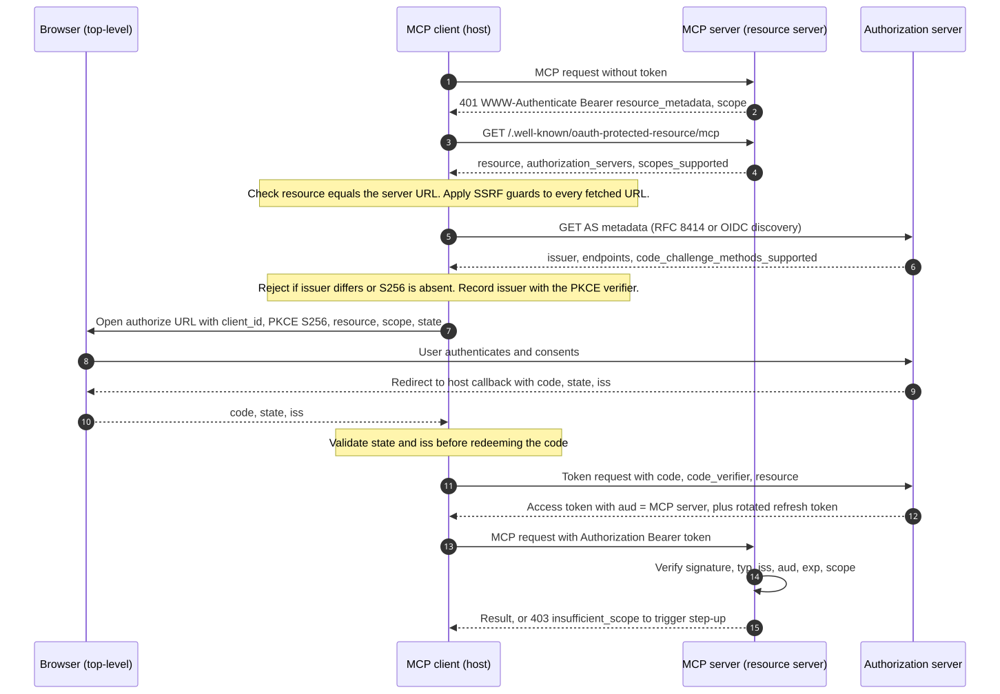

Each check in that chain answers a specific attack.

**Audience binding defeats token passthrough and token redirection.** RFC 8707 lets the authorization server stamp the MCP server's URI into the token. Since 2025-06-18 the spec has required clients to send `resource` "regardless of whether authorization servers support it". Servers "MUST validate that access tokens were issued specifically for them" and "MUST NOT accept or transit any other tokens" ([MCP 2026-07-28](https://modelcontextprotocol.io/specification/2026-07-28/basic/authorization)). The changelog states the purpose directly: "to prevent malicious servers from obtaining access tokens" ([MCP 2025-06-18 changelog](https://modelcontextprotocol.io/specification/2025-06-18/changelog)).

A server that validates JWT access tokens should follow RFC 9068: require a `typ` of `at+jwt`, match `iss` to the expected issuer, confirm that `aud` names this server, and reject `alg: none`. The explicit type stops an attacker from submitting an ID token in place of an access token ([RFC 9068](https://www.rfc-editor.org/rfc/rfc9068.html)). Obot's Dynamic Client Registration (DCR) takeover (GHSA-xwmw-prc4-v3cr, CVSS 8.8) shows the cost of skipping this. Tokens minted through a client registered by an attacker carried the victim's full group set and worked against every Obot API, until v0.23.0 added audience validation ([VulnCheck](https://www.vulncheck.com/advisories/obot-before-0.23.0-authentication-bypass-via-oauth-dynamic-client-registration)).

The hosts enforce the client half of this. ChatGPT appends `resource=<MCP URL>` to both authorization and token requests and expects the authorization server to put it in `aud` ([OpenAI Apps SDK: Authentication](https://developers.openai.com/apps-sdk/build/auth)). Claude requires the PRM `resource` to equal the URL "as the user enters it in Claude, including any path", and it uses only the first entry in `authorization_servers`. Servers backed by Microsoft Entra must register the MCP URL as an Application ID URI, or token requests fail with `AADSTS9010010` ([Claude: Authentication for connectors](https://claude.com/docs/connectors/building/authentication)).

**Issuer validation defeats mix-up and metadata spoofing.** A client that talks to many authorization servers can be tricked by a malicious one into sending it a code that an honest server issued. The 2026-07-28 revision added RFC 9207 handling: clients MUST record the issuer before redirecting, MUST validate a present `iss` by exact string comparison with no normalization, and MUST NOT display error text from a response whose issuer does not match. The spec notes that "PKCE alone does not prevent this attack because the client transmits the `code_verifier` to the attacker's token endpoint" ([MCP Security Considerations](https://modelcontextprotocol.io/specification/2026-07-28/basic/authorization/security-considerations)). Stored client credentials MUST be keyed by issuer and never reused with a different authorization server ([MCP Client Registration](https://modelcontextprotocol.io/specification/2026-07-28/basic/authorization/client-registration)).

The September 2026 Python SDK flaw is the textbook failure. When a malicious server returned 404 to standard discovery, the SDK took its OAuth configuration from that server and handed it the secret, code and verifier, which the attacker could redeem at the real authorization server ([CSA research note](https://labs.cloudsecurityalliance.org/wp-content/uploads/2026/09/CSA_research_note_mcp_python_sdk_oauth_flaw_20260930-csa-styled.pdf)). ChatGPT already rejects responses that omit or mismatch `iss` when the authorization server advertises support ([OpenAI Apps SDK: Authentication](https://developers.openai.com/apps-sdk/build/auth)). OAuth 2.1 draft -16 makes `iss` mandatory for authorization servers ([OAuth 2.1 -16](https://www.ietf.org/archive/id/draft-ietf-oauth-v2-1-16.html)). MCP says a future revision is expected to upgrade it from SHOULD to MUST ([MCP 2026-07-28](https://modelcontextprotocol.io/specification/2026-07-28/basic/authorization)). Authorization servers should start sending it now.

**Discovery guards defeat SSRF and malicious URLs.** Every URL in the chain can be controlled by an attacker: `resource_metadata`, `authorization_servers`, and the endpoints in authorization server metadata. A hostile server can answer `resource_metadata="http://169.254.169.254/..."` and harvest cloud credentials through the client's fetch ([MCP Security Best Practices](https://modelcontextprotocol.io/docs/2026-07-28/tutorials/security/security_best_practices)). Because Claude and ChatGPT run discovery from their own clouds, this is server-side request forgery against the vendor's infrastructure. The MCP best practices tell clients to enforce HTTPS except for loopback during development, block private and link-local ranges (`10.0.0.0/8`, `169.254.0.0/16`, `fc00::/7` and the rest) with a vetted library rather than hand-written IP parsing, validate or disable redirects, consider an egress proxy such as Stripe's Smokescreen, and pin DNS resolution between the check and the use ([MCP Security Best Practices](https://modelcontextprotocol.io/docs/2026-07-28/tutorials/security/security_best_practices)). RFC 9728 §7.7 gives the same advice ([RFC 9728](https://www.rfc-editor.org/rfc/rfc9728.html)).

URLs that will be opened, rather than fetched, need a scheme allowlist. Clients MUST allow only `http` and `https`, MUST reject `javascript:`, `data:`, `file:` and `vbscript:`, and MUST NOT open URLs through a shell ([MCP Security Best Practices](https://modelcontextprotocol.io/docs/2026-07-28/tutorials/security/security_best_practices)). These rules were written after `mcp-remote` passed a crafted endpoint to an `open()` helper that built a PowerShell command on Windows ([JFrog](https://jfrog.com/blog/2025-6514-critical-mcp-remote-rce-vulnerability/)).

**PKCE S256 defeats code interception and injection, but only when the server enforces it.** S256 sends only a hash of the verifier through the browser, so someone who sees the authorization request cannot redeem the code. The `plain` method exposes the verifier, and OAuth 2.1 -16 has "removed and explicitly prohibited" it ([RFC 7636](https://www.rfc-editor.org/rfc/rfc7636.html); [OAuth 2.1 -16](https://www.ietf.org/archive/id/draft-ietf-oauth-v2-1-16.html)). Enforcement is the weak point. **68.1% of testable OAuth-enabled MCP servers accepted a PKCE downgrade** ([Zhou et al.](https://arxiv.org/html/2605.22333v1)). Cloudflare's `workers-oauth-provider` shipped a PKCE bypass (CVE-2025-4144) together with a redirect URI that was checked only at token exchange (CVE-2025-4143); both were fixed in 0.0.5 ([Kodem](https://www.kodemsecurity.com/cve-archive/cve-2025-4143)). RFC 9700 requires the authorization server to reject a token request that carries a `code_verifier` when the authorization request had no challenge ([RFC 9700](https://www.rfc-editor.org/rfc/rfc9700.html)).

**Verifying every request defeats session and state-handle hijacking.** The 2025-11-25 best practices described attackers who obtain a session ID and then either inject events through a shared queue or simply call the server with it. The fix was that servers "MUST verify all inbound requests" and "MUST NOT use sessions for authentication" ([MCP Best Practices 2025-11-25](https://modelcontextprotocol.io/specification/2025-11-25/basic/security_best_practices)). The 2026-07-28 revision removed protocol-level sessions and the `Mcp-Session-Id` header entirely ([MCP 2026-07-28 changelog](https://modelcontextprotocol.io/specification/2026-07-28/changelog)). It renamed the threat "State Handle Hijacking". A cart ID or similar handle passed as a tool argument does not prove who the caller is. Stored state should be keyed as `<user_id>:<handle>`, with the user ID taken from the verified token ([MCP Security Best Practices](https://modelcontextprotocol.io/docs/2026-07-28/tutorials/security/security_best_practices)). The same principle rules out failing open. LiteLLM's fallback to an empty auth object let attackers list and invoke every configured tool (CVE-2026-59822, fixed in 1.84.0) ([Corgea](https://corgea.com/research/cve-2026-59822-litellm-mcp-streamable-http-auth-bypass)).

**Scope minimization and step-up limit the damage.** If a server lists everything in `scopes_supported`, tokens end up carrying broad scopes like `files:*` or `admin:*`, and any theft becomes lateral access ([MCP Security Best Practices](https://modelcontextprotocol.io/docs/2026-07-28/tutorials/security/security_best_practices)). The spec's progressive model starts with a minimal scope and elevates through targeted challenges such as `403 Forbidden` with `WWW-Authenticate: Bearer error="insufficient_scope", scope="files:write"`. Since 2026-07-28 the client accumulates scopes by taking a union, instead of the server re-listing them ([MCP 2026-07-28](https://modelcontextprotocol.io/specification/2026-07-28/basic/authorization)). The `scope` parameter on the first 401 is a SHOULD, not a MUST, but leaving it out has a cost: Claude then requests all of `scopes_supported` plus `offline_access`, "which can produce an over-broad consent prompt" ([Claude: Lazy authentication](https://claude.com/docs/connectors/building/lazy-authentication)).

Platform-level gates do not replace checks in each tool. Microsoft notes that App Service's MCP authorization "doesn't provide granular control to individual MCP tools" ([Microsoft Learn](https://learn.microsoft.com/en-us/azure/app-service/configure-authentication-mcp)). OpenAI tells developers to verify token, scopes and audience "on every invocation", whatever the tool declares ([OpenAI Apps SDK: Authentication](https://developers.openai.com/apps-sdk/build/auth)).

### Client ID Metadata Documents replace client registration that clients describe themselves

Consent phishing starts with client identity. Under Dynamic Client Registration (RFC 7591), an anonymous caller can register any name, logo and redirect URI. The authorization server "MUST treat all client metadata as self-asserted", and RFC 7591 itself warns that "a rogue client might use the name and logo of a legitimate client" ([RFC 7591](https://www.rfc-editor.org/rfc/rfc7591.html)). The measured result is stark: **95.8% of testable OAuth-enabled MCP servers let anonymous requesters attach arbitrary redirect URIs through DCR** ([Zhou et al.](https://arxiv.org/html/2605.22333v1)).

MCP made Client ID Metadata Documents (CIMD) the SHOULD option in 2025-11-25 and formally deprecated DCR in 2026-07-28. DCR can be removed no earlier than the first revision released on or after 28 July 2027 ([MCP deprecated features](https://modelcontextprotocol.io/specification/2026-07-28/deprecated)). With CIMD, the `client_id` is an HTTPS URL. The authorization server fetches the JSON document at that URL, requires the document's `client_id` to match the URL exactly, and registers the document's redirect URIs at fetch time. It should also show the `client_id` hostname on the consent screen, so the user sees a domain instead of a display name the client picked ([CIMD draft -02](https://www.ietf.org/archive/id/draft-ietf-oauth-client-id-metadata-document-02.html)). SEP-991 describes the benefit as "Verifiable Identity: The HTTPS URL serves as both identifier and trust anchor" ([SEP-991](https://modelcontextprotocol.io/seps/991-enable-url-based-client-registration-using-oauth-c)).

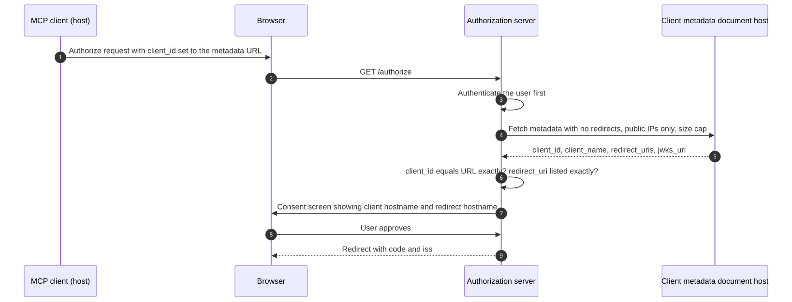

CIMD moves risk rather than removing it. The authorization server now fetches a URL supplied by an unknown client. CIMD -02 therefore forbids fetching URLs that resolve to special-use IP addresses, forbids following redirects, and recommends capping responses at about 5 KB ([CIMD draft -02](https://www.ietf.org/archive/id/draft-ietf-oauth-client-id-metadata-document-02.html)). Cloudflare's library turns CIMD on only together with a `global_fetch_strictly_public` flag ([workers-oauth-provider](https://github.com/cloudflare/workers-oauth-provider)).

Localhost redirect impersonation also survives. An attacker can present a legitimate client's CIMD URL with a loopback redirect, and "the user will see the legitimate client's name". The authorization server MUST therefore show the redirect URI hostname, and SHOULD warn when a client registers only loopback redirects ([MCP Security Considerations](https://modelcontextprotocol.io/specification/2026-07-28/basic/authorization/security-considerations)).

Host behaviour shapes deployment. **Claude** uses CIMD only when the authorization server metadata advertises both `client_id_metadata_document_supported: true` and `none` in `token_endpoint_auth_methods_supported`; otherwise it falls back to DCR, which registers "a new client on every fresh connection" ([Claude: Authentication for connectors](https://claude.com/docs/connectors/building/authentication)). **ChatGPT** prefers CIMD, using the client ID `https://chatgpt.com/oauth/client.json`, and supports `private_key_jwt` with its own JWKS ([OpenAI Apps SDK: Authentication](https://developers.openai.com/apps-sdk/build/auth)).

Identity-provider support arrived during 2026, but unevenly. Clerk reached general availability on 17 September 2026, Auth0 offers manual CIMD registration, and Stytch remains in beta ([Clerk](https://clerk.com/changelog/2026-09-17-client-id-metadata-documents-ga); [Auth0](https://auth0.com/docs/get-started/auth0-overview/create-applications/register-applications-with-cimd); [Stytch](https://stytch.com/docs/guides/connected-apps/client-types)). Microsoft Entra does not support DCR ([Microsoft Learn](https://learn.microsoft.com/en-us/azure/app-service/configure-authentication-mcp)), and no evidence of Entra CIMD support was found. Only 3 of the 78 MCP servers Obsidian tested had adopted CIMD by January 2026 ([Obsidian](https://www.obsidiansecurity.com/blog/when-mcp-meets-oauth-common-pitfalls-leading-to-one-click-account-takeover)).

## Approach 2: host-mediated authentication keeps the View token-free

The MCP Apps project documents one standard pattern, which it calls "UI-initiated auth escalation". A public tool renders the View without authorization. The user clicks a button that calls a protected tool through `app.callServerTool()`, "the MCP host receives HTTP 401 and automatically runs the OAuth flow", the host retries the call with the new token, and the data appears in the View ([ext-apps authorization guide](https://github.com/modelcontextprotocol/ext-apps/blob/main/docs/authorization.md)). The guide says plainly that "the host manages the entire OAuth flow — the app code simply calls the tool and handles the result". It adds that the 401 must come from the HTTP layer, and that tool handlers re-check auth info as a second line of defence ([ext-apps authorization guide](https://github.com/modelcontextprotocol/ext-apps/blob/main/docs/authorization.md)). The reference `lazy-auth-server` example sets a 30-second access-token lifetime and a 5-minute refresh-token lifetime, so it exercises three paths: direct success, silent refresh and full re-authentication ([lazy-auth-server example](https://github.com/modelcontextprotocol/ext-apps/tree/main/examples/lazy-auth-server)).

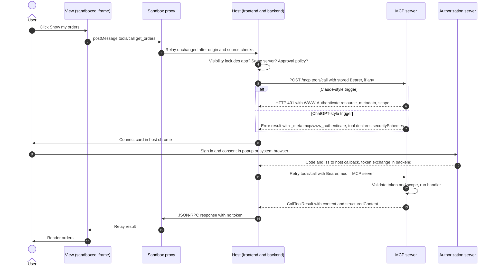

### Claude and ChatGPT trigger account linking differently

The pattern works on both hosts, but the trigger does not. Claude starts sign-in "only when the HTTP request itself fails with `401 Unauthorized` and a `WWW-Authenticate` header". A `200` response carrying `isError: true` goes to the model as text, and "there is no auth prompt" ([Claude: Lazy authentication](https://claude.com/docs/connectors/building/lazy-authentication)). ChatGPT shows its linking UI only when two things are both present: per-tool `securitySchemes` together with PRM metadata, and a runtime error result carrying `_meta["mcp/www_authenticate"]` with `error` and `error_description` ([OpenAI Apps SDK: Authentication](https://developers.openai.com/apps-sdk/build/auth)).

A server targeting both hosts should enforce authentication at the HTTP layer for Claude, and also declare `securitySchemes` and emit the `_meta` challenge for ChatGPT. Whether a plain 401 also triggers ChatGPT's per-tool linking is not documented.

| Dimension | Claude | ChatGPT |
|---|---|---|
| Linking trigger | HTTP `401` with `WWW-Authenticate`; ignores the header on a `200` | `securitySchemes` on the tool plus an `isError` result with `_meta["mcp/www_authenticate"]` |
| Step-up | `403` with `error="insufficient_scope"` re-authenticates; any other `403` is terminal | Re-authorization can include `id_token_hint` |
| Client registration | CIMD if `none` auth is advertised, otherwise DCR; Anthropic-held credentials on request | CIMD preferred (`chatgpt.com/oauth/client.json`), DCR registered once per connection |
| Redirect URI | `https://claude.ai/api/mcp/auth_callback`; loopback on any port for Claude Code | `https://chatgpt.com/connector_platform_oauth_redirect` for servers compliant with RFC 9207 |
| Token custody and egress | Backend; tool calls leave from `160.79.104.0/21` | Backend; optional OpenAI-managed mTLS client certificate |
| Machine-to-machine | `client_credentials` unsupported; `static_headers` in beta | No client credentials, service accounts or custom API keys |
| View origin | `{sha256(url)[:32]}.claudemcpcontent.com` | `ui.domain` required and unique for each plugin with UI |
| Write gating | Read-only tools run unprompted; destructive tools always prompt | All three hints required; hints "do not grant permission" |
| Refresh | Reactive on `401`, proactive up to 5 minutes before expiry | Not documented |
| Enterprise | EMA performs a silent token exchange instead of the Connect card | Workspace domain restrictions require OIDC and `email_verified` |

Sources: [Claude: Authentication](https://claude.com/docs/connectors/building/authentication); [Claude: Lazy authentication](https://claude.com/docs/connectors/building/lazy-authentication); [Claude: Getting started with MCP Apps](https://claude.com/docs/connectors/building/mcp-apps/getting-started); [Claude: review criteria](https://claude.com/docs/connectors/building/review-criteria); [OpenAI Apps SDK: Authentication](https://developers.openai.com/apps-sdk/build/auth); [OpenAI Apps SDK: Reference](https://developers.openai.com/apps-sdk/reference); [OpenAI guidelines](https://developers.openai.com/apps-sdk/app-submission-guidelines).

### The View is a presentation layer with no credentials

Keeping the View free of tokens makes token theft through the View structurally impossible, not merely unlikely. A View cannot leak, store or forward a credential it never receives. OpenAI's guidance is to "Avoid embedding secrets or tokens in component props" ([OpenAI Security & Privacy](https://developers.openai.com/apps-sdk/guides/security-privacy)). Three less obvious leaks need the same discipline.

First, **`_meta` is not private**. ChatGPT exposes the "full MCP result envelope, including hidden `_meta`" to widgets ([OpenAI Apps SDK: Reference](https://developers.openai.com/apps-sdk/reference)), and the MCP Apps `tool-result` notification passes `CallToolResult` with `_meta` intact, so servers must never put secrets there. Second, **templates are shared across users**. Hosts "MAY prefetch and cache UI resource content", OpenAI treats the resource URI as a cache key ([MCP Apps stable spec](https://github.com/modelcontextprotocol/ext-apps/blob/main/specification/2026-01-26/apps.mdx); [OpenAI: Build your ChatGPT UI](https://developers.openai.com/apps-sdk/build/chatgpt-ui)), and lazy authentication lets `resources/read` run before sign-in. `ui://` HTML must therefore be identical for every user, with per-user data arriving only in authenticated tool results; Pomerium's MCP App guide serves widget assets publicly for exactly this reason ([Pomerium: Develop an MCP App](https://www.pomerium.com/docs/capabilities/mcp/develop-mcp-app)). Third, **the PKCE verifier and any DPoP private key must stay in the host process**. A View that could see the verifier and also observe the redirect could redeem the code, and DPoP offers no protection against code running inside the client ([RFC 9449](https://www.rfc-editor.org/rfc/rfc9449.html)).

### Login happens in a top-level window the user can verify

Entering credentials inside a View is the MCP Apps version of a decade-old anti-pattern. RFC 8252 says native apps "MUST NOT use embedded user-agents to perform authorization requests". The embedding app can "record every keystroke entered in the login form", and the practice "trains them that it's OK to enter credentials without validating the site first" ([RFC 8252](https://www.rfc-editor.org/rfc/rfc8252.html)). OAuth 2.1 carries the rule forward: "Native apps MUST use an external user agent" ([OAuth 2.1 -16](https://www.ietf.org/archive/id/draft-ietf-oauth-v2-1-16.html)).

To an authorization server, a sandboxed iframe inside a chat host is an embedded user agent with no visible address bar. RFC 9700 already requires authorization servers to prevent clickjacking with CSP `frame-ancestors` ([RFC 9700](https://www.rfc-editor.org/rfc/rfc9700.html)), so a correctly configured identity provider (IdP) login page refuses to render inside a View at all.

Both major hosts keep login in windows they control. Claude's hosted apps redirect to exactly `https://claude.ai/api/mcp/auth_callback`. Sign-in opens in a popup or the same tab on the web, and in the user's browser on desktop ([Claude: Authentication](https://claude.com/docs/connectors/building/authentication); [Claude: connectors overview](https://claude.com/docs/connectors/overview)). ChatGPT redirects to `https://chatgpt.com/connector_platform_oauth_redirect` ([OpenAI Apps SDK: Authentication](https://developers.openai.com/apps-sdk/build/auth)).

Policy backs this up on only one side. OpenAI's plugin guidelines forbid collecting "access credentials and authentication secrets (such as API keys, MFA/OTP codes, or passwords)" and prohibit "misleading or copycat designs, impersonation" ([OpenAI guidelines](https://developers.openai.com/apps-sdk/app-submission-guidelines)). The MCP Apps spec only names phishing in its threat model and says "Hosts should clearly indicate sandboxed UI boundaries" ([MCP Apps stable spec](https://github.com/modelcontextprotocol/ext-apps/blob/main/specification/2026-01-26/apps.mdx)). No equivalent Anthropic rule was found. Server developers should treat any password, API-key or OTP field in a View as a defect, whatever the host.

Top-level windows are not immune to UI redressing. DoubleClickjacking targets top-level windows, so `frame-ancestors` and `X-Frame-Options` "do not prevent this attack", and OWASP recommends separate transaction authorization for high-risk actions ([OWASP Clickjacking Cheat Sheet](https://cheatsheetseries.owasp.org/cheatsheets/Clickjacking_Defense_Cheat_Sheet.html)). For consents that grant write access, two RFCs help: Rich Authorization Requests (RFC 9396) let the authorization server display and record exactly what is being approved ([RFC 9396](https://www.rfc-editor.org/rfc/rfc9396.html)), and RFC 9470 lets a server demand fresh, stronger authentication before a sensitive tool runs ([RFC 9470](https://www.rfc-editor.org/rfc/rfc9470.html)).

### Two independent gates guard every write the View starts

Host mediation pays off most against prompt injection, because every View-initiated `tools/call` gets two chances to be stopped.

The **host gate** comes first. Hosts "MUST reject `tools/call` requests from apps for tools that don't include `"app"` in visibility". Cross-server calls are "always blocked for app-only tools". The host "MAY decide to block some messages or subject them to further user approval" ([MCP Apps stable spec](https://github.com/modelcontextprotocol/ext-apps/blob/main/specification/2026-01-26/apps.mdx)). Claude maps annotations to permissions: read-only tools "can run without per-call confirmation, and destructive tools always prompt", and users can set each tool to Always allow, Needs approval or Blocked ([Claude: review criteria](https://claude.com/docs/connectors/building/review-criteria); [Claude: connectors overview](https://claude.com/docs/connectors/overview)). ChatGPT requires `readOnlyHint`, `destructiveHint` and `openWorldHint` on every tool, and says the hints "do not grant permission or replace authentication, authorization and scope checks" ([OpenAI guidelines](https://developers.openai.com/apps-sdk/app-submission-guidelines)).

The **server gate** is authoritative. The same audience, scope and step-up checks apply whether the model or the View started the call. A tool marked `visibility: ["app"]` is hidden from the model but still runs with the user's token, so it needs annotations and authorization like any other tool.

Two View capabilities bypass the tool gate entirely. `ui/message` adds text to the conversation with `role: "user"`, and `ui/update-model-context` silently shapes future turns. For both, the host only "MAY request user consent" or "MAY display" the update ([MCP Apps stable spec](https://github.com/modelcontextprotocol/ext-apps/blob/main/specification/2026-01-26/apps.mdx)). A View that renders content an attacker controls, such as an email body or a support ticket, can therefore speak as the user and push the model into another connector's write tools. The per-server `"app"` visibility rule cannot catch this cross-connector pivot, because the model makes the call, not the View.

The incident record shows why confirmations matter and also why they wear down. The GitHub exfiltration succeeded partly because users click "Always Allow" ([Invariant Labs](https://invariantlabs.ai/blog/mcp-github-vulnerability)). Only **37.2% of 1,723 MCP client apps require a blocking approval before running a tool** ([Majeed et al.](https://arxiv.org/abs/2607.25635)). Deterministic enforcement outperforms model judgment. Progent's tool-call privilege policies cut AgentDojo attack success from 41.2% to 2.2% ([Progent](https://arxiv.org/html/2504.11703v2)). CaMeL tags data with capabilities and blocks exfiltration with provable guarantees ([CaMeL](https://arxiv.org/abs/2503.18813)).

The 2026-07-28 release-candidate post states that UI-initiated actions "go through the same audit and consent path as a direct tool call" ([MCP RC post](https://blog.modelcontextprotocol.io/posts/2026-07-28-release-candidate/)). Neither Anthropic nor OpenAI documents whether View-initiated calls get the same "Allow once" or write-confirmation prompts as calls the model starts. Server-side authorization must not assume they do.

## Double-iframe sandboxing makes postMessage the only way in or out

The spec requires that "All View content MUST be rendered in sandboxed iframes". A web host "MUST wrap the View and communicate with it through an intermediate Sandbox proxy" on a different origin from the host. The proxy needs `allow-scripts allow-same-origin`, and it forwards every message except its own `ui/notifications/sandbox-*` handshake ([MCP Apps stable spec](https://github.com/modelcontextprotocol/ext-apps/blob/main/specification/2026-01-26/apps.mdx)).

The separate origin is essential. WHATWG warns that combining `allow-scripts` and `allow-same-origin` on content from the same origin lets the page remove its own sandbox. It advises serving hostile HTML "from a separate dedicated domain" ([WHATWG HTML](https://html.spec.whatwg.org/multipage/iframe-embed-object.html)). The result is three origins. Because the View cannot reach the host's DOM, cookies or storage, it cannot read the host's session cookie or anything held in the host backend.


**Content Security Policy controls where data can go.** If `_meta.ui.csp` is absent, the host MUST apply `default-src 'none'; script-src 'self' 'unsafe-inline'; … connect-src 'none'`. It MUST NOT allow undeclared domains. It maps `connectDomains`, `resourceDomains`, `frameDomains` and `baseUriDomains` onto the matching directives ([MCP Apps stable spec](https://github.com/modelcontextprotocol/ext-apps/blob/main/specification/2026-01-26/apps.mdx)). Inline scripts are always allowed, so the CSP limits where data can go, not what code runs.

Every declared domain is an exfiltration channel for whatever the View can see. A page embedded through `frameDomains` "follows its own CSP", and the widget's allowlists "do not restrict network requests made inside that page" ([OpenAI Security & Privacy](https://developers.openai.com/apps-sdk/guides/security-privacy)). The spec says hosts SHOULD warn users when a View needs external domains, but no evidence shows Claude or ChatGPT doing so. OpenAI instead checks the declared policy against the UI's behaviour during review ([OpenAI: Build your ChatGPT UI](https://developers.openai.com/apps-sdk/build/chatgpt-ui)).

**The `postMessage` channel is where MCP Apps' only known vulnerability appeared.** The ext-apps SDK transport sends with a `'*'` target, described as "visible to all frames. The receiver should validate the message source". It filters inbound messages by `event.source` ([ext-apps message-transport.ts](https://github.com/modelcontextprotocol/ext-apps/blob/main/src/message-transport.ts)). The spec's example for use without the SDK posts with `'*'` and checks nothing ([MCP Apps stable spec](https://github.com/modelcontextprotocol/ext-apps/blob/main/specification/2026-01-26/apps.mdx)).

CVE-2026-76894, published 16 October 2026, hit exactly that gap. A CKAN MCP server's `ui://` resource accepted messages without validating `event.origin` and posted JSON-RPC with `targetOrigin "*"`. An embedding page could inject fabricated rows and phishing links, spoof responses to pending request IDs, and read the View's traffic ([GitLab advisory](https://advisories.gitlab.com/npm/@aborruso/ckan-mcp-server/CVE-2026-76894/)).

Host SDKs had the mirror-image problem. According to an aggregator's copy of its release notes, Vercel's `@ai-sdk/react` 4.0.31, released 15 July 2026, set a concrete target origin and validated inbound origins, limited `resources/read` to `ui://`, restricted `ui/open-link` to `https`, `http` and `mailto`, and made permissions deny-by-default ([releases.sh mirror of release notes](https://releases.sh/release/rel_C741RVCbIV3Y8N-MK0vIR)).

The correct rules combine several standards. Never use `'*'` when a message carries anything sensitive ([WHATWG Web Messaging](https://html.spec.whatwg.org/multipage/web-messaging.html)); RFC 9700 §4.17 makes this a MUST for OAuth messages ([RFC 9700](https://www.rfc-editor.org/rfc/rfc9700.html)). Check `event.source === iframe.contentWindow`, because a sandboxed frame without `allow-same-origin` reports its origin as the string `"null"` and an origin check alone is not enough ([WHATWG origin serialization](https://html.spec.whatwg.org/multipage/browsers.html#ascii-serialisation-of-an-origin)). Validate every message against a schema, and never `eval` message data or insert it with `innerHTML` ([OWASP HTML5 Cheat Sheet](https://cheatsheetseries.owasp.org/cheatsheets/HTML5_Security_Cheat_Sheet.html)). The reference host sandbox shows the pattern. It derives the expected host origin from an allowlisted referrer and rejects other origins. It deliberately probes `window.top` to confirm isolation. It delivers its CSP through HTTP headers, which the View cannot tamper with ([ext-apps sandbox.ts](https://github.com/modelcontextprotocol/ext-apps/blob/main/examples/basic-host/src/sandbox.ts)).

**The host controls navigation, which turns phishing redirects into events the user can confirm.** The reference inner iframe omits `allow-popups`, `allow-top-navigation` and `allow-downloads`, so links go through `ui/open-link` ([ext-apps sandbox.ts](https://github.com/modelcontextprotocol/ext-apps/blob/main/examples/basic-host/src/sandbox.ts)). Claude shows an "Open external link" modal that "protects users from being silently redirected by an embedded app". Directory connectors can allowlist origins, but skipping the modal still requires "a real user gesture", look-alike hosts such as `https://example.com.attacker.net` still trigger the prompt, and custom and locally configured connectors always show it ([Claude: Open external links](https://claude.com/docs/connectors/building/mcp-apps/external-links)). ChatGPT blocks `alert`, `prompt` and `confirm` in widgets ([OpenAI Security & Privacy](https://developers.openai.com/apps-sdk/guides/security-privacy)). Against clickjacking, the View is confined to its iframe box, so its content cannot cover the host's own confirmation modals. Neither vendor documents defences against a View in fullscreen or picture-in-picture mode imitating host chrome.

**The choice of origin determines what a View can remember.** By default, a host assigns a sandbox origin, typically one per conversation. Setting `_meta.ui.domain` opts into a stable origin. Claude requires that domain to be the first 32 hex characters of the SHA-256 hash of the connector URL, plus `.claudemcpcontent.com`, which ties each origin to one server URL ([Claude: Getting started with MCP Apps](https://claude.com/docs/connectors/building/mcp-apps/getting-started)). ChatGPT requires a unique `ui.domain` for each plugin with a UI ([OpenAI Apps SDK: Reference](https://developers.openai.com/apps-sdk/reference)). A stable origin shares `localStorage` across every conversation and every instance of that server in the user's browser. ChatGPT's multi-account support means one widget origin can serve two linked accounts ([OpenAI Apps SDK: Authentication](https://developers.openai.com/apps-sdk/build/auth)). OWASP's advice applies directly: "Do not store session identifiers in local storage" ([OWASP HTML5 Cheat Sheet](https://cheatsheetseries.owasp.org/cheatsheets/HTML5_Security_Cheat_Sheet.html)). Key any View storage by an identifier the server issues. Keep anything that represents the user's work on the server, through app-only tools, as the ext-apps patterns guide recommends ([ext-apps patterns](https://github.com/modelcontextprotocol/ext-apps/blob/main/docs/patterns.md)).

## Approach 3: credentials held by the View are a narrow, deliberate exception

Host mediation covers every call that goes through MCP. It does not cover a View that talks directly to the developer's own web API. In that case "MCP OAuth does not authorize those iframe requests", and the API "needs its own web auth and CORS" ([sunpeak: MCP Apps authorization](https://sunpeak.ai/docs/mcp-apps/mcp/authorization)). The spec anticipates this case: `ui.domain` is "Useful when views need stable, dedicated origins for OAuth callbacks, CORS policies, or API key allowlists" ([MCP Apps stable spec](https://github.com/modelcontextprotocol/ext-apps/blob/main/specification/2026-01-26/apps.mdx)). Claude says a stable origin is needed "if your app runs its own OAuth flow", and local stdio connectors cannot use `ui.domain` at all ([Claude: Troubleshoot MCP Apps](https://claude.com/docs/connectors/building/mcp-apps/troubleshooting)).

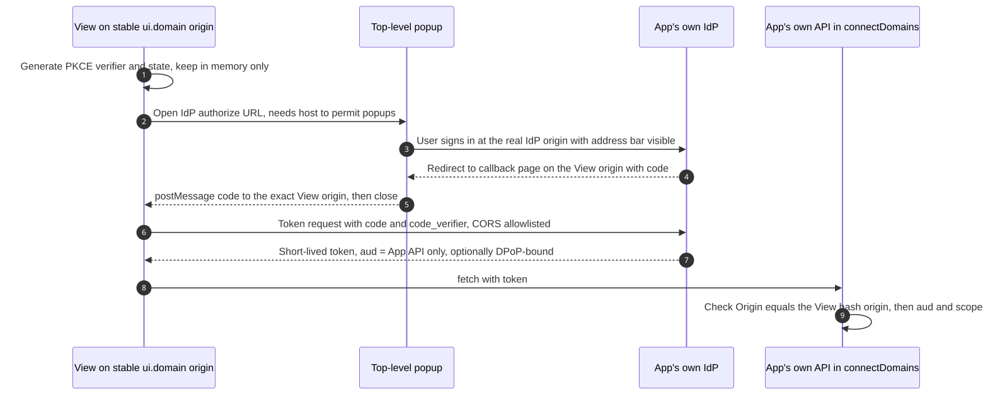

This approach brings back the browser-token problems that host mediation removed, so every compensating control is needed. The token sits in View JavaScript on a vendor-controlled origin, outside the host's credential store and consent screens, and any script injected into the View can use it. Request a token whose audience is only the app's API, never the MCP server, keep it in memory rather than `localStorage`, and keep its lifetime short. Consider DPoP with a non-extractable WebCrypto key, while accepting that DPoP "does not protect against XSS" because live malicious code can still mint proofs ([RFC 9449](https://www.rfc-editor.org/rfc/rfc9449.html)). Have the API allowlist the exact View `Origin`, which matters on iOS, where Claude renders Views in `WKWebView` and WebKit omits `Referer` on cross-origin subresources ([Claude: Troubleshoot MCP Apps](https://claude.com/docs/connectors/building/mcp-apps/troubleshooting)), and declare only that API in `connectDomains`. The login itself must still happen in a top-level popup at the IdP's real origin, never in a form inside the View, and whether Claude's production sandbox permits popups at all is not documented.

For most teams the better design avoids tokens in the View entirely. Expose the needed operations as app-only MCP tools (`visibility: ["app"]`) so they travel over the host's authenticated connection. If a third-party service is involved, let the MCP server hold that token through URL-mode elicitation, described next.

## Approach 4: downstream APIs get their own tokens, never the client's

Once an MCP server calls GitHub, Google or an internal API, it becomes an OAuth client in its own right. The spec's rule since 2025-06-18 is clear: "The access token used at the upstream API is a separate token, issued by the upstream authorization server. The MCP server MUST NOT pass through the token it received from the MCP client" ([MCP Security Considerations](https://modelcontextprotocol.io/specification/2026-07-28/basic/authorization/security-considerations)). Token passthrough breaks rate limiting and audit trails. It lets a stolen token use the server "as a proxy for data exfiltration", and it spreads one compromise across services ([MCP Security Best Practices](https://modelcontextprotocol.io/docs/2026-07-28/tutorials/security/security_best_practices)).

Microsoft gives the same instruction for Azure. The MCP token "is meant to represent access to your MCP server, and not to a downstream resource", so servers should "obtain a new token through the on-behalf-of flow or another mechanism for explicit delegation" ([Microsoft Learn](https://learn.microsoft.com/en-us/azure/app-service/configure-authentication-mcp)). The Coalition for Secure AI (CoSAI) generalizes this: "perform token exchange at every trust boundary" ([CoSAI](https://www.coalitionforsecureai.org/after-rsac-2026-the-mcp-security-question-everyone-kept-asking/)).

The resulting two-token architecture is simple to state. **Token A** has the MCP server as its audience and travels only from host to server. **Token B** has the downstream API as its audience, lives only on the server, and is bound to the user's `sub`.


Three mechanisms produce token B.

### OAuth proxies must collect consent for each client before going upstream

The oldest mechanism makes the MCP server an authorization server toward the client and an OAuth client toward the third party. The server mints its own token "bound to the third-party session". This was the 2025-03-26 design. The spec has since superseded it, but it survives in Cloudflare's hybrid pattern ([MCP 2025-03-26](https://modelcontextprotocol.io/specification/2025-03-26/basic/authorization); [Cloudflare Docs](https://developers.cloudflare.com/agents/model-context-protocol/protocol/authorization/)).

It is also the source of MCP's best-documented confused deputy. The attack needs four conditions at once: the proxy uses a static upstream client ID, MCP clients can register dynamically, the upstream authorization server sets a consent cookie, and the proxy does not ask for consent per client ([MCP Security Best Practices](https://modelcontextprotocol.io/docs/2026-07-28/tutorials/security/security_best_practices)). Obsidian Security found this attack live at Square's MCP server, where a DCR redirect restriction applied only to newly registered clients. A victim's single click delivered an MCP authorization code to the attacker's redirect URI. Other servers they tested also had `state` not bound to the session, injectable session cookies, and token passthrough ([Obsidian](https://www.obsidiansecurity.com/blog/when-mcp-meets-oauth-common-pitfalls-leading-to-one-click-account-takeover)).

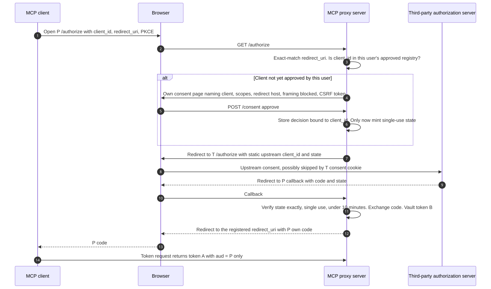

The spec turned the fix into MUST requirements. The proxy keeps a per-user registry of approved `client_id` values and checks it before redirecting upstream. Its consent page names the client, shows the upstream scopes and the registered redirect URI, carries CSRF protection, and blocks framing with `frame-ancestors` or `X-Frame-Options: DENY`. Consent cookies use the `__Host-` prefix with `Secure`, `HttpOnly` and `SameSite=Lax`, and are bound to the specific `client_id`. Redirect URIs match by exact string, and `state` is random, stored "only after consent has been explicitly approved", single-use and short-lived, for example 10 minutes ([MCP Security Best Practices](https://modelcontextprotocol.io/docs/2026-07-28/tutorials/security/security_best_practices)).

Zhou et al. add two failure modes specific to proxies. One is enforcing PKCE at the MCP layer but not upstream. The other is embedding the downstream redirect URI inside the upstream `state` without integrity protection; 40 of 81 servers using delegated authorization used such nested state ([Zhou et al.](https://arxiv.org/html/2605.22333v1)). Libraries help but do not finish the job. `workers-oauth-provider` stores tokens only as hashes and encrypts each grant's upstream tokens. However, it "advertises scopes but does not enforce them" and leaves the consent page to the application ([workers-oauth-provider](https://github.com/cloudflare/workers-oauth-provider)).

### URL-mode elicitation gets third-party consent outside the client

URL-mode elicitation (SEP-1036) was introduced in 2025-11-25 and developed with Arcade.dev. It lets an authenticated MCP server obtain consent for a third-party service without the client ever touching the credential ([SEP index](https://modelcontextprotocol.io/seps); [Arcade](https://blog.arcade.dev/mcp-server-authorization-guide)). Arcade sells this pattern, so its framing is not neutral, but the mechanism is now normative spec text. It is explicitly "not for authorizing the MCP client's access to the MCP server" ([MCP Elicitation](https://modelcontextprotocol.io/specification/2026-07-28/client/elicitation)).

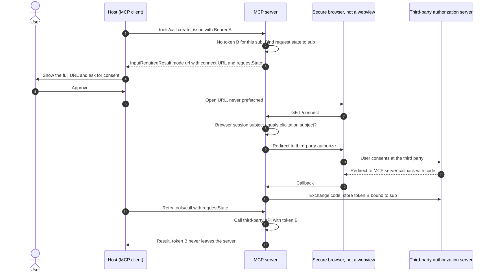

The rules map one-to-one onto risks. Against **token theft**, third-party credentials "MUST NOT transit through the MCP client", and the server "MUST NOT transmit credentials obtained through URL mode elicitation to the MCP client". Against **token passthrough**, the server "MUST NOT use the client's credentials for the third-party service". Against **credential entry in an embedded view**, the client opens the URL in a secure browser (`SFSafariViewController` qualifies, `WKWebView` does not), shows the full URL and gets consent first, and never pre-fetches it. Against **leaked or reusable URLs**, the server "MUST NOT provide a URL which is pre-authenticated" and must not put credentials or personal data in it ([MCP Elicitation](https://modelcontextprotocol.io/specification/2026-07-28/client/elicitation)).

The subtlest rule addresses consent phishing. Suppose Alice triggers an elicitation and forwards the URL to Bob. If Bob completes it, Bob's third-party account would be bound to Alice. The server therefore "MUST ensure that the user who started the elicitation request … is the same user who completes the authorization flow", for example by comparing the MCP token's `sub` with the browser session's subject ([MCP Elicitation](https://modelcontextprotocol.io/specification/2026-07-28/client/elicitation)). The 2026-07-28 revision removed the completion notification. Clients learn that the flow finished by retrying with `requestState` ([MCP 2026-07-28 changelog](https://modelcontextprotocol.io/specification/2026-07-28/changelog)).

### Token exchange and gateway vaults scale the two-token model

When the MCP server and the downstream API trust the same IdP, RFC 8693 token exchange replaces interactive consent. The server presents token A as `subject_token`, names the downstream `audience`, and receives token B. The `act` claim in token B records that the MCP server is acting for the user ([RFC 8693](https://www.rfc-editor.org/rfc/rfc8693.html)). AWS AgentCore Gateway implements this as an on-behalf-of exchange whose result "carries both the user's identity and the agent's identity". Its support matrix lists token passthrough as **not supported** for MCP server targets ([AWS AgentCore outbound auth](https://docs.aws.amazon.com/bedrock-agentcore/latest/devguide/gateway-outbound-auth.html)).

Gateways that broker credentials put the two-token model into production. Pomerium keeps internal upstream tokens that are "never exposed to external clients" ([Pomerium](https://www.pomerium.com/docs/capabilities/mcp/reference)), Azure API Management (APIM) has a credential manager that injects upstream tokens ([APIM](https://learn.microsoft.com/azure/api-management/secure-mcp-servers)), Auth0 Token Vault has been generally available since November 2025 ([Auth0](https://auth0.com/blog/auth0-for-ai-agents-generally-available/)), and AgentCore Identity's vault is encrypted with KMS and scoped to one agent-and-user pair ([AgentCore Identity](https://aws.amazon.com/blogs/machine-learning/introducing-amazon-bedrock-agentcore-identity-securing-agentic-ai-at-scale)).

Two cautions apply. First, gateways still ship passthrough options, such as APIM's documented header forwarding, so passthrough is now a configuration risk inside architectures that are otherwise sound ([APIM](https://learn.microsoft.com/azure/api-management/secure-mcp-servers)). Second, a vault concentrates risk. In 2025, attackers stole OAuth and refresh tokens tied to Salesloft's Drift AI chat agent and used them to export data from customer Salesforce instances ([Security Affairs](https://securityaffairs.com/181632/hacking/unc6395-targets-salesloft-in-drift-oauth-token-theft-campaign.html)). The MCP spec gives no normative guidance on how long upstream tokens may be cached, or how to revoke them when the MCP token is revoked. General token exchange from MCP server to upstream remains a roadmap item ([MCP Roadmap](https://blog.modelcontextprotocol.io/posts/mcp-roadmap/)).

## Approach 5: Enterprise-Managed Authorization trades user consent for IdP policy

Per-user, per-server consent scales badly inside companies. Users accumulate grants that nobody tracks, administrators have no central policy, and personal and work accounts get mixed ([MCP EMA blog](https://blog.modelcontextprotocol.io/posts/enterprise-managed-auth/)). The Enterprise-Managed Authorization (EMA) extension has been stable since 18 June 2026. It brings Okta's Cross App Access protocol into MCP using the Identity Assertion JWT Authorization Grant (ID-JAG), which is IETF draft -04, dated 21 May 2026 ([MCP EMA blog](https://blog.modelcontextprotocol.io/posts/enterprise-managed-auth/); [ID-JAG -04](https://www.ietf.org/archive/id/draft-ietf-oauth-identity-assertion-authz-grant-04.html)). Anthropic has implemented it for Claude, Claude Code and Cowork, and VS Code supports it in preview. On the server side, Asana, Atlassian, Canva, Figma, Granola, Linear and Supabase support it ([MCP EMA blog](https://blog.modelcontextprotocol.io/posts/enterprise-managed-auth/)).

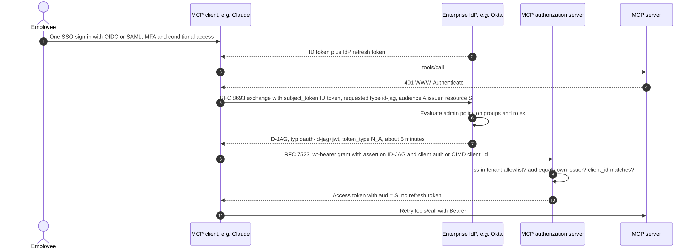

This design removes several attack surfaces at once. With "no per-connector consent page", there is no consent screen to phish, frame or click through, and MFA and conditional access apply once, at SSO ([Claude: Enterprise Managed Auth](https://claude.com/docs/connectors/building/enterprise-managed-auth)). The ID-JAG is returned with `token_type: N_A`, so it cannot be used as a bearer token; its `aud` must equal the MCP authorization server's issuer, it must not be reused across authorization servers, and the resulting access token "MUST be audience-restricted to the MCP Server named in the ID-JAG's resource claim" ([MCP EMA spec](https://github.com/modelcontextprotocol/ext-auth/blob/main/specification/stable/enterprise-managed-authorization.mdx); [ID-JAG -04](https://www.ietf.org/archive/id/draft-ietf-oauth-identity-assertion-authz-grant-04.html)). Lifetimes are short: the example ID-JAG expires in 300 seconds, and authorization servers "SHOULD NOT issue refresh tokens", so clients re-exchange instead ([WorkOS](https://workos.com/blog/mcp-enterprise-managed-authorization-id-jag)). Anthropic's integration guide adds a multi-tenant control, in which the MCP authorization server keeps a per-tenant allowlist of trusted issuer URLs and rejects any `iss` not on it with `invalid_grant` "even if the signature is valid" ([Claude: Enterprise Managed Auth](https://claude.com/docs/connectors/building/enterprise-managed-auth)).

The trade-offs are real. Users no longer see a notice before an agent gains access, and the IdP's visibility ends when it issues the token, so the MCP operator must audit actual tool use ([WorkOS](https://workos.com/blog/mcp-enterprise-managed-authorization-id-jag)). DCR is not supported, because the IdP stamps a fixed `client_id` into each assertion, so clients must be pre-registered or use CIMD ([Claude: Enterprise Managed Auth](https://claude.com/docs/connectors/building/enterprise-managed-auth)). Every customer needs an existing three-way SSO trust between client, IdP and server, and linking IdP subjects to local users, including email collisions, is left to the implementer ([WorkOS](https://workos.com/blog/mcp-enterprise-managed-authorization-id-jag)). ID-JAG also works only for confidential clients and does not yet define `act` semantics, so on its own it cannot express "agent X acting for user Y" ([ID-JAG -04](https://www.ietf.org/archive/id/draft-ietf-oauth-identity-assertion-authz-grant-04.html)).

For MCP Apps the effect is specific. In an EMA organization, Claude answers a protected tool's 401 with "a silent token exchange instead of the Connect card" ([Claude: Lazy authentication](https://claude.com/docs/connectors/building/lazy-authentication)). A View-initiated call can therefore gain access with no visible authentication moment, and the host's tool-approval gate becomes the only control the user sees.

## Approach 6: machine credentials and local servers need different guardrails

Not every caller is a person in a chat host.

**Machine-to-machine credentials.** For service-to-service traffic, SEP-1046 (Final) restored the OAuth client-credentials grant that disappeared after 2025-03-26. It recommends JWT client assertions per RFC 7523 over shared secrets, and excludes mTLS. The matching `ext-auth` extension is still labelled Draft ([SEP-1046](https://modelcontextprotocol.io/seps/1046-support-oauth-client-credentials-flow-in-authoriza); [Client Credentials draft](https://github.com/modelcontextprotocol/ext-auth/blob/main/specification/draft/oauth-client-credentials.mdx)). Neither consumer host uses it. Claude states that "a machine-to-machine `client_credentials` grant isn't supported". ChatGPT supports no client credentials, service accounts, JWT bearer assertions or custom API keys ([Claude: Authentication](https://claude.com/docs/connectors/building/authentication); [OpenAI Apps SDK: Authentication](https://developers.openai.com/apps-sdk/build/auth)).

**Static API keys.** Claude's `static_headers` option (beta, for a limited set of organizations) lets an owner enter one API key ([Claude: Authentication](https://claude.com/docs/connectors/building/authentication)). The key must be read from a header and "never [accepted] in the URL". It is "the organization's credential, not a person's": every member's requests carry it, so it must not be used to identify users.

**Client authenticity.** ChatGPT adds authentication in the other direction. It presents an OpenAI-managed mTLS certificate with SAN `mtls.prod.connectors.openai.com`. OpenAI is clear that "mTLS authenticates ChatGPT as the client; OAuth still authenticates the user" ([OpenAI Apps SDK: Authentication](https://developers.openai.com/apps-sdk/build/auth)).

**Local servers live under different rules.** Every revision says stdio implementations "SHOULD NOT follow this specification, and instead retrieve credentials from the environment", and no revision standardizes how ([MCP 2026-07-28](https://modelcontextprotocol.io/specification/2026-07-28/basic/authorization)). The practical record is weak. **79% of API keys in open-source servers are passed through plain environment variables** ([Astrix](https://astrix.security/learn/blog/state-of-mcp-server-security-2025/)), Trail of Bits found long-lived keys in plaintext config files, some of them world-readable ([Trail of Bits](https://blog.trailofbits.com/2025/04/30/insecure-credential-storage-plagues-mcp/)), and researchers found 9 GitHub tokens, 5 still valid, in mcp.so configuration examples ([Li & Gao, DSN 2026](https://arxiv.org/html/2510.16558)).

Local HTTP is worse when it is unauthenticated. MCP Inspector's proxy had no authentication between its web client and the process that spawned commands, so public web pages could reach it through CSRF and DNS rebinding (CVE-2025-49596, CVSS 9.4) until version 0.14.1 required a session token and checked Host and Origin ([Oligo](https://www.oligo.security/blog/critical-rce-vulnerability-in-anthropic-mcp-inspector-cve-2025-49596)). Both official SDKs left DNS-rebinding protection off by default for localhost servers until CVE-2025-66414 and CVE-2025-66416 led to the default being changed ([Wiz](https://www.wiz.io/vulnerability-database/cve/cve-2025-66414); [OSV](https://osv.dev/vulnerability/GHSA-9h52-p55h-vw2f)), and Backslash found hundreds of servers bound to `0.0.0.0`, reachable by anyone on the same network ([Backslash](https://www.backslash.security/blog/hundreds-of-mcp-servers-vulnerable-to-abuse)).


The controls follow from those failures. Local servers SHOULD use stdio. If they use HTTP, they should require an authorization token or a Unix domain socket ([MCP Security Best Practices](https://modelcontextprotocol.io/docs/2026-07-28/tutorials/security/security_best_practices)). Streamable HTTP servers must return 403 for invalid `Origin` headers ([MCP 2025-11-25 changelog](https://modelcontextprotocol.io/specification/2025-11-25/changelog)). Secrets belong in an OS keychain or secret manager and should be injected at launch ([Trail of Bits](https://blog.trailofbits.com/2025/04/30/insecure-credential-storage-plagues-mcp/)).

Consent must also be tied to content and must come before any credential is used. One-click installers MUST show "the exact command that will be executed, without truncation" and require explicit approval ([MCP Security Best Practices](https://modelcontextprotocol.io/docs/2026-07-28/tutorials/security/security_best_practices)). Cursor's MCPoison bug (CVE-2025-54136) shows why approval must be tied to a configuration's contents rather than its name ([Check Point Research](https://research.checkpoint.com/2025/cursor-vulnerability-mcpoison/)), and Claude Code's CVE-2026-21852, in which a repository setting redirected API traffic and sent the user's key "before showing the trust prompt", shows why consent must come first ([Check Point Research](https://research.checkpoint.com/2026/rce-and-api-token-exfiltration-through-claude-code-project-files-cve-2025-59536/)).

## Approach 7: sender-constrained and rotated tokens shrink the theft window

Every approach above still issues bearer tokens, which work for whoever holds them. RFC 9700 says authorization and resource servers "SHOULD use mechanisms for sender-constraining access tokens". For public-client refresh tokens it makes sender-constraining one of two mandatory options ([RFC 9700](https://www.rfc-editor.org/rfc/rfc9700.html)).

DPoP (RFC 9449) does this at the application layer. The client signs a proof JWT for each request with its private key, the token carries the key's thumbprint in `cnf.jkt`, and the resource server rejects any request whose proof does not match ([RFC 9449](https://www.rfc-editor.org/rfc/rfc9449.html)). mTLS (RFC 8705) binds tokens to a client certificate and suits gateways that talk server to server ([RFC 8705](https://www.rfc-editor.org/rfc/rfc8705.html)). MCP core mandates neither. RFC 9728 lets a server advertise `dpop_bound_access_tokens_required`, and the August 2026 MCP roadmap lists "finalizing and driving adoption of DPoP (RFC 9449)" under agent identity ([RFC 9728](https://www.rfc-editor.org/rfc/rfc9728.html); [MCP Roadmap](https://blog.modelcontextprotocol.io/posts/mcp-roadmap/)).

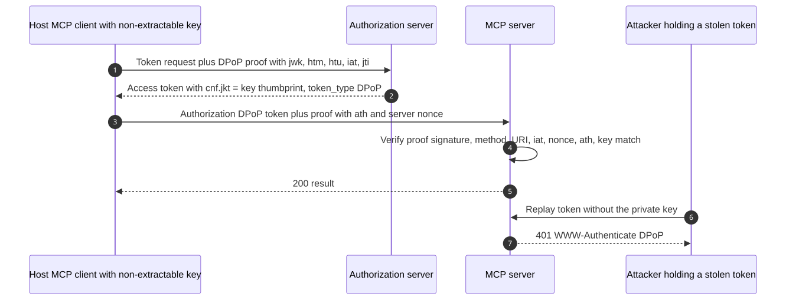

For MCP Apps the placement rule is absolute. The DPoP key belongs to the host's MCP client, is generated as non-extractable, and is never reachable from the View. DPoP "does not protect against XSS": code running inside the client can mint proofs while it is online ([RFC 9449](https://www.rfc-editor.org/rfc/rfc9449.html)).

Refresh tokens need their own discipline. The 2026-07-28 spec says the authorization server "MUST rotate refresh tokens" for public clients and "SHOULD issue short-lived access tokens" ([MCP Security Considerations](https://modelcontextprotocol.io/specification/2026-07-28/basic/authorization/security-considerations)). OAuth 2.1 requires replay detection. RFC 9700 explains that when an already-used refresh token reappears, the authorization server cannot tell the thief from the client, so it revokes the active token ([OAuth 2.1 -16](https://www.ietf.org/archive/id/draft-ietf-oauth-v2-1-16.html); [RFC 9700](https://www.rfc-editor.org/rfc/rfc9700.html)).

Hosts that run many tool calls at once run into this. Two simultaneous refreshes with the same token either split the token family, if the code is not atomic, or trigger false theft detection that users experience as random logouts ([DEV Community](https://dev.to/silentwatcher_95/race-conditions-in-jwt-refresh-token-rotation-3j5k)). Implementations need single-flight refresh in the client, so only one refresh per token runs at a time, and atomic consume-and-issue at the authorization server. Most also add a short grace window that returns the same rotated tokens; WorkOS uses 30 seconds and Endurain 60, accepting that a replay inside the window goes undetected ([WorkOS](https://workos.com/docs/authkit/session-resilience); [Endurain](https://docs.endurain.com/reference/users/users_sessions/rotated_refresh_tokens)). DPoP-bound refresh tokens remove this trade-off. Claude refreshes "reactively on a 401 response, and proactively up to five minutes before the stored expiry". It expects `invalid_grant` for dead refresh tokens and asks servers with public clients to rotate them ([Claude: Authentication](https://claude.com/docs/connectors/building/authentication)).

Operational hygiene closes the loop: hash tokens at rest ([workers-oauth-provider](https://github.com/cloudflare/workers-oauth-provider)), never log or return raw tokens ([Cloudflare Docs](https://developers.cloudflare.com/agents/model-context-protocol/protocol/authorization/)), require authorization on introspection endpoints to prevent token scanning ([RFC 7662](https://www.rfc-editor.org/rfc/rfc7662.html)), and expose revocation as a kill switch ([RFC 7009](https://www.rfc-editor.org/rfc/rfc7009.html)).

## Ten risks mapped to the controls that stop them

The approaches overlap by design, and no single one covers all ten risks. The first table names, for each risk, the controls that stop it, who must implement them, and the normative anchor.

| Risk | Controls that stop it | Enforced by | Normative anchor |
|---|---|---|---|
| Confused deputy | Per-user registry of approved clients, checked before redirecting upstream; consent cookie bound to `client_id`; audience-bound tokens; explicit delegation with `act` | Proxy MCP server, authorization server | [MCP Best Practices](https://modelcontextprotocol.io/docs/2026-07-28/tutorials/security/security_best_practices); [RFC 8693](https://www.rfc-editor.org/rfc/rfc8693.html) |
| Token passthrough | Reject tokens whose `aud` is not this server; separate upstream token from a vault, elicitation or exchange | MCP server, gateway configuration | [MCP 2026-07-28](https://modelcontextprotocol.io/specification/2026-07-28/basic/authorization); [MCP Elicitation](https://modelcontextprotocol.io/specification/2026-07-28/client/elicitation) |
| Token theft and replay | No tokens in Views, URLs or logs; host backend holds tokens; short lifetimes; rotation or DPoP; hashing at rest; issuer-bound client credentials | Host, authorization server, server | [RFC 9700](https://www.rfc-editor.org/rfc/rfc9700.html); [RFC 9449](https://www.rfc-editor.org/rfc/rfc9449.html); [MCP Client Registration](https://modelcontextprotocol.io/specification/2026-07-28/basic/authorization/client-registration) |
| Session and state hijacking | Verify every request; never treat a session as authentication; key handles to the token's `sub`; single-use `state` bound to the session; session tokens and Origin checks on local servers | MCP server, proxy, local tools | [MCP Best Practices](https://modelcontextprotocol.io/docs/2026-07-28/tutorials/security/security_best_practices) |
| SSRF via discovery | HTTPS only; block private and link-local ranges; no automatic redirects; DNS pinning; egress proxy; scheme allowlist for authorization URLs; limits on CIMD fetches | Host as client, authorization server | [MCP Best Practices](https://modelcontextprotocol.io/docs/2026-07-28/tutorials/security/security_best_practices); [RFC 9728](https://www.rfc-editor.org/rfc/rfc9728.html); [CIMD -02](https://www.ietf.org/archive/id/draft-ietf-oauth-client-id-metadata-document-02.html) |
| Consent phishing | CIMD hostname display; redirect hostname shown on consent; warnings for loopback-only clients; `iss` validation; elicitation user binding; no pre-authenticated URLs | Authorization server, host, MCP server | [MCP Security Considerations](https://modelcontextprotocol.io/specification/2026-07-28/basic/authorization/security-considerations); [RFC 7591](https://www.rfc-editor.org/rfc/rfc7591.html) |
| Clickjacking | `frame-ancestors 'none'` or `X-Frame-Options: DENY` on login and consent pages; approval modals owned by the host; re-confirmation for high-risk actions | Authorization server, proxy, host | [RFC 9700](https://www.rfc-editor.org/rfc/rfc9700.html); [OWASP](https://cheatsheetseries.owasp.org/cheatsheets/Clickjacking_Defense_Cheat_Sheet.html) |
| Prompt injection driving tool calls | Least-privilege scopes and step-up; destructive annotations with host confirmation; server-side authorization that ignores hints; deterministic tool policies; confirmation of `ui/message` | Host, MCP server | [OpenAI Security & Privacy](https://developers.openai.com/apps-sdk/guides/security-privacy); [MCP Best Practices](https://modelcontextprotocol.io/docs/2026-07-28/tutorials/security/security_best_practices) |
| iframe and postMessage | Sandbox proxy on a separate origin; validate `event.source` and origin; explicit `targetOrigin`; schema validation; deny-by-default CSP; narrow `connectDomains` | Host, View author | [MCP Apps spec](https://github.com/modelcontextprotocol/ext-apps/blob/main/specification/2026-01-26/apps.mdx); [WHATWG](https://html.spec.whatwg.org/multipage/web-messaging.html) |
| Credential entry in Views | External user agent for every login; IdP blocks framing; store policy against collecting credentials; host shows UI boundaries | Host, authorization server, store review | [RFC 8252](https://www.rfc-editor.org/rfc/rfc8252.html); [OpenAI guidelines](https://developers.openai.com/apps-sdk/app-submission-guidelines) |

The second table summarizes the analysis above. For each risk it shows which approach does the main defensive work. "Primary" means the approach is the main defence. "Partial" means it narrows the risk. "Adds risk" marks an approach that enlarges the risk and needs compensating controls. A dash means the approach has no meaningful effect on that risk.

| Approach | Confused deputy | Passthrough | Theft and replay | Session hijack | SSRF | Consent phishing | Clickjacking | Prompt injection | postMessage | Credential entry |
|---|---|---|---|---|---|---|---|---|---|---|
| 1. Audience-bound resource server | Partial | Primary | Partial | Primary | Primary | Partial | – | Partial | – | – |
| 1b. CIMD client identity | Partial | – | Partial | – | Adds risk | Primary | – | – | – | – |
| 2. Host-mediated View auth | – | – | Primary | – | – | Partial | Partial | Primary | Partial | Primary |
| 2b. Double-iframe sandbox and CSP | – | – | Partial | Partial | – | – | Partial | – | Primary | Partial |
| 3. Credentials held by the View | – | – | Adds risk | – | – | – | – | – | Adds risk | Partial |
| 4a. Proxy with consent per client | Primary | Primary | Partial | Partial | – | Primary | Primary | – | – | – |
| 4b. URL-mode elicitation | Partial | Primary | Primary | Partial | – | Primary | – | Partial | – | Primary |
| 4c. Token exchange and vaults | Primary | Primary | Partial | – | – | – | – | Partial | – | – |
| 5. Enterprise-Managed Authorization | Partial | – | Primary | – | – | Primary | Partial | – | – | Partial |
| 6. Local and machine guardrails | – | – | Partial | Primary | – | – | – | Partial | – | – |
| 7. DPoP, mTLS and rotation | – | Partial | Primary | Partial | – | – | – | – | – | – |

Two patterns stand out. First, prompt injection has no primary defence outside the host-mediated layer. Even there it depends on host approval policy that the spec leaves at MAY, so server-side least privilege is the only control a server developer fully owns. Second, every risk unique to MCP Apps (postMessage, credential entry, injection driven by the View) sits on the host or View side. That is why the server developer's job for a View is mostly subtraction: no tokens, no secrets in templates or `_meta`, and no login forms.

## A reference stack for an MCP App that ships in Claude and ChatGPT

The decision tree below combines the approaches for the common case: a server that ships a View to both major hosts.


Responsibilities split cleanly by component.

| Component | Must do | Must never do |
|---|---|---|
| MCP server (resource server) | Return `401` with `resource_metadata` and a `scope` hint at the HTTP layer; validate `typ`, `iss`, `aud`, `exp` and scope on every call; re-check auth inside handlers; fail closed; declare `securitySchemes` and emit `mcp/www_authenticate` for ChatGPT; annotate every tool, including app-only ones; key state handles to the token's `sub` | Accept tokens for other audiences; forward the client's token; put secrets or user data in `ui://` HTML or result `_meta`; trust client-supplied identity or location fields |
| Authorization server | Enforce and advertise PKCE S256; map `resource` to `aud`; send and advertise `iss`; support CIMD with `none`; exact-match redirect URIs for both hosts plus loopback on any port; rotate refresh tokens; block framing of login and consent; show the redirect hostname | Accept `plain` PKCE; run open DCR that accepts arbitrary redirect URIs; render inside third-party frames |
| Host (Claude, ChatGPT) | Keep tokens, verifiers and keys in the backend; run login in top-level windows; validate View messages; enforce visibility and approval gates | Expose tokens to Views; let Views navigate the top window unconfirmed |
| View author | Call tools through the host bridge; validate `event.source` and origin; render data with `textContent`; keep `connectDomains` minimal; open links with `ui/open-link` | Render password, API-key or OTP fields; store tokens; post sensitive data with `'*'`; send `ui/message` text derived from untrusted content |

As of October 2026, a server that works in both hosts needs an authorization server that supports PKCE S256 advertised in `code_challenge_methods_supported`, RFC 8707 mapping of `resource` to `aud`, RFC 9207 `iss` (ChatGPT rejects mismatches), CIMD with `none` authentication (Claude's condition for using CIMD), refresh-token rotation, and form-encoded token requests. It also needs exact redirect allowlists for both hosts' callbacks, plus loopback on any port for Claude Code ([Claude: Authentication](https://claude.com/docs/connectors/building/authentication); [OpenAI Apps SDK: Authentication](https://developers.openai.com/apps-sdk/build/auth)). Deployments on Microsoft Entra need a separate authorization server or gateway in front, because Entra lacks DCR and requires the MCP URL to be registered as an Application ID URI ([Microsoft Learn](https://learn.microsoft.com/en-us/azure/app-service/configure-authentication-mcp); [Claude: Authentication](https://claude.com/docs/connectors/building/authentication)).

## Five gaps the standards have not closed

**1. MCP Apps has no normative rule against collecting credentials.** The spec names phishing in its threat model, but it neither forbids password or API-key fields in Views nor defines anti-impersonation controls. OpenAI's store policy is the only binding prohibition found ([MCP Apps stable spec](https://github.com/modelcontextprotocol/ext-apps/blob/main/specification/2026-01-26/apps.mdx); [OpenAI guidelines](https://developers.openai.com/apps-sdk/app-submission-guidelines)). No source covers fullscreen or picture-in-picture spoofing of host chrome.

**2. Approval of View-initiated actions is undocumented.** Neither vendor documents whether View-initiated `tools/call`, `ui/message` or `ui/update-model-context` goes through the same confirmation as actions the model starts. The spec leaves all three at MAY.

**3. Host interoperability is incomplete.** Claude and ChatGPT use incompatible linking triggers. Anthropic's own pages describe the Connect card only for calls the model makes; the claim that View-initiated 401s also trigger it comes from the ext-apps project ([ext-apps authorization guide](https://github.com/modelcontextprotocol/ext-apps/blob/main/docs/authorization.md)). No source specifies which JSON-RPC error a View receives if the user cancels sign-in.

**4. Downstream token lifecycle and multi-hop delegation are unstandardized.** The MCP spec says nothing about how long upstream tokens may be cached or how to revoke them. General token exchange is on the roadmap. ID-JAG leaves `act` undefined. The WIMSE AI identity draft is only Informational ([MCP Roadmap](https://blog.modelcontextprotocol.io/posts/mcp-roadmap/); [ID-JAG -04](https://www.ietf.org/archive/id/draft-ietf-oauth-identity-assertion-authz-grant-04.html); [draft-ietf-wimse-aims](https://datatracker.ietf.org/doc/draft-ietf-wimse-aims/)). The OpenID Foundation names recursive delegation chains and consent fatigue as the main unsolved problems ([OpenID Foundation](https://openid.net/new-whitepaper-tackles-ai-agent-identity-challenges/)).

**5. The foundations are still drafts, and the evidence base is thin.** OAuth 2.1 is still draft -16, with a target of reaching the IESG by December 2026, while MCP pins draft -13 and cites CIMD -00 although the IETF draft is at -02 ([IETF Datatracker](https://datatracker.ietf.org/doc/draft-ietf-oauth-v2-1/); [MCP 2026-07-28](https://modelcontextprotocol.io/specification/2026-07-28/basic/authorization)). `iss` remains a SHOULD for authorization servers, and DPoP is optional. The security bodies' outputs are early: the OWASP MCP Top 10 is in beta, NIST NCCoE has a concept paper, and CoSAI and CSA have white papers ([OWASP MCP Top 10](https://owasp.org/www-project-mcp-top-10/); [NIST](https://www.nist.gov/news-events/news/2026/02/new-concept-paper-identity-and-authority-software-agents); [OASIS](https://www.oasis-open.org/2026/01/27/coalition-for-secure-ai-releases-extensive-taxonomy-for-model-context-protocol-security); [CSA](https://labs.cloudsecurityalliance.org/wp-content/uploads/2026/05/CSA_whitepaper_mcp_security_agentic_attack_surface_20260516-csa-styled.pdf)). The only study that tested OAuth flows end to end is a preprint ([Zhou et al.](https://arxiv.org/html/2605.22333v1)), and no study has yet measured whether CIMD or per-client consent reduced incidents after the 2025-11-25 update.

## Conclusion

This research changes how the question should be framed. For a classic web app, "how should the front end authenticate?" leads to tokens in the browser and careful storage. For MCP Apps, the answer is that the front end should not authenticate at all. The View is the least trusted code in the system. A third-party server writes it, it renders next to the user's other connectors, and it can speak as the user through `ui/message`. The secure design is to strip it of everything: move every credential, verifier and key into the host backend, and every authorization decision into the MCP server. Claude and ChatGPT already work this way. Most of a developer's remaining risk therefore sits in their own server: audience checks, PKCE enforcement, consent pages and refusing to pass tokens through. That is exactly where the 2026 measurement studies found failures in almost every server they tested.

The next phase of risk is not credential theft but forged intent. Once tokens are out of reach, an attacker's best move is to make a legitimate, authenticated host do something the user never meant to do. The routes are injected content, a View that speaks with the user's role, or a silent EMA exchange that removes the last visible authentication step. The standards are steadily closing the token-handling gaps: mandatory `iss`, DPoP, CIMD-only registration once DCR can be removed after July 2027, and token exchange at each hop. None of that work addresses intent. Teams building MCP Apps now should spend less effort on clever View-side authentication and more on deterministic least privilege enforced on the server, plus explicit confirmation for destructive tools. They should treat every View-initiated call as if a stranger had typed it.
